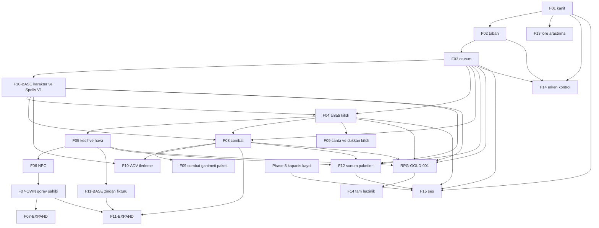

# AI-DND — Future Project Bible v2.1
## Önerilen yol haritası, kabul anayasası ve değişiklik protokolü

**Belge kodu:** `AI-DND-FPB-2.1-PROPOSED`  
**Tarih:** 9 Ekim 2026  
**Durum:** **PROPOSED — OWNER APPROVAL REQUIRED. UYGULAMA, FAZ BAŞLANGICI VEYA GIT İZNİ DEĞİLDİR.**  
**Öncel:** `ai-dnd/docs/AI-DND_Future_Project_Bible_v2_PROPOSED_2026-10-09.md`  
**Öncel SHA-256:** `bc1949f63a7ccf81bcc65680f1cef569c3e6b1351beab527f89edf145c10055b`  
**Bu dosya öncelin üzerine yazılmaz.** Master Handoff v2/v3, Stage 10A/10B el devirleri, kabul planları, kanıt ve kaynak dosyaları bu belgenin yazılmasıyla değişmez.

Dil Türkçedir. Dosya, API, test ve sözleşme adları teknik İngilizce kalabilir.  
Çalışma hattı: yerel Windows, Cursor birincil uygulama, Codex bağımsız inceleme, ChatGPT mimari ve kabul, Python/FastAPI/SQLite, yerel Ollama/Qwen, gerçek Experience istemcisi. **Replit kullanılmaz.**

Bu `v2.1`, gelecek yol haritasının kendi sürümüdür. `AI-DND_Master_Handoff_v3_Project_Bible.md` (2 Ekim 2026) mimari bağlayıcılığını sürdürür. O dosya bu deponun `ai-dnd/docs` ağacında değildir; Stage 10B plan v2’nin işaret ettiği ChatGPT kaynak kopyasından okunmuştur. v2.1 onu geri almaz. Eski Phase 0–9 ve Stage 10A/10B kayıtlarına yeni tarihsel anlam atanmaz. **F01–F15 kimlikleri v2 ile aynı temada korunur.** Yürütme sırası değişmiştir. Owner dondurmasından sonra kimlik yeniden kullanılmaz.

---

# 0. v2 → v2.1 değişiklik günlüğü

| Konu | v2 | v2.1 |
|---|---|---|
| Belge durumu | PROPOSED | PROPOSED kalır. Bu revizyon owner onayı değildir. |
| Faz kimlikleri | F01–F15 | Aynı kimlikler. İç paketler bölündü. Yürütme sırası sayı sırası değildir. |
| F08 bağımlılığı | Tablo F03–F07, mermaid F07→F08 | Combat, görev sisteminin bitmesini beklemez. Ayrı yazım sırası ile özellik bağımlılığı karışmaz. |
| Karakter | F10, ekonomiden sonra | `F10-BASE` F03’ten hemen sonra. `F10-ADV` yüksek slot, sınıf ilerlemesi ve save etkisi için ayrı sözleşme. |
| Anlatı | F04 yeni paketler gibi okunabiliyordu | Mevcut kabulün kilidi. İkinci bir anlatı motoru yok. |
| Görev | Tek fazda lifecycle ve macera modülü | `F07-OWN` önce. Yayımlanmış macera genişlemesi `F07-EXPAND` ve ancak sahip varken. Sahte üretim görevi yasak. |
| Ekonomi | F09 broad | Mevcut çanta ve dükkân korunur. Fiyat, stok ve kasa sahibi yokken işlem uydurulmaz. Attunement `F10-ADV`e gider. |
| Zindan | F11 yeni alan gibi | Önce mevcut opt-in fixtür kilidi `F11-BASE`, sonra `F11-EXPAND`. |
| Arayüz | F03 sonrası geniş F12 | Alanın API’si donunca o alanın sunumu. Erken kabuk, eksik state’i sözleşme yapmaz. |
| Ses F15 | Phase 8 kapandıktan sonra ve F12 | **İkisi birlikte:** owner onaylı Phase 8 Expansion kapanış kaydı **ve** F01, F03, F04, F12. Stage 10A/10B tek başına Phase 8 kapanışı değildir. |
| Komut özdeşliği | Örtük “aynı koşu” | A: dondurulmuş komut. B: bağımsız incelenmiş eşdeğer veya katı süperküme, kapsam haritası ve owner kabulü. Aksi NOT TESTED veya BLOCKED. Sessiz değiştirme yok. |
| Onay sıklığı | DoR her paket için ağır okunabiliyordu | Faz başına **bir** sürümlü master sözleşme. Onaylı paketler sırayla, tekrar izin istemeden. Yeni onay yalnız madde 8 kapılarında. |
| Setting kuralı | Genel kurala üstün olabilir | Üstünlük edition, özgüllük, sayfa ve bağlam ile açıksa geçerlidir. Owner kararı mühendislik kapsamıdır, WotC metnini yeniden yazmaz. Çatışma uydurulmaz. |
| Bölünmüş PDF | Kitap otoritesi gibi tek satır | Dosya hash’i, PDF sayfası, basılı sayfa ve kitap kimliği ayrıdır. Hash, doğrulanmamış kural cümlesinin yerine geçmez. |
| F01 kanıtı | Yedek doğrulanmamış, 129/176 | 9 Ekim 2026 akşam raporu işlenir. F01 **KAPALI DEĞİLDİR.** |
| Altın yol | Yok | `RPG-GOLD-001` zorunlu entegrasyon kilometre taşı. Faz değildir. Sahte görev açmaz. |
| Yama kimliği | Birden çok sayaç | Tek append-only kayıt. Şeritler ayrı. Aynı FX numarası iki ajana verilmez. |
| Hafif değişiklik | 15 kapı her şeye uygulanabiliyordu | Belge düzeltmesi ayrı hafif şerit. Lore errata orijinal baytı korur. |

İncelemede reddedilen üç öneri bu sürümde **uygulanmadı:**

1. Ses için Phase 8 kapanış şartı silinmedi. Ölçülebilir kapanış tanımı eklendi ve F01, F03, F04, F12 şartı onun yerine değil yanına kondu.
2. Kabul kapısı yalnız birebir komut dizesine kilitlenmedi. Eşdeğer veya katı süperküme, harita ve owner kabulü ile geçerlidir.
3. Her küçük paket için yeniden owner onayı istenmez.

---

# 1. Kimlik eşlemesi

Faz kimlikleri yerinde durur. Değişen, paket sınırı ve yürütme kenarıdır.

| Kimlik | v2 konusu | v2.1 konusu | Yürütme sırası |
|---|---|---|---|
| F01 | Kanıt, yedek, pin taşınabilirliği | Aynı, güncel yedek gerçeği ile. Kapalı değil | 1 |
| F02 | Tekrarlanabilirlik | Aynı, artı yeniden yazılmayacak sahip envanteri | 2 |
| F03 | Tarayıcı, API, oturum | Aynı, alan yolu ve yalıtım ile | 3 |
| F10-BASE | F10’nun içinde, geç | Yaratılış, HP/AC, sheet, Spells V1 kilidi | 4 |
| F04 | Niyet ve anlatı | Mevcut davranışın kilidi | 5 |
| F05 | Keşif, zaman, hava | Aynı, projeksiyon yolu zorunlu | 6 |
| F06 | NPC, bellek, faction | Aynı. Skor sahibi yokken tablo yazılmaz | 7 |
| F08 | Combat, F07’ye bağlıydı | Derinlik. Görev bitişini beklemez | 8 |
| F07-OWN | F07’nin başı | Teklif, kabul, event sahibi | 9 |
| F07-EXPAND | F07-P05 dahil | Ancak F07-OWN sözleşmesi varken | 10 |
| F09 | Eşya ve ekonomi | Çanta ve dükkân kilidi. Sahipsiz satış yok | 11 |
| F10-ADV | F10’nun kalanı | Yüksek büyü, sınıf ilerlemesi, save etkisi | 12 |
| F11-BASE | F11 başı | Opt-in zindan fixtürü kilidi | 13 |
| F11-EXPAND | F11 kalanı | Tuzak, giz, geniş grafik. Ayrı sözleşme | 14 |
| F12 | Arayüz | Kararlı API alanı geldikçe | 15, paket paket |
| RPG-GOLD-001 | Yok | Oyuncu yolculuğu. Faz kimliği değil | F14-FULL öncesi |
| F13 | Şehirler, isteğe bağlı | Araştırma ayrı, aktivasyon ayrı | Aktivasyon geç |
| F14 | Release | Erken kontrol noktası tam faz değildir | Kapsama bağlı |
| F15 | Ses, isteğe bağlı | Phase 8 kapanışı ve F01, F03, F04, F12 | Son isteğe bağlı |

Eski kabul kimlikleri yeni kimliklerin yerine geçmez. v2’deki `Fxx-AC-00N` metinleri tarihsel taslaktır. v2.1 aynı numarayı **yeniden tanımlanmış PROPOSED madde** olarak kullanır. Owner dondurmasından sonra numara bir daha başka anlama çekilmez. v2 hiçbir kapıyı PASS ilan etmemişti. Bu yüzden numara yeniden tanımı, eski bir PASS’i silmez.

---

# 2. Ürün vizyonu

AI-DND, uzun kampanyada tutarlı kalan bir Forgotten Realms D&D macerasıdır. Sohbet botu, teknik pano veya prosedürel metin üreteci değildir.

Oyuncunun hissetmesi gereken şey:

> Neverwinter’a döndüğünde beni tanıyan bakışı, verdiğim sözün bedelini ve geçen zamanı hissediyorum. Zar her zaman kurtarmaz. Oyun kararımı hatırlar.

Beş sütun:

1. **Ajans.** Serbest niyet desteklenen eyleme çözülür. Başarısızlık da sonuçtur. `Continue` oyuncunun yerine seçim yapmaz.
2. **Süreklilik.** Kişiler bildiklerini bilir. İki kampanya birbirine karışmaz. Kayıt kapanıp açılınca aynı gerçek durur.
3. **2024 kuralları.** Zar, savaş, büyü, eşya ve ilerleme Python’dadır.
4. **1501 DR.** Güncel setting kaynakları esastır. Yayımlanmış macera sonucu yaşanmış sayılmaz. Çatışma açık kalır.
5. **Sinema, dürüst mekanik.** Atmosfer sahte görev, eşya, kişi, hava veya savaş sonucu yazmaz. Oyuncu yüzü dashboard değildir.

Kuzey yıldızı hedeftir, uygulanmış iddiası değildir: karakter → anlamlı başlangıç → keşif → doğrulanmış NPC → karar ve sonuç → kurallı risk → çanta ve ilerleme → kaydet, kapat, aç → aynı dünyadan devam.

Oyuncu metninde `Python`, `model`, `server`, `backend`, `debug` veya `canonical record` görünmez.

---

# 3. Mimari anayasa

```text
PYTHON DECIDES GAME REALITY.
LORE AUTHORITY DECIDES SETTING REALITY.
CAMPAIGN EVENTS CREATE CAMPAIGN CANON.
QWEN UNDERSTANDS INTENT, USES VERIFIED CONTEXT, AND TELLS THE STORY.
FRONTEND PRESENTS REALITY.
```

| Katman | Yetki | Sınır |
|---|---|---|
| Python | State, RNG, saldırı, HP, combat, eylem ekonomisi, büyü, koşul, mesafe, zaman, hava, NPC belleği, envanter, para, görev, event kabulü, save, rollback, yalıtım | Mekaniği Qwen veya istemciye devretmez |
| Lore authority | Doğrulanmış setting olgusu, dönem, kısıt, pin | Macera sonucunu yaşanmış yapmaz |
| Campaign canon | İlgili kampanyada engine’in kabul edip persist ettiği olay | Kitaptaki örnek geçmiş değildir |
| Qwen | Niyet ve doğrulanmış anlatı. Tur başına en fazla 2 çağrı | Zar, hasar, eşya, görev, lore veya save yazamaz. Reddedilen anlatıda 0 retry. Deterministik fallback yeni canon uydurmaz |
| Frontend | `artifacts/ai-dnd-experience` gerçek state’i gösterir | HP, hava, görev, ekonomi veya hareket üretmez |

Doğrudan combat veya karakter cevabında 0 model çağrısı geçerlidir. Çağrı sayısını doldurmak için Qwen çağrılmaz. Çözüm öncesi taşıma arızası ile çözüm sonrası anlatı arızası aynı rollback değildir. Bu sınır mevcut transaction sahibi bozulmadan her ilgili sözleşmede durur.

## 3.1 Kaynak önceliği

| Soru | Otorite |
|---|---|
| Bu kampanyada ne oldu? | Persist edilmiş state ve kabul edilmiş event. Retcon yalnız owner kararıdır. |
| Mekanik | PHB 2024, DMG 2024, yüklenmiş Monster Manual edition. Çözüm Python’dadır. |
| Güncel Faerûn | Heroes of Faerûn ve Adventures in Faerûn. Baseline 1501 DR, Year of the Shining Mythal. |
| Eski FR ve yayımlanmış macera | Tarih, ek veya olasılık. Sessiz override yok. |
| Mühendislik | Master Handoff v3 ve onaylı faz sözleşmesi. Oyun kaynağının yerine geçmez. |

**Setting’e özgü kural.** Resmî kaynak, belirli bir durumda genel kuraldan daha özel bir kural yazıyorsa o özel kural uygulanır. Kayıt zorunludur: edition, özgüllük, basılı sayfa, PDF sayfası, bağlam ve Python’daki resolver. Owner onayı, bu kuralı mühendislik kapsamına almaktır. Owner, D&D kaynak metnini yeniden yazmaz. Çelişki kapanmıyorsa kayıt açık kalır. Yaratıcı uzlaştırma yasaktır.

**Bölünmüş PDF.** Şunlar ayrı alanlardır ve birbirinin yerine geçmez:

- fiziksel dosyanın SHA-256’sı
- PDF görüntü sayfası
- basılı sayfa
- kitap kimliği

Ayna parça, tam kitap hash’i değildir. Dosya hash’i, doğrulanmamış bir kural cümlesinin kanıtı değildir. Kısa alıntı yeter. Kitap gövdesi belgeye kopyalanmaz.

**Lore baytı.** Pin, dosyanın exact SHA-256’sıdır. `OWNER_APPROVED_CONTINUITY` resmî source tier değildir. `runtime_enabled` ve `official_source_fact` false kalır. Belge onayı, lore admission, şehir aktivasyonu ve campaign canon ayrı kapılardır. Fail-closed: pin uyuşmazsa kamu kümesi boşalır, fallback lore yayınlanmaz.

## 3.2 Kesin yasaklar

- `game.py` sessiz yeniden yazımı ve mekanik yetki devri.
- Model tavanını yükseltmek, red sonrası retry.
- Doğrulanmamış lore, görev, NPC geçmişi, fiyat, ödül, envanter veya havayı canon yapmak.
- Başka kampanyaya oturum sızdırmak.
- İstemcinin HP, hava, görev veya hareket uydurması.
- Yol haritası onayını commit, push, merge, reset, clean, stash, production, şehir veya Phase 9 saymak.
- FAIL kanıtını silmek, eski handoff’un üzerine yazmak.
- Yeni fikri dondurulmuş sözleşmeye sessiz eklemek.
- Sahte üretim görevi açarak altın yolu geçmek.

---

# 4. Doğrulanmış taban

Etiketler:

| Etiket | Anlam |
|---|---|
| `MODÜL VAR` | Dosya duruyor. Tam ürün değildir. |
| `KISMİ` | Sınırlı sözleşme uygulanmış, tam 2024 sistemi değil. |
| `TARİHSEL KANIT` | Eski run kaydı. Bu belgede yeniden koşulmadı. |
| `KAYNAK OKUNDU` | İlgili sözleşme veya sahip bu revizyonda okundu. Test PASS’i değildir. |
| `YENİDEN KOŞULMADI` | Son lore-integrity diff’i o yüzeyi tekrar etmedi. |
| `KORUNUR` | Yeniden inşa edilmez. |
| `YENİ SÖZLEŞME` | Eksik davranış için ayrı faz sözleşmesi gerekir. |

HEAD `f63d952506064cd59e960f1e3efa6627d4e52053` tek başına test edilmiş snapshot değildir. Çalışma ağacı kirli.

| Sistem | Sahip | Uygulanan | Kısmi | Eksik | Kanıt | Korunan davranış | Yeni sözleşme |
|---|---|---|---|---|---|---|---|
| Karakter yaratılışı ve sheet | `api/character_creation.py`, save içindeki sheet | Seçilmiş sınıf, ekipman, AC hesabı | Büyücü hazırlığı ve rahip/druid seviye büyüleri kaynakla çelişiyor, kapatılmış | Tam 2024 yaratılış sihirbazı, tüm sınıflar | `spell-scope.md` kaynak okundu. Bu tur test yok | Seçilmemiş büyü açılmaz. Eski save’e slot uydurulmaz | F10-BASE kilidi. Tam sheet F10-ADV değil |
| Spells V1 | `spells.py`, `spell_scope` | Fire Bolt, Sacred Flame, Magic Missile, Cure Wounds. Seviye-1 tek slot. Uzun dinlenme yeniler | Yüksek slot, upcast, kısa dinlenme yok | Diğer büyüler, hazırlık sahibi | `spell-scope.md`, `test_spells_v1.py` dosyası var. Bu tur koşulmadı | Python çözer. Qwen büyü ekleyemez | F10-BASE mevcut dördü kilitler. F10-ADV kalanı |
| XP ve ilerleme | `xp.py` | XP sahibi modülü var | Level-up ve özellik açılışı bu belgede yeniden doğrulanmadı | Sessiz retcon yok hükmü durur | Sahip dosyası var. Güncel test bu turda yok | XP V1 yeniden açılmaz, kullanıcı adlandırmadıkça | F10-ADV, save RFC ile |
| Bounded encounter | `bounded_encounter.py` | Initiative, saldırı, Dash, HP, eylem ekonomisi | 2024’ün tüm savaş eylemleri değil | Ölüm kurtarması envanteri bu turda tamam sayılmaz | 10A combat kapısı tarihsel: kimlik `302305dd-8ae6-40b3-9cd4-49d679d0be21`. 0 Qwen çağrısı geçerli | Hostile enjekte edilmez. Opt-in commoner. Dash anlatısı gerçek mesafedir | F08 yalnız eksik kural için |
| Dükkân ve ekonomi | `shop_creation.py` | Arama, yaratma ayrımı, sabit keeper | Fiyat, stok, kasa sahibi yok | Satış işlemi | 10A shop repair tarihsel. Hash o kapanışta kilitlendi | “Tüccar bul” dükkân yaratmaz. Ekonomi yokken satış uydurulmaz | F09 kilit. İşlem ancak sahip sözleşmesiyle |
| Eşya, çanta, ganimet | `game.py` envanter, `weapon_attack.py` | Seçilmiş ekipman, yer eşyası, ödülün Python’da kalması | Zırh giyme süresi ayrı sahip ister | Genel para birimi defteri | `equipment-loot-economy-v1.md` kaynak okundu | Model ganimet yazamaz. UI düz liste sözleşmesi | F09 |
| NPC kimlik, bellek, ilişki | `living_world.py`, `local_dialogue.py` | Stabil kimlik, oyuncu kaynaklı bellek, görünür rol | Yazılı inanç, söylenti, faction skoru yok | Skor tablosu | 10A Elara ve Arven tarihsel. 10B repair-v2 tarayıcı tarihsel, lore turunda yenilenmedi | Görünüş kişisel ad olmaz. Başka NPC’ye ad kopyalanmaz | F06 |
| Olay ve macera modülleri | `incidents/`, `adventure/` | Modüller duruyor | Üretim davranışının tamamı bu turda doğrulanmadı | Yeni lore veya tarihsel faction olayı | Dosyalar var | Yeni manager, mevcut sözleşme okunmadan yazılmaz | F07, F11 |
| Görev kataloğu | Python quest sahibi | Üretim kataloğu bilinçli boş | Teklif ve yaşam döngüsü sahibi netleşmeden genişleme yok | Dolu üretim görevleri | Interaction-quest belgesi ve 10B boş katalog yolu tarihsel | Boş katalogda olumsuz cevap meşrudur. “İş var mı” kabul edilmiş teklif değildir | F07-OWN önce |
| Keşif, zaman, hava | `living_world`, kampanya saati | Sahne ve saat sahibi var | Doğrulanmamış rotaya süre yazılmaz | Hava JSON yolunun bu turda kodda `world.weather` diye durduğu doğrulanmadı | 10B sisli hava tarihsel. Hata `player.weather` ile diğer projeksiyonun karışmasıydı | UI saat veya hava uydurmaz | F05 yolu dondurur |
| Opt-in zindan | `authored_dungeon_v1` | Giriş, hol, dönüş. Vault kapalı | Geometri, tuzak, DC yok | Geniş zindan | `authored-dungeon-foundation-v1.md` okundu | Doğal yolculuk grafiği baypas etmez | F11-BASE, sonra EXPAND |
| API, SQLite, idempotency | `api/main.py`, `session_manager`, `campaign_store` | Tur, receipt, atomik commit | Şema 5, campaign format 1, lore payload 2, game save 3 | Yeni şema yok | 10B replay tarihsel. Bu tur yeniden koşulmadı | Çift istek ikinci zar üretmez | F03 |
| Model fazı ve fallback | `api/model_phase.py`, `resolved_presentation.py`, `ollama_adapter.py` | Çözüm öncesi rollback, çözüm sonrası sonuç kalır | Tüm yollar değil | — | Repair-v2 AC-019 tarihsel. Lore turu bu dosyaları değiştirdiğini söylemez | 0 retry. Fallback mekaniği yalanlamaz | F04 kilit |
| Experience arayüzü | `game-browser.tsx` | Oturum kimliği gecikmiş cevabı diğer kampanyadan keser | Tam RPG kabuğu değil | Sınıf ve şehir ekranları | Repair-v2 tarayıcı tarihsel. Lore turunda yenilenmedi | İstemci canon yazmaz | F12, alan bazında |
| Neverwinter lore | `freeze_admission.py`, `pack_index.json` | Üretim yükü Neverwinter. Şehirler kapalı. Pinler çalışma ağacında duruyor | Waterdeep ve Baldur’s Gate paketleri eksik ve DISABLED | Şehir aktivasyonu yok | Lore-integrity: 95 açık, 5 kısıtlı, sahte pin boş küme. Bu belge testi yeniden koşmadı | Fail-closed. Owner continuity resmî kaynak olmaz | F13 ayrı imza |

Stage 10A reconstructed yerel kabul PASS / OWNER-APPROVED / CLOSED. Özgün 10A sözleşmesi bulunamadı.  
Stage 10B repair-v2 FAIL olarak durur. Lore-integrity handoff yerel kabulü PASS yazar: 296 ve 634 exit 0. Bu, tüm depo, production, şehir veya Phase 9 değildir. S10B-INV-001 UNCONFIRMED. Tarayıcı ve 20 tur, lore-integrity diff’inde yeniden koşulmamıştır.

---

# 5. Bağımlılık

Özellik kenarı ile `game.py` yazım sırası ayrıdır. Combat’ın görev sistemine özellik bağımlılığı yoktur. Aynı dosyaya iki ajan yazmaz. `game.py` yazım sırası: F04, sonra F08, sonra F07, sonra F09’un `game.py` dokunan paketi. Bu sıra, F08’in F07’yi beklemesi değildir. F08 paketi F07 dosyasına girmez.



Döngü yoktur. F15, F14’e girmez. F14, F15’e girmez. F13 aktivasyonu bu grafiğin otomatik kenarı değildir. F08, F07’ye girmez.

---

# 6. Altın yol `RPG-GOLD-001`

Bu bir faz değildir. Kimliği F01–F15 ile çakışmaz. F14 tam hazırlık ondan önce PASS yazamaz. Erken F14 kontrol noktası onu dışarıda bırakabilir, bunu listede söyler.

Meşru yol, yalnız var olan veya ayrıca yetkilendirilmiş içeriktir:

karakter yarat veya seç → Neverwinter tanıtımı → keşif → meşru NPC → anlamlı karar → Python’ın çözdüğü risk → sonuç → save → restart → aynı kampanya.

Boş görev kataloğu duruyorsa “anlamlı karar” mevcut meşru seçimdir: dükkân aramak, aramayı reddetmek, doğrulanmış lore sorusu veya opt-in combat. Altın yolu geçmek için üretim görevi uydurulmaz. İçerik yoksa bu bir boşluktur. Qwen o boşluğu canon yapamaz.

Kayıt: kampanya kimliği, tur receipt’leri, state farkı, gerçek tarayıcı gözlemi, uygunsa gerçek Qwen izi, mekanik çözüm, save/restart özdeşliği, ayrı manuel deneyim notu. Mekanik PASS ile anlatı PASS ayrı satırlardır.

---

# 7. Faz sözleşmeleri

Her madde PROPOSED’dur. Faz, tek master sözleşme owner tarafından dondurulmadan başlamaz. Aşağıdaki AC’ler o sözleşmenin taslağıdır. PASS, bu belgenin yazılmasıyla oluşmaz.

Ortak kapı alanları her AC’de zorunludur: stabil kimlik, beklenen state, pozitif ve negatif, komut kimliği, model beklentisi veya N/A gerekçesi, restart ve yalıtım veya N/A gerekçesi, API ve tarayıcı veya N/A gerekçesi, kanıt yolu, kaynak snapshot hash’i, reviewer, owner sınırı, sonuç etiketi. Anlatı kalitesi ayrı manuel kapıdır.

## F01 — Kanıt ve bayt taşınabilirliği

**Sıra 1.** Oyuncu kaydı ve pin, yanlış Git işlemiyle kaybolmasın.  
**Sahip:** envanter ve hash okuma. `game.py`, pin değeri, save şeması değişmez.  
**Başlamaz:** eşzamanlı yazan başka ajan varsa.

9 Ekim 2026 akşam raporu, tarihsel girdi olarak işlenir, F01’i kapamaz:

- `.local/evidence` 344 dosya, `D:\AI-DND-evidence-backup\2026-10-09-stage10-local-evidence` ile hash eşleşmesi raporlandı.
- `D:` ayrı NTFS birimidir. Ayrı fiziksel disk **kanıtlanmadı**.
- Bu yol makineye özeldir. Yayınlanabilir taşınabilir yol değildir.
- `.gitattributes` iki dar `-text` kuralı taşır: Castle Ward owner kararı ve `pack_index.json`. Bu belge o dosyayı değiştirmez.
- Üç Neverwinter dosyası, extraction, review ve catalog, CRLF riski taşır. Öznitelik kararı **PENDING**.
- `pack_index.json` çalışma ağacı onaylı SHA-256 ile eşleşir. HEAD ve index hâlâ LF baytıdır.
- Temiz checkout kanıtı **PENDING**.
- **F01 KAPALI DEĞİLDİR.**

| AC | Beklenen |
|---|---|
| F01-AC-001 | Kritik kaynak ve kanıt envanteri, yok sayılan ve izlenmeyen dahil, yol başına SHA-256. Eksik satır FAIL. |
| F01-AC-002 | Castle Ward ve pack_index temiz checkout baytı pin ile aynı. Yalnız çalışma ağacı hash’i PASS değildir. Checkout yoksa PENDING, PASS yazılmaz. |
| F01-AC-003 | Yedek ile kaynak tüm dosyalarda eşleşir. `D:` kopyası hacim kopyasıdır, felaket yedeği iddiası değildir. Hedef yoksa BLOCKED. |
| F01-AC-004 | Üç Neverwinter dosyası için öznitelik kararı yazılıdır. Bu Bible onları stage etmez ve `.gitattributes`e eklemez. |
| F01-AC-005 | Yayın, hariç ve makine yolu listesi owner kararı olmadan commit grubu sayılmaz. |

Negatif: autocrlf pinli baytı değiştirirse fail closed. Pin metne uymuyorsa pin çevrilmez. `git add -A`, clean, reset, checkout restore yok. Index yenileme de ayrı izinsiz yapılmaz.

## F02 — Taban ve sahip envanteri

**Sıra 2.** F01 yedek yolu durmadan başlar. Oyun davranışı değişmez.  
Ürün: yeniden yazılmayacak sahip listesi. Bölüm 4 bu listenin taslağıdır. F02 onu güncel hash ile dondurur.

| AC | Beklenen |
|---|---|
| F02-AC-001 | Kaynak manifesti, kilit dosyası, komut ve exit ile aynı makinede tekrar. |
| F02-AC-002 | Seçili regresyon, tam keşif, tarayıcı, canlı Qwen ve manuel ayrı sonuç. Koşulmayan NOT TESTED. |
| F02-AC-003 | Bölüm 4’teki her satır `KORUNUR` veya `YENİ SÖZLEŞME` diye işaretli. Modül var diye COMPLETE yazılmaz. |
| F02-AC-004 | S10B-INV-001 UNCONFIRMED kalır. Yeniden üretilirse traceback ve kapsam ile bug olur. |
| F02-AC-005 | F01 pinleri paketleme sırasında bozulmaz. |

Eksik import skip ile örtülmez. Ollama yokken canlı Qwen PASS yazılmaz.

## F03 — Oturum, işlem, devam

**Sıra 3.** Experience, `ai-dnd-web` ile karışmaz. Save şeması ayrı RFC ister.

| AC | Beklenen |
|---|---|
| F03-AC-001 | HP, XP, envanter, zaman, konum, combat, dükkân, görev, NPC, anlatı ve kampanya kimliği, aynı `campaign_id` API projeksiyonu ile UI’de eşittir. Alan yolu satırda yazılıdır. |
| F03-AC-002 | Aynı payload tek çözüm. Farklı payload çatışma. Çift tıklama ve gecikmiş retry ikinci zar, hasar veya ödül yazmaz. |
| F03-AC-003 | Yenileme ve süreç restart, aktif combat’ta aynı combat kimliği, HP ve kalan eylem ekonomisini taşır. |
| F03-AC-004 | Save başarısızlığında mevcut rollback sınırı durur. Kısmi state ve ikinci event yoktur. |
| F03-AC-005 | Kampanya A’nın gecikmiş cevabı kampanya B’nin HP veya anlatısını değiştirmez. |
| F03-AC-006 | API veya Qwen yokken oyuncu mesajı yeni lore veya mekanik gerçek yazmaz. |

Kanıt gerçek tarayıcıdır. Statik kaynak okuması UI maddesini geçmez.

## F10-BASE — Karakter ve Spells V1 kilidi

**Sıra 4.** F03’ten sonra, F10-ADV’den önce. Yeni sınıf motoru değildir.

Kapsam: mevcut yaratılış, HP, AC, sheet projeksiyonu ve dört büyünün bugünkü sözleşmesi. Büyücü hazırlığı hâlâ kapalıysa kapalı kalır. “Varmış gibi” seçenek gösterilmez.

| AC | Beklenen |
|---|---|
| F10B-AC-001 | Uygulanmış yaratılış alanları API sheet ile eşittir. UI’de olmayan sınıf veya büyü seçeneği yoktur. |
| F10B-AC-002 | Fire Bolt, Sacred Flame, Magic Missile ve Cure Wounds yalnız mevcut resolver ile çözülür. Slot yetersizse kaynak değişmez. |
| F10B-AC-003 | Uzun dinlenme mevcut tek seviye-1 slotu mevcut sözleşmedeki gibi yeniler. Kısa dinlenme slot uydurmaz. |
| F10B-AC-004 | Save, restart ve ikinci kampanya slot veya HP taşımaz. Eski save’e slot havuzu eklenmez. |
| F10B-AC-005 | Büyü çözümünde model çağrısı 0’dır. Anlatı ayrı kapıdır ve hasarı değiştirmez. |

Kimlik öneki `F10B`, faz F10’un erken sözleşmesidir. `F10-AC-*` ileri pakete kalır. Numaralar çakışmaz.

## F04 — Niyet ve anlatı kilidi

**Sıra 5.** İkinci anlatı motoru yok. `Continue` ancak ayrı FX ile açılır ve oyuncu yerine karar veremez.

| AC | Beklenen |
|---|---|
| F04-AC-001 | Her oyuncu turunda 0–2 çağrı. Reddedilen anlatıdan sonra ek çağrı 0. |
| F04-AC-002 | “Tüccar bul” yeni dükkân yaratmaz. Açık yaratma isteği mevcut shop sahibiyle çözülür. |
| F04-AC-003 | Bilinmeyen özel ad, aktif barmene bağlanmaz. Bellek yazılmaz. |
| F04-AC-004 | Çözüm öncesi model arızası mevcut rollback ve 503 sınırındadır. Çözüm sonrası yalnız anlatı arızası mekanik sonucu ve save’i korur. |
| F04-AC-005 | Fallback metni, aynı turdaki HP, konum, check veya dükkân sonucunu yalanlamaz. |
| F04-AC-006 | Manuel anlatı PASS ayrı satırdır. Exit 0 onu doldurmaz. Canlı Qwen ile mock ayrıdır. |

## F05 — Keşif, zaman, hava

**Sıra 6.** Doğrulanmamış rotaya süre ve mesafe yazılmaz.

Hava testi, Experience’ın gerçekten okuduğu public alan yolunu kullanır. Tarihsel hata, `player.weather` boş diye diğer projeksiyonu yok saymaktı. v2 retrospektifi o katmana `world.weather` demiştir. F05 sözleşmesi dondurulurken güncel public projeksiyon okunur. Alan kodda yoksa AC BLOCKED kalır, alan uydurulmaz. Alan dondurulunca üç fixture zorunludur: dolu değer, alan yok, değer `unknown`. Sentetik fixture canlı oyun diye etiketlenmez. Sisli örnekte görünen metin, o alanın Türkçe projeksiyonuyla aynıdır.

| AC | Beklenen |
|---|---|
| F05-AC-001 | Çıkış ve yeniden giriş aynı venue kimliği ve parent’tır. İkinci tavern yazılmaz. |
| F05-AC-002 | Rotası olmayan yolculuk süre yazmaz. Doğrulanmış rota, kampanya saatiyle aynı artışı yazar. |
| F05-AC-003 | Aktif combat veya yasak harekette konum değişmez. |
| F05-AC-004 | Dondurulmuş hava yolu için dolu, yok ve unknown tarayıcı kanıtı. `player.weather` bu yolun yerine geçemez. |
| F05-AC-005 | Restart sonrası konum, zaman ve hava projeksiyonu aynıdır. |

## F06 — NPC

**Sıra 7.** Faction skorunun sahibi yazılmadan tablo açılmaz.

| AC | Beklenen |
|---|---|
| F06-AC-001 | Açıklanan ad doğru NPC kimliğinde durur. Restart sonrası o NPC bilir, diğeri bilmez. |
| F06-AC-002 | Belirsiz hitap bellek yazmaz. Görünüş, kişisel ad olmaz. |
| F06-AC-003 | İlişki değişimi varsa kabul edilmiş event ve state farkına bağlıdır. Model cümlesi kaynak değildir. |
| F06-AC-004 | İki kampanyada ad ve rol sızmaz. |
| F06-AC-005 | “Diğer NPC’nin listesi tamamen boş” diye test yazılmaz. Test, yanlış ismin sızmadığını ölçer. |

## F08 — Combat derinliği

**Sıra 8.** Bağımlılık: F03, F10-BASE, F04. **F07 yok.** Mevcut bounded encounter yeniden yazılmaz. Uygulanmamış kural varmış gibi geçilemez. Fixture, yarım sözlük değil, mevcut `start_combat` sahibidir.

| AC | Beklenen |
|---|---|
| F08-AC-001 | Savaş, meşru katılımcı, kaynak edition izi ve tekil kimlikle başlar. Sahte hostile yok. |
| F08-AC-002 | Zar, isabet, hasar ve HP aynı Python izindedir. Public anlatı bu sayıları değiştirmez. |
| F08-AC-003 | Dash ve sıra dışı istek, konum ve eylem ekonomisini sözleşmedeki gibi bırakır. Negatif istek HP yazmaz. |
| F08-AC-004 | Restart aynı combat kimliği, HP, sıra ve kalan ekonomiyi taşır. İkinci kampanya sızmaz. |
| F08-AC-005 | Ödül ve ölüm sonucu yalnız engine yazar. Replay ikinci ganimet veya ikinci saldırı üretmez. Doğrudan combat anlatısında model çağrısı 0’dır. |

## F07 — Görev sahibi, sonra genişleme

**F07-OWN sıra 9. F07-EXPAND sıra 10.** Katalog boşken olumsuz cevap meşrudur. Sahip bulunamazsa EXPAND BLOCKED kalır.

| AC | Beklenen |
|---|---|
| F07-AC-001 | Kayıtlı olmayan teklif, aktif görev diye sunulmaz. |
| F07-AC-002 | Offer, accept, progress, complete, fail yalnız Python event’i ile değişir. |
| F07-AC-003 | Aynı action kimliği ikinci görev, ödül veya XP yazmaz. Kampanyalar yalıtıktır. |
| F07-AC-004 | Yayımlanmış macera sonucu kampanya geçmişine eklenmez. |
| F07-AC-005 | Restart sonrası kabul edilmiş görev durumu aynıdır. Saatli görev varsa saat sahibi Python’dadır. |

F07-EXPAND ayrı master sözleşme ister. F07-OWN PASS’i onu açmaz.

## F09 — Çanta ve dükkân

**Sıra 11.** Mevcut shop creation korunur. Fiyat veya stok sahibi yokken alışveriş state yazmaz. Attunement ve büyü etkileşimi burada değildir. Onlar F10-ADV.

| AC | Beklenen |
|---|---|
| F09-AC-001 | UI eşya kimlikleri API listesiyle birebir. Sessiz kayıp veya kopya yok. |
| F09-AC-002 | Arama, yaratma, ret ve mevcut keeper idempotency tekrar geçer. Model, NPC’yi stok sahibi yapmaz. |
| F09-AC-003 | Desteklenmeyen satın alma hiçbir state yazmaz. Desteklenen transfer varsa kaynak, hedef, miktar ve para farkı exact’tir. |
| F09-AC-004 | Replay, çökme ve ikinci kampanya altın veya eşya çoğaltmaz. |
| F09-AC-005 | Ret metni dünya içindedir ve “kampanya durumu” gibi teknik ret kullanmaz. |

## F10-ADV — İlerleme ve yüksek büyü

**Sıra 12.** F10-BASE ve combat entegrasyonu gerekir. Save şemasını değiştiren paket RFC olmadan başlamaz. Eski karakterin seviyesi sessiz değişmez.

| AC | Beklenen |
|---|---|
| F10-AC-001 | Her yeni sınıf, büyü veya özellik için edition, basılı sayfa ve resolver testi vardır. Kapsam dışı seçenek UI’de yoktur. |
| F10-AC-002 | Geçersiz hedef, yetersiz slot ve konsantrasyon ihlali kaynak değiştirmez. |
| F10-AC-003 | Level veya slot değişimi save/restart sonra aynıdır. Qwen yalnız anlatır. |
| F10-AC-004 | Eski save, sözleşmede yazılmadıkça seviye veya slot kazanmaz. |
| F10-AC-005 | Şema değişecekse durulur. Göç yokken test, eski save’in açıldığını gösterir. |

## F11 — Zindan

**F11-BASE sıra 13. F11-EXPAND sıra 14.** Önce mevcut `/dungeon` grafiği. Vault kapalı kalır, sözleşme açmadıkça.

| AC | Beklenen |
|---|---|
| F11-AC-001 | Giriş, hol ve dönüş stabil kimliklerle olur. Komşu olmayan geçiş state yazmaz. |
| F11-AC-002 | Restart aynı odayı ve aynı keşif bayraklarını korur. İkinci ödül yoktur. |
| F11-AC-003 | EXPAND’da düşman veya giz, ancak kaynak ve tetik kaydıyla görünür. |
| F11-AC-004 | Tuzak hasarı varsa Python yazar. Qwen hasar yazarsa FAIL. |
| F11-AC-005 | Manuel inceleme, görülmemiş kapıyı oyuncuya göstermez. Bu satır mekanik PASS’in yerine geçmez. |

## F12 — Sunum

Paketler, ilgili API donunca açılır. Kabuk paketi F03’ten sonra yalnız yerleşim ve erişilebilirliktir. Karakter sheet paketi F10-BASE’i, hava paketi F05’i, savaş paketi F08’i bekler. Eksik alan için sahte UI değeri sözleşmeye girmez.

| AC | Beklenen |
|---|---|
| F12-AC-001 | O paketin adlandırdığı API alanları, masaüstü görünümde eşittir. |
| F12-AC-002 | API değeri değişince yalnız sunum değişir. İstemci alan uydurmaz. |
| F12-AC-003 | Oyuncu metninde yasak teknik kelime listesi eşleşmez. Liste sözleşmede sabittir. |
| F12-AC-004 | Klavye ve dar ekran için adlandırılmış akış geçer. Reduced motion açıksa sürekli animasyon zorunlu değildir. |
| F12-AC-005 | Manuel okunabilirlik ayrı satırdır. Anlatı kimliği ve event doğruluğu ayrı satırdır. |

## F13 — Şehirler

İsteğe bağlı. Bu Bible hiçbir şehri açmaz. Araştırma F01 pinleri okunarak yapılabilir. Aktivasyon, şehir başına ayrı owner imzası ve admission PASS ister. Waterdeep ve Baldur’s Gate DISABLED kalır.

| AC | Beklenen |
|---|---|
| F13-AC-001 | Aktivasyon yokken motor ve oyuncu yüzü şehri aktif sanmaz. |
| F13-AC-002 | Sahte pin kamu kayıt kabul etmez. |
| F13-AC-003 | Owner continuity resmî rank almaz. |
| F13-AC-004 | Neverwinter regresyonu ve eski save aynı kalır. |
| F13-AC-005 | Aktivasyon imzası, faz kabulünden ayrı dosyadadır. İmza yoksa AC NOT TESTED değil, aktivasyon BLOCKED’dır. |

## F14 — Hazırlık

Üç sonuç birbirinin yerine geçmez.

| Sonuç | Anlam |
|---|---|
| Geliştirme kontrol noktası | Adlandırılmış paket bitti. Faz PASS değildir. |
| Kapsamlı yerel kabul | O sözleşmenin AC’leri PASS. Depo geneli değildir. |
| Tam faz PASS | F14 sözleşmesindeki zorunlu maddelerin hepsi PASS. |
| Depo geneli hazırlık | Tam keşif ayrı rapor. Seçili yeşil onu doldurmaz. |
| Production | Ayrı owner kararı. F14 PASS onu açmaz. |

Erken kontrol `F14-EARLY` yalnız F01, F02 ve F03’ün dondurulmuş kapsamını içerebilir. İçerdiği ve dışladığı AC’ler listelenir. `RPG-GOLD-001`, canlı Qwen, performans eşiği veya güvenlik yoksa listede EXCLUDED durur. Erken PASS, tam F14 PASS cümlesi kuramaz.

Tam hazırlık için ayrıca: kararlaştırılmış tur sayısı, p50/p95 eşikleri, save geri yükleme provası, giz ve güvenlik taraması, bağımsız inceleme. Eşik yazılmadan performans PASS olmaz. S10B-INV-001 açık kalabilir. Aynı 500 testte yeniden çıkarsa ilgili kapı FAIL olur.

| AC | Beklenen |
|---|---|
| F14-AC-001 | Erken kontrol, included ve excluded listesi olmadan PASS yazılmaz. |
| F14-AC-002 | Tam faz, owner’ın yazdığı tur sayısında kampanya sızıntısı ve çift eylem olmadığını gösterir. Sayı yoksa NOT TESTED. |
| F14-AC-003 | Seçili regresyon ve tam depo keşfi ayrı raporlanır. |
| F14-AC-004 | p95 eşiği aşıldıysa ortalama ile PASS yazılmaz. |
| F14-AC-005 | `RPG-GOLD-001` tam fazda PASS’tir. Mekanik ve manuel ayrıdır. |
| F14-AC-006 | Geri yükleme provası ve redaksiyon taraması vardır. |
| F14-AC-007 | Commit, merge ve production ayrı kararlardır. |

## F15 — Ses

İsteğe bağlı. **İki önkoşul birlikte gerekir.**

1. Phase 8 Expansion kapanış kaydı: owner onaylı, sürümlü, SHA-256’lı bir dosya. Kapsamdaki kabul kimliklerini PASS veya owner’ın açık ertelemesi olarak listeler. Belge “Phase 8 Expansion kapanışı”nı bu anlamda söyler. Stage 10A reconstructed CLOSED ve Stage 10B yerel PASS bu kaydın yerine geçmez. Böyle bir dosya bu revizyonda `ai-dnd/docs` içinde yoktur. F15 bu yüzden BLOCKED başlangıçtadır.
2. F01, F03, F04 ve F12’nin ses girdisinin dayandığı sözleşmeleri kendi master planlarında PASS’tir. F12 burada oyuncu metin yoludur.

Phase 9 başlamaz. Ses, 2 çağrı tavanını yükseltmez. Onaysız metin tur çözmez.

| AC | Beklenen |
|---|---|
| F15-AC-001 | İki önkoşul dosya yolu ve hash ile durmuyorsa faz BLOCKED. |
| F15-AC-002 | Mikrofon izni yoksa ses alınmaz. Saklama ve ağ davranışı test edilir. |
| F15-AC-003 | Oyuncu onayından önce action kimliği ve dünya değişikliği yoktur. |
| F15-AC-004 | Aynı onayın ikinci gönderimi yeni zar yazmaz. |
| F15-AC-005 | Metin yolu durur. Oyun turu 0–2 çağrıda kalır. Kapalı düzeltme ham metni bozmaz. |

---

# 8. Tek master sözleşme ve onay

Her faz için bir sürümlü master plan bir kez onaylanır. Plandaki paketler, bağımlılık, sahip, dokunulmayacak dosyalar ve AC’ler baştan içindedir. Cursor, onaylı paketleri sırayla uygular. Küçük diff ve kontrol noktası bırakır. Her paket için yeniden izin istemez. Kontrol noktası Git commit değildir.

Yeni owner onayı gerekir:

- Onaylı planda olmayan kapsam.
- Yeni FX’in aktif edilmesi.
- Büyük mimari veya sahip değişikliği.
- Save göçü veya uyumsuz şema.
- Kapanmamış resmî kural veya lore çatışması kararı.
- Onaylı kapsam dışındaki lore admission.
- Yeni şehir aktivasyonu.
- Git stage, commit, push, merge, reset, clean, stash, restore, branch değişimi.
- Production veya dağıtım.

“Belgeyi hazırla” planlama iznidir. “Bu planın SHA-256’sını uygulama için onaylıyorum” cümlesi yalnız o dosyayı dondurur.

Hazırlık kapıları plan onayından önce bir kez doldurulur: oyuncu değeri, HEAD ve kirli manifest, tek yazar, dokunulacak ve dokunulmayacak sahip, lore ve save etkisi, model sınırı, AC kimlikleri, kanıt yolu, durma koşulları. Onaydan sonra her paket bu listeyi baştan imzalatmaz.

Bitiş: sözleşmedeki zorunlu AC’lerin hepsi PASS. Biri FAIL, BLOCKED veya NOT TESTED ise faz PASS değildir. Exit 0, insan anlatısı PASS değildir. Kaynak hash’i değiştiyse eski PASS taşınmaz. Commit izni ayrıdır.

## 8.1 Komut eşdeğerliği

Her kapı için biri yeter:

**A.** Dondurulmuş komut ve dondurulmuş assertion.  
**B.** Bağımsız incelenmiş eşdeğer veya katı süperküme. Madde madde kapsam haritası, korunan negatif assertion, test keşif kaydı, gevşetme yok, owner’ın yerine koymayı açık kabulü.

A veya B yoksa sonuç NOT TESTED veya BLOCKED’dır. Düşen test, başka bir geçen testle sessiz değiştirilmez. Tarihsel kanıt yeniden yazılmaz. 296’lık koşu, kayıp 165 komutunun kendisi değildir. Harita ve owner kabulü yoksa o kapı için NOT TESTED kalır. Harita varsa süperküme, eksik negatifleri örtmeden kullanılabilir.

## 8.2 Kanıt katmanları

Birim, API, yerel entegrasyon, canlı Qwen, gerçek tarayıcı, uzun koşu, manuel hikâye, kaynak lore ve taşınabilir derleme birbirinin yerine geçmez. Etki varsa pozitif, negatif, replay, rollback, restart, ikinci kampanya, model bütçesi ve UI eşitliği ayrıdır. N/A gerekçesiz PASS olmaz.

---

# 9. Değişiklik şeritleri ve kayıt

Tek kayıt önerilir: `ai-dnd/docs/roadmap/ID_REGISTRY.jsonl`. Bu revizyon o dosyayı oluşturmaz. Satır yalnız sona eklenir. Alanlar: `id`, `lane`, `parent`, `state`, `allocated_at`, `agent`. İki ajan aynı `id`yi alamaz. Ayırma, dosyaya eklemeden önce mevcut son satırı okumak ve çakışmada yeni numara seçmektir. Örnek kimlikler gerçek numara değildir.

| Şerit | Kod yazılır mı | Kabul |
|---|---|---|
| IDEA | Hayır | Backlog |
| FX-FEATURE | Onaylı plandan sonra | Yeni AC’ler. Eski AC gevşemez |
| FX-HOTFIX | Sınırlı sözleşme | Veri kaybı, sızıntı, çift ödül, bozuk pin, güvenlik |
| DOC | Yalnız belge | Ürün testi gerekmez. Gerekçe yazılır. Tarihsel FAIL metni değişmez |
| LORE-ERRATA | Yeni sürümlü düzeltme | Orijinal bayt yerinde kalır. Yeni pin ayrıdır |
| EXPERIMENT | Üretim state’e bağlı değil | Terfi yeni kabul ister |

Hafif DOC şeridi faz denetiminin 15 kapısını açmaz. Lore, save, çağrı tavanı veya sahip değişiyorsa hafif şerit kullanılamaz.

Yeni fikir her zaman backlog’a girer. Girmesi, faz kapsamını kendiliğinden büyütmez. Dondurulmuş AC’yi “optional” yapmak yasaktır. AC gerçekten değişecekse yeni sürüm yazılır. Eski sürüm ve eski PASS veya FAIL tarihi durur.

---

# 10. Stage 10A/10B kontrolleri

| Risk | Kontrol |
|---|---|
| Kayıp sözleşme | İlk iş hash’li sürüm ve açık owner cümlesi. Reconstructed etiket zorunlu |
| Kirli ağaç | Yazmadan önce izinli dirty manifest. Dışarıdaki drift FAIL |
| İki yazar | Dosya başına tek yazar. Devir, hash’li handoff okunmadan başkası yazmaz |
| Yanlış snapshot | Kontrol öncesi ve sonrası SHA-256 |
| Yanlış JSON yolu | AC, UI’nin okuduğu yolu adlandırır |
| Çözüm öncesi ve sonrası | F04-AC-004 |
| Fallback’in başarıyı yalanlaması | F04-AC-005 |
| Yarım combat fixture | F08, `start_combat` sahibi |
| Retry | F04-AC-001 |
| Mock ile canlı Qwen | Ayrı kanıt türü |
| FAIL’in silinmesi | Yeni run-id. Eski kök durur |
| Başka komutun PASS sayılması | Madde 8.1 |
| Owner continuity | Resmî rank almaz |
| Testi gevşetmek | Assertion değişimi, eski davranışı ve gerekçeyi bağımsız incelemeden PASS olmaz |
| CRLF pin | F01-AC-002 PENDING iken o dosyalar stage edilmez |
| 0 çağrı combat | Eksik test değildir. Sözleşme 0 diyorsa 0 geçerlidir |

Handoff şunları taşır: plan SHA-256, HEAD, dirty manifest, değişen dosya hash’leri, komut, exit, tür, model izi, save sınırı, açık blocker, sonraki tek güvenli adım. HEAD satırı tek başına yetmez.

---

# 11. Örnek faz sözleşmesi

Bu metin **örnektir**. Ayrı dosya değildir. Owner onayı değildir. F01’i başlatmaz. Git izni vermez.

```text
# F01 — Master Implementation Plan v1
Durum: PROPOSED. Onay referansı yok.
Owner isteği: yok. Bu örnek Bible içindedir.
Kapsam: kanıt envanteri, yedek karşılaştırması, pin checkout gerçeği.
Kaynak: Future Bible v2.1 PROPOSED. Master Handoff v3 bağlayıcı kalır.
Başlangıç: dal phase8/emergent-storytelling-expansion.
HEAD: f63d952506064cd59e960f1e3efa6627d4e52053.
Kirli ağaç: yazmadan önce yeniden ölçülür. Bu örnek ölçüm değildir.
Sahipler: hash okuma ve belge. Dokunulmaz: game.py, pin değerleri,
  save şeması, şehir kapıları, .gitattributes bu örnekte.
Paketler: P01 envanter, P02 yedek karşılaştırma, P03 checkout PENDING kaydı,
  P04 üç Neverwinter dosyası için karar taslağı, P05 yayın listesi.
Kabul: F01-AC-001 .. F01-AC-005. Hepsi ölçülebilir.
Regresyon: lore pin fail-closed, şehirler kapalı, 2 çağrı tavanı değişmez.
Kanıt: yeni run-id. Eski stage10a ve stage10b kökleri durur.
Durma: stage, commit, push, merge, reset, clean, stash, şehir, Phase 9.
Hariç: oyun mekaniği, yeni lore, F02 kodu.
Onay: ayrı dosyada bu planın SHA-256’sı yazılmadan uygulama yok.
```

Örnek owner cümlesi, arşive girmiş gerçek kabul değildir:

> F01 plan dosyasının yazılacak SHA-256’sını yalnız o yerel kapsam için onaylıyorum. Bu onay commit, production, şehir, save göçü veya başka faz değildir.

## 11.1 Örnek FX

Gerçek numara değildir. Kayıt dosyası yoktur. Kullanılacak ilk gerçek kimlik, kayıt oluşturulduktan sonra son satırdan gelir.

```text
# FX-SAMPLE-DO-NOT-REGISTER — Proposal v1
Durum: IDEA. Owner onayı yok.
Kullanıcı cümlesi: “Sahnede hafif yağmur sesi olsun.”
Oyuncu değeri: yağmur varken ortam hissedilir.
Parent: F12 hava paketi. F05 projeksiyonu donmadan aktif edilmez.
Neden F12’nin mevcut AC’si yetmez: ses, görüntü sözleşmesinde yok.
Kurallar ve lore: yok. Campaign canon: yok.
Değişen sahip: Experience sunumu. Korunan: Python hava sahibi, Qwen, save.
Şema, çağrı tavanı, güvenlik: değişmez. Ses dosyası hava değeri yazamaz.
FX-SAMPLE-AC-001: API havası rain değilse yağmur sesi çalmaz.
FX-SAMPLE-AC-002: Ses öğesi kapanırsa state aynı kalır.
FX-SAMPLE-AC-003: İkinci kampanyanın havası bu sesi açmaz.
Eski F05 ve F12 AC’leri gevşetilmez.
Durma: backend’e hava yazan animasyon.
```

Bu örnek onaylanırsa bile F12 kapsamı kendiliğinden büyümez. Ayrı FX sözleşmesi gerekir.

---

# 12. Riskler ve owner kararları

| Kimlik | Risk | Şiddet | Olasılık | Azaltma |
|---|---|---|---|---|
| R-CANON | Qwen veya UI state yazar | Çok yüksek | Orta | Dur. Sahip incelemesi |
| R-LORE | Pin veya kısıt sızıntısı | Çok yüksek | Orta | Fail closed |
| R-SAVE | Şema kırılması | Çok yüksek | Orta | RFC |
| R-SESSION | Kampanya sızıntısı | Çok yüksek | Düşük | F03 ve hotfix |
| R-MODEL | 2 çağrı veya retry | Yüksek | Düşük | F04-AC-001 |
| R-CRLF | HEAD LF, çalışma ağacı CRLF | Yüksek | Yüksek | F01-AC-002 PENDING. Stage yok |
| R-DISK | `D:` aynı fiziksel disk olabilir | Yüksek | Bilinmiyor | Ayrı disk veya uzak kopya F01’de aranır |
| R-PHASE8 | F15 için kapanış dosyası yok | Orta | Yüksek | F15 BLOCKED |
| R-SCOPE | Tek faz onayı geniş diff | Yüksek | Orta | Paket sınırı ve tek yazar |
| R-GOLD | Sahte görevle altın yol | Yüksek | Orta | Boş katalog meşru. Uydurma yasak |
| R-EQ | Süperküme negatifleri düşürür | Yüksek | Orta | Madde 8.1 owner kabulü |
| R-WEATHER | Hava yolu dondurulmadan test | Orta | Yüksek | F05-AC-004 BLOCKED kalabilir |

Owner’ın bu belgeyi onaylaması gerekmeyen, sonraki ayrı kararlar:

1. v2.1’in kendisini gelecek çerçeve olarak kabul etmek. Bu, faz başlatmaz.
2. F01 planını ayrıca onaylamak. Checkout hâlâ PENDING.
3. Üç Neverwinter dosyası için `-text` yazmak veya yazmamak.
4. Phase 8 Expansion kapanış kaydının kapsamı. Stage 10A ve 10B onu tamamlamaz.
5. F14 tam hazırlığın tur sayısı ve p95 eşikleri.
6. Her şehir için ayrı aktivasyon. Bu belgeyle açılmaz.

---

# 13. Kullanma

Owner, bu dosyanın tam SHA-256’sını ayrı bir sürümde gelecek çerçeve diye kabul edebilir. O kabul F01–F15’i başlatmaz, Git veya production açmaz, Phase 9 açmaz, şehir açmaz. Taslağın içine geriye dönük onay cümlesi eklenmez.

İlk güvenli iş, owner ayrıca F01 derse, okuma ve kanıt karşılaştırmasıdır. Kod, `.gitattributes` ve index bu Bible yüzünden değişmez.

Kısa devir:

> Future Bible v2.1 PROPOSED’dur. Master Handoff v3 bağlayıcıdır. F01–F15 kimlikleri durur. Yürütme sırası F01, F02, F03, F10-BASE, F04, F05, F06, F08, F07, F09, F10-ADV, F11, F12, altın yol, F14’tür. F15 ses, Phase 8 kapanış kaydı ve F01, F03, F04, F12 ister. Combat görev sistemini beklemez. Mevcut dükkân, büyü, boş katalog, Neverwinter ve opt-in zindan yeniden yazılmaz. İki çağrı, sıfır retry. Şehirler kapalı. Commit ve production ayrıdır.

---

# 14. Bu dosyanın sınırı

15 faz vardır: F01, F02, F03, F04, F05, F06, F07, F08, F09, F10, F11, F12, F13, F14, F15. F10 ve F11 ve F07 paket bölünmüştür, ek faz kimliği değildir. `RPG-GOLD-001` faz değildir. `F10B-AC-*` erken sözleşmenin kabul kimliğidir. Phase 9 yoktur. Replit yoktur. Production izni yoktur. Tarihsel el devirleri ve v2 dosyası durur.

**SON DURUM:** `PROPOSED — OWNER REVIEW PENDING`.
