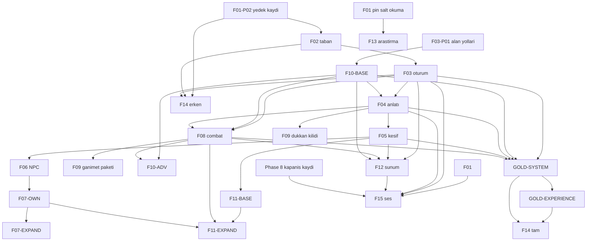

# AI-DND — Future Project Bible v2.3
## Uygulanabilir uzun vadeli yol haritası — PROPOSED

**Belge kodu:** `AI-DND-FPB-2.3-PROPOSED`  
**Tarih:** 9 Ekim 2026  
**Durum:** **PROPOSED. DONDURULMAMIŞTIR. OWNER ONAYI DEĞİLDİR. FAZ BAŞLATMAZ. ÇALIŞMA ZAMANI TEST PASS’İ DEĞİLDİR. GIT, PRODUCTION, ŞEHİR VEYA PHASE 9 İZNİ DEĞİLDİR.**

**Öncüller, yerinde durur:**

| Dosya | SHA-256 |
|---|---|
| `ai-dnd/docs/AI-DND_Future_Project_Bible_v2_PROPOSED_2026-10-09.md` | `bc1949f63a7ccf81bcc65680f1cef569c3e6b1351beab527f89edf145c10055b` |
| `ai-dnd/docs/AI-DND_Future_Project_Bible_v2_1_PROPOSED.md` | `b85b30295af4579036220c16fd6d500a87cde14855517bb409e36422a6152f8c` |
| `ai-dnd/docs/AI-DND_Future_Project_Bible_v2_2_PROPOSED.md` | `35651c09768635460a4de2395cf7557190cc71bb5ef057d7e370646ba8ab8124` |

v2 ayrıntı referansıdır. v2.1 bağımlılık referansıdır. v2.2 düzeltilmiş ayrıntı referansıdır. Bu v2.3 üç dosyayı da değiştirmez. v2.2.1 diye ayrı bir belge yoktur. Master Handoff v3 mimari bağlayıcılığını sürdürür. O dosya bu deponun `ai-dnd/docs` ağacında yoktur. Stage 10A/10B el devirleri, kabul planları, kanıt, lore pinleri ve kaynak kodu bu belgenin yazılmasıyla değişmez.

Dil Türkçedir. Çalışma hattı yerel Windows, Cursor, Codex, ChatGPT, Python, FastAPI, SQLite, yerel Ollama/Qwen ve gerçek Experience istemcisidir. **Replit kullanılmaz.**

F01–F15 kimlikleri korunur. Owner dondurmasından sonra kimlik yeniden kullanılmaz. Bu belge dondurma değildir.

---

# 0. Bu sürüm neyi değiştirir

v2.1’in sırası ve anayasası durur. v2.2 bunların üzerine şunları koyar:

- Her faz için oyuncu deneyimi, mevcut taban, boşluk, paket, sahip, yasak, senaryo, kanıt, eşik, durma ve oyuncunun göreceği sonuç.
- F01 kapanışı beş korumalı dosyanın temiz checkout baytına bağlanır. Yazılı `.gitattributes` kararı kapanış sayılmaz.
- F07-OWN ile F07-EXPAND, F11-BASE ile F11-EXPAND, F10-BASE ile F10-ADV ayrı kabul kimlikleri alır. Erken paket, sonraki paketin tuzağını veya görev yaşam döngüsünü PASS sayamaz.
- Altın yol iki kapıdır: `GOLD-SYSTEM` ve `GOLD-EXPERIENCE`.
- Kimlik ayırıcı, son satırı okuyup eklemek değildir. Ayrılmış oluşturma ile çakışma yakalanır.
- Model çağrısı: saf Python yolu 0 çağrı olabilir. Serbest metin niyeti, tavanın içinde niyet çağrısı kullanabilir. Her büyü veya savaş turu zorla 0 çağrıya bağlanmaz.
- Phase 8 kapanışı ayrıca tanımlanır. Zorunlu FAIL, erteleme ile PASS olmaz.
- Mühendislik şablonları geri gelir.

Açık kararlar kapanmış gibi yazılmaz. Bölüm 16 onları listeler.

---

# 1. Anayasa

```text
PYTHON DECIDES GAME REALITY.
LORE AUTHORITY DECIDES SETTING REALITY.
CAMPAIGN EVENTS CREATE CAMPAIGN CANON.
QWEN UNDERSTANDS INTENT, USES VERIFIED CONTEXT, AND TELLS THE STORY.
FRONTEND PRESENTS REALITY.
```

Python zar, HP, savaş, büyü, envanter, görev, hareket, zaman, hava, bellek ve kaydı çözer. Lore authority 1501 DR setting olgusunu verir, macera sonucunu yaşanmış yapmaz. Kampanya canon, o kampanyada engine’in kabul edip kaydettiği olaydır. Qwen tur başına en fazla iki çağrı kullanır. Reddedilen anlatıdan sonra ek çağrı yoktur. Fallback yeni canon uydurmaz. Frontend `artifacts/ai-dnd-experience` üzerinden gerçekliği gösterir, üretmez.

2024 PHB, DMG ve yüklenmiş Monster Manual mekanik referanstır. Heroes of Faerûn ve Adventures in Faerûn güncel setting referansıdır. Baseline 1501 DR’dir. Setting’e özgü resmî kural, edition, özgüllük, basılı sayfa, PDF sayfası ve bağlam kayıtlıysa genel kuraldan özel olabilir. Owner kararı bu kuralı koda almaktır. Kaynak metnini yeniden yazmaz. Çelişki uydurulmaz.

Bölünmüş PDF’de dosya SHA-256, PDF sayfası, basılı sayfa ve kitap kimliği ayrıdır. Hash, doğrulanmamış kural cümlesinin yerine geçmez. Ayna parça, tam kitap hash’i değildir.

`OWNER_APPROVED_CONTINUITY` resmî source tier değildir. Runtime ve official bayrakları false kalır. Pin uyuşmazsa kamu küme boşalır.

Bir fazın bir master sözleşmesi vardır. F07-OWN ile F07-EXPAND, F10-BASE ile F10-ADV, F11-BASE ile F11-EXPAND ve F13-RESEARCH, F13-ADMISSION, F13-ACTIVATION aynı master’ın çıkış kapılarıdır. İkinci master açılmaz. Sözleşme, bilinen paketleri ve zorunlu AC’leri baştan sayarsa Cursor o paketleri sırayla uygular. Her paket için yeniden izin istenmez. Kontrol noktası commit değildir. Kapsamı, kaynağı veya kabul ölçüsü henüz tanımsız olan paket kendiliğinden yetkili değildir. Onu başlatmak sürümlü sözleşme değişikliği veya FX onayı ister. Zorunlu BLOCKED madde, PASS üretmek için sonradan kapsam dışına alınamaz.

Yeniden izin gerekir: planda olmayan kapsam, FX aktivasyonu, sahip veya mimari değişikliği, save göçü, kapanmamış kural veya lore kararı, kapsam dışı admission, şehir aktivasyonu, Git stage/commit/push/merge/reset/clean/stash/restore, production.

Save sürümleri bu belgede değiştirilmez: lore payload 2, campaign format 1, SQLite şema 5, game save 3. Bu bir gözlem kaydıdır, yeni şema izni değildir.

---

# 2. Mevcut taban — uygulanmış olan yeniden yazılmaz

Etiketler: `MODÜL VAR` dosyanın durduğunu söyler. `KISMİ` sınırlı sözleşmedir. `TARİHSEL` eski run’dır, bu belgede yeniden koşulmamıştır. `KAYNAK OKUNDU` sözleşme metninin okunduğunu söyler, test PASS’i değildir. Hiçbir satır, modül var diye COMPLETE değildir.

| Sistem | Sahip | Durum | Korunan | Yeni iş |
|---|---|---|---|---|
| Yaratılış, HP, AC, sheet | `api/character_creation.py` | KISMİ. Büyücü hazırlığı ve rahip/druid seviye büyüleri kaynak çelişkisi yüzünden kapalı | Seçilmemiş büyü açılmaz. Eski save’e slot uydurulmaz | F10-BASE kilit. Tam sheet F10-ADV |
| Spells V1 | `spells.py` | KISMİ. Dört büyü, seviye-1 tek slot, uzun dinlenme | Python çözer | F10-BASE. Kalan büyü F10-ADV |
| XP | `xp.py` | MODÜL VAR. Level-up bu turda doğrulanmadı | XP V1 kullanıcı adlandırmadıkça yeniden açılmaz | F10-ADV, save kararı açıksa |
| Bounded encounter | `bounded_encounter.py` | TARİHSEL 10A combat kapısı. Kimlik `302305dd-8ae6-40b3-9cd4-49d679d0be21` | Hostile enjekte edilmez. Dash gerçek mesafedir | F08 yalnız eksik kural |
| Dükkân | `shop_creation.py` | TARİHSEL 10A. Fiyat ve stok sahibi yok | “Tüccar bul” dükkân yaratmaz | F09. Satış uydurulmaz |
| Çanta ve ganimet | dünya envanteri, `weapon_attack.py` | KISMİ. Genel kasa yok | Model ganimet yazamaz | F09 |
| NPC | `living_world.py`, `local_dialogue.py` | KISMİ. Söylenti ve faction skoru yok | Görünüş ad olmaz. Ad başka NPC’ye kopyalanmaz | F06 |
| Olay ve macera modülleri | `incidents/`, `adventure/` | MODÜL VAR. Üretim davranışı bu turda doğrulanmadı | Yeni manager, sözleşme okunmadan yazılmaz | F07, F11 |
| Görev kataloğu | Python quest sahibi | Üretim kataloğu bilinçli boş | Boş katalog olumsuz cevap verir. Soru, kabul edilmiş teklif değildir | F07-OWN. Yaşam döngüsü ancak yetkili içerikle F07-EXPAND |
| Keşif, zaman, hava | living world, kampanya saati | KISMİ. Public hava yolunun adı bu turda kodda dondurulmadı | UI hava uydurmaz. Rotasız süre yazılmaz | F05. Yol OPEN DECISION |
| Opt-in zindan | `authored_dungeon_v1` | KAYNAK OKUNDU. Giriş, hol, dönüş. Vault kapalı | Doğal yolculuk grafiği baypas etmez | F11-BASE. Tuzak F11-EXPAND |
| API ve SQLite | `main.py`, `session_manager`, `campaign_store` | TARİHSEL replay. Bu tur yenilenmedi | Çift istek ikinci zar yazmaz | F03 |
| Model fazı | `model_phase.py`, `resolved_presentation.py` | TARİHSEL AC-019. Lore turu bu yüzeyi yeniden koşmadı | Çözüm öncesi rollback. Çözüm sonrası sonuç kalır. 0 retry | F04 |
| Experience | `game-browser.tsx` | TARİHSEL. Lore turunda yenilenmedi | İstemci canon yazmaz | F12, alan donunca |
| Neverwinter | `freeze_admission.py`, paketler | TARİHSEL lore-integrity. 95 açık, 5 kısıtlı. Şehirler kapalı | Fail-closed. Bu belge testi yeniden koşmadı | F13 ayrı imza |

Stage 10A reconstructed yerel kabul tarihsel olarak PASS / OWNER-APPROVED / CLOSED’dur. Özgün sözleşme bulunamadı. Stage 10B repair-v2 FAIL olarak durur. Lore-integrity handoff yerel PASS yazar: 296 ve 634 exit 0. Bu depo geneli, production veya Phase 8 kapanışı değildir. S10B-INV-001 UNCONFIRMED’dur. Tarayıcı ve 20 tur, lore-integrity diff’inde yeniden koşulmamıştır.

HEAD `f63d952506064cd59e960f1e3efa6627d4e52053` test edilmiş snapshot değildir. Çalışma ağacı kirli. Her kontrol, HEAD artı dirty manifest artı dosya SHA-256 ister.

---

# 3. Yürütme sırası

Özellik kenarı ile `game.py` yazım sırası ayrıdır. Combat’ın görev sistemine özellik bağımlılığı yoktur. Aynı dosyaya iki ajan yazmaz. `game.py` yazım sırası F04, sonra F08, sonra F07, sonra F09’un o dosyaya dokunan paketidir. Bu sıra F08’in F07’yi beklemesi değildir.



Döngü yoktur. F08, F07 faz PASS’ini beklemez. F15, F14’e bağlanmaz. F13 aktivasyonu otomatik kenar değildir. F12’nin tek kutusu, kabuk, hava ve savaş paketlerinin aynı anda başladığı anlamına gelmez. Aşağıdaki tablo başlangıç ve bitiş koşusudur. Çelişirlerse tablo geçerlidir.

| İş | Tür | PASS gereken kapı | Ek owner izni |
|---|---|---|---|
| F02 başlangıcı | START | F01-P02 yedek karşılaştırması kayıtlı. F01-AC-002 PASS şart değil | Hayır |
| F02 bitişi | COMPLETE | F02 zorunlu AC’leri. F01 checkout PENDING ise F02 bunu PASS saymaz | Hayır |
| F03 başlangıcı | START | F02-AC-005 | Hayır |
| F10-BASE başlangıcı | START | F03-P01 sheet ve oturum alan yolları PASS | Hayır |
| F10-BASE çıkışı | COMPLETE | F10-BASE AC’leri ve F03-AC-003, F03-AC-005 | Hayır |
| F04 başlangıcı | START | F03 faz PASS ve F10-BASE çıkışı | Hayır |
| F05 başlangıcı | START | F04 çıkışı | Hayır |
| F06 başlangıcı | START | F05 çıkışı | Hayır |
| F08 başlangıcı | START | F03 faz PASS, F10-BASE çıkışı, F04 çıkışı. F07 yok | Hayır |
| F07-OWN başlangıcı | START | F06 çıkışı. Aynı F07 master | Hayır |
| F07-EXPAND başlangıcı | START | F07-OWN çıkışı. İçerik tanımsızsa paket yetkisiz, kapı BLOCKED | İçerik için evet |
| F09 dükkân başlangıcı | START | F04 çıkışı | Hayır |
| F09 ganimet | START | F08 çıkışı | Hayır |
| F10-ADV başlangıcı | START | F10-BASE ve F08 çıkışları. Yeni büyü veya save tanımsızsa yetkisiz | Sayfa ve RFC için evet |
| F11-BASE başlangıcı | START | F05 çıkışı ve F03 faz PASS | Hayır |
| F11-EXPAND başlangıcı | START | F11-BASE, F08, F07-OWN çıkışları. Tuzak tanımsızsa yetkisiz | İçerik için evet |
| F12 kabuk | START | F03 faz PASS | Hayır |
| F12 hava | START | F05-AC-004 PASS | Hayır |
| F12 savaş veya sheet | START | İlgili F08 veya F10-BASE çıkışı | Hayır |
| F13-RESEARCH | START | F01 pinleri salt okunur | Hayır |
| F13-ADMISSION | COMPLETE | Araştırma çıkışı. Aktivasyon değildir | Admission için evet |
| F13-ACTIVATION | START | Admission çıkışı | Şehir başına evet |
| GOLD-SYSTEM | COMPLETE | Bölüm 7 tablosu | Hayır |
| GOLD-EXPERIENCE | COMPLETE | GOLD-SYSTEM PASS ve yetkili anlamlı içerik | İçerik yoksa BLOCKED |
| F14 erken | COMPLETE | F01-P02, F02, F03 ve included/excluded listesi | Tur sayısı için evet |
| F14 tam | COMPLETE | GOLD iki kapı ve donmuş eşikler | Evet |
| F15 | START | Phase 8 kapanış kaydı ve F01, F03, F04, F12 faz PASS | Evet |

F07-EXPAND, F10-ADV ve F11-EXPAND ayrı master açmaz.

---

# 4. Model çağrı sözleşmesi

Dört yüzey karıştırılmaz.

| Yüzey | Çağrı | Ne değildir |
|---|---|---|
| Saf Python çözümü | 0 geçerlidir | Eksik test değildir. Zar, hasar, slot ve HP burada çözülür |
| Serbest metin oyuncu turu | Yetkili niyet çağrısı kullanabilir | Mekanik çözüm değildir. Tavan 2’dir |
| Anlatı uygunluğu | Çözülmüş sonuçtan sonra bir anlatı çağrısı olabilir | İkinci bir mekanik zar değildir |
| Reddedilen anlatı | Ek çağrı 0. Deterministik fallback | Fallback, başarılı HP veya konumu yalanlayamaz |
| Canlı Qwen | `qwen3:8b` izi | Mock veya kapalı Ollama PASS değildir |

Serbest cümle “ateş oku at” niyet ve anlatı kullanabilir. Çözülmüş savaş düğmesi veya doğrudan Python resolver 0 çağrıda kalabilir. Sözleşme, turun hangi yüzey olduğunu yazar. Her savaş veya büyü turunu, mekanik Python’da diye 0’a zorlamak yasaktır. Qwen zar, hasar, slot veya görev sonucu seçemez. Tavan yükselmez.

Bütçe mantıksal oyuncu turuna ve onun `action_id` / receipt kimliğine aittir. Aynı kimliğin istemci tekrarı, eşzamanlı ikinci gönderim veya süreç restart sonrası aynı receipt yeni tur değildir ve harcanmış çağrıyı geri vermez. Adaptör veya SDK görünmeyen retry yaparsa bu, tavanın içinde sayılır. Tavanı aşan gizli retry FAIL’dir. Çözüm öncesi arıza mevcut rollback sahibindedir. Çözüm sonrası yalnız anlatı arızası mekanik sonucu korur ve ek çağrı açmaz. Reddedilen veya uydurma anlatı, transcript’te kalsa bile sonraki turun bağlamında lore, NPC belleği, görev, çanta, ilişki veya campaign event olmaz. Anlatı, mevcut doğrulanmış sınırda yalnız anlatı olarak durabilir.

---

# 5. Kimlik ayırıcı

Son satırı okuyup eklemek **uygunsuzdur**. İki ajan aynı anda aynı son satırı görür.

Ayırıcı, bu belgeyle oluşturulmaz. Sözleşme şudur:

1. Ayırıcı kökü `ai-dnd/docs/roadmap/id-lock/` olur. Kök yokken kimse numara dağıtamaz.
2. İstenen kimlik, dosya adının kendisidir: `FX-2026-004.reserve`.
3. Oluşturma exclusive create ile yapılır. Windows’ta `CREATE_NEW`, Python’da `open(path, "x")`. Dosya varsa işlem **FAIL** olur. Ajan bir sonraki sayıyı tahmin edip yazamaz. Yeni bir ad dener. Yalnız exclusive create kazanan rezervasyonu tutar.
4. Rezervasyon dosyasının içi: ajan, UTC zaman, şerit, parent, niyet cümlesinin SHA-256’sı. Bu içerik numaranın sahibi değildir. Sahip, exclusive create’in kendisidir.
5. Rezervasyon dosyası tam ve ayrışır olmalıdır. Yarım dosya kimlik dağıtmaz. İçerik: ajan, UTC, şerit, parent, niyet SHA-256. Sözdizimi `FX-YYYY-NNN` veya `DOC-YYYY-NNN` veya `ERRATA-YYYY-NNN`dir. Örnek `FX-SAMPLE-DO-NOT-REGISTER` gerçek kimlik değildir. Aday, önce kayıt ve `id-lock` dizinindeki bütün `.reserve` adları okunarak seçilir. Seçim, exclusive create kazanılmadan kimlik değildir.
6. Kayıt satırı `ID_REGISTRY.jsonl` dosyasına `ALLOC.lock` tutulurken eklenir. Satır tam bir JSON nesnesidir ve satır sonu ile biter. Yazmadan önce dosya yeniden okunur. Aynı kimlik varsa ekleme yapılmaz.
7. Çökme. Rezervasyon var, satır yoksa kimlik tüketilmiştir. Başka ajan alamaz. Exclusive `RECONCILE.lock` altında `ORPHAN_RESERVE` ve rezervasyon SHA-256’sı yazılır. Dosya ayrışmıyorsa `RESERVE_CORRUPT` yazılır. Kimlik serbest kalmaz. Satır var, rezervasyon yoksa `ORPHAN_ROW`dır. İkinci rezervasyon açılmaz. Son satır ayrışmıyorsa ayırıcı durur. Satır kesilmez. Durum `REGISTRY_TORN` ve BLOCKED’dır.
8. Kilit düşünce silinmez. Başka ajan `LOCK_DISPUTE` yazar. Yeni rezervasyon, numaranın sahibi dosya olduğu için alınabilir. Dispute dururken kayıt eklenmez. Owner `EXPIRED` satırı yazmadan dispute kapanmaz. `EXPIRED` ve terk edilmiş kimlik yeniden kullanılmaz. Durum geçişleri yalnız `RESERVED → ORPHAN_RESERVE → ALLOCATED` veya `RESERVED → EXPIRED` yönündedir. Geri dönüş yoktur.
9. Ayrılmış kimlik uygulama onayı değildir.
10. Şeritler: `IDEA`, `FEATURE`, `HOTFIX`, `DOC`, `LORE-ERRATA`, `EXPERIMENT`. Hepsi aynı ayırıcıdadır. Aynı kimlik iki şeritte kullanılamaz.
11. DOC şeridi ürün testi açmaz. Gerekçe yazılır. Tarihsel FAIL metni değişmez. Lore, save, çağrı tavanı veya sahip değişiyorsa DOC kullanılamaz.
12. LORE-ERRATA orijinal baytı yerinde bırakır. Düzeltme yeni sürümlü dosya ve ayrı pin’dir.
13. EXPERIMENT üretim state’e yazmaz.
14. FEATURE ve HOTFIX, parent’ın dondurulmuş AC’lerini gevşetemez. Etki varsa yeni AC eklenir. Eski madde optional yapılmaz.

Örnek kimlik `FX-SAMPLE-DO-NOT-REGISTER` gerçek rezervasyon değildir.

---

# 6. Phase 8 kapanışı ve F15 önkoşulu

F15 iki şeyi birlikte ister.

Birincisi, owner onaylı, sürümlü, SHA-256’lı bir **Phase 8 Expansion kapanış kaydı**. Bu kayıt `ai-dnd/docs` içinde bu revizyonda yoktur. Stage 10A reconstructed CLOSED ve Stage 10B yerel PASS onun yerine geçmez.

Kapanış kaydının dürüst olması için kapsam, kapanış iddiasından **önce** yazılır.

- Kapsamda diye yazılmış her madde PASS olmak zorundadır.
- Kapsamda diye yazılmış bir FAIL, sonradan “ertelendi” denerek PASS olmaz.
- Kapsam dışı bırakmak, ancak kapanıştan önce ve açık cümleyle olur. Bu, depo geneli sertifikasının istenmediğini söyleyebilir. Koşulmuş bir FAIL’i yok sayamaz.
- S10B-INV-001, doğrulanmadıkça fixed yazılmaz. Kapsama alınırsa UNCONFIRMED kalması kapanışı, o maddenin PASS’i sayılmaz. Kapsam dışı bırakılırsa bu, onun geçtiği anlamına gelmez.
- Hangi tarihsel Stage 10A ve 10B maddelerinin Phase 8 kapsamına gireceği **OPEN DECISION**dır. Bu Bible o listeyi uydurmaz.

İkincisi, F01, F03, F04 ve F12’nin ses girdisinin dayandığı sözleşmeleri kendi planlarında PASS’tir. F12 burada oyuncu metin yoludur.

Phase 9 bu kayıttan otomatik başlamaz.

---

# 7. Altın yol

`RPG-GOLD-001` iki kapıya ayrılır. İkisi de faz değildir.

## GOLD-SYSTEM

Gerçek tarayıcı, API, Python ve SQLite yolculuğu. Testten önce yol dondurulur. Dondurulmamış adım PASS yazmaz.

| Adım | Başlamadan önce PASS | Değilse |
|---|---|---|
| Oturum, receipt, restart, ikinci kampanya | F03 faz PASS | BLOCKED |
| Karakter, HP, AC, dört büyü | F10-BASE çıkış kapısı | BLOCKED |
| Serbest metin | F04 çıkış kapısı | BLOCKED |
| Oyuncunun gördüğü HP, konum, anlatı | İlgili F12 paketi | Sunum BLOCKED. Gizli JSON yetmez |
| Opt-in combat | F08 çıkış kapısı | Adım kullanılmaz. Sahte düşman yok |
| Dükkân | F09 çıkış kapısı | Adım kullanılmaz |
| Hareket | F05 çıkış kapısı | Rotasız süre yok |

İçerik yalnız bu kapılardan geçen mevcut sistemlerdir. Üretim görevi ve yeni NPC uydurulmaz. Kayıt: sözleşme ve kaynak hash’i, kampanya kimliği, tur receipt’i, persist edilen event, uygunsa Qwen izi, save/restart özdeşliği, görünen metin ile API yolu. PASS mekanik sürekliliktir. Hash değişirse HISTORICAL’dır.

## GOLD-EXPERIENCE

Anlamlı ajans, anlaşılır risk, inanılır temas, sonuç ve elle okunmuş anlatı.

Şunlar bu kapıyı **otomatik geçmez:** tek lore sorusu, pasif bakış, yalnız ret, boş katalogda “iş yok” cevabı. Bunlar GOLD-SYSTEM’in meşru adımı olabilir. Deneyim kapısı, oyuncunun bir şeyi seçip sonucunu taşımasını ister.

Deneyim kapısı şunları ayrı satırda sorar: anlamlı ajans, anlaşılır risk, yetkili gerçek risk, görünen sonuç, kampanya sürekliliği, inanılır NPC ve hikâye sunumu. Yetkili içerik bunu vermiyorsa eksik yazılır ve kapı **BLOCKED** kalır. Görev veya NPC bu yüzden icat edilmez. F07-EXPAND yetkisizse görev sahnesi yoktur.

İki kapının PASS’i ayrı satırdır. F14 tam hazırlık ikisini de ister. F14 erken kontrolü onları EXCLUDED diye listelemeden PASS yazamaz.

---

# 8. Ortak mühendislik zarfı

Her fazın kendi bölümü bu zarfı tekrar etmek zorunda kalmadan ona döner ve faza özgü farkı yazar.

**Snapshot.** HEAD, dal, dirty yolların SHA-256 listesi, ilgili dosyaların önce ve sonra hash’i. HEAD tek başına yetmez.

**Kanıt kökü.** `.local/evidence/<faz>-<paket>-<tarih>-<run-id>/`. İçinde `baseline/`, `unit/`, `api/`, `model/`, `browser/`, `human/`, `summary.json`, `evidence-hashes.json`. Eski kökler durur. Kırmızı koşu silinmez.

**Eşik.** Sayı, uygulama başlamadan sözleşmede donar. Donmamış p95 için PASS yazılmaz. Sonuç `NOT TESTED` veya `OPEN DECISION` kalır. Bu belgede evrensel milisaniye uydurulmaz.

**Kontrol noktası.** Paket biter. Faz PASS değildir. Commit değildir.

**Paket PASS.** Yalnız o paketin kendi AC’leri. Faz PASS değildir.
**Çıkış kapısı PASS.** Adlandırılmış alt küme, örneğin F10-BASE. Faz PASS değildir. Sonraki paketin başlangıç önkoşulu olabilir.
**Faz PASS.** Master’daki bütün zorunlu AC’ler PASS’tir. Biri FAIL, BLOCKED, NOT TESTED veya PENDING ise faz PASS yoktur. Exit 0, manuel anlatı PASS değildir.
**BLOCKED.** Meşru içerik, karar, ortam veya Git izni yok. Güvenlik kuralı delinerek doldurulmaz.
**NOT TESTED.** Koşulmadı. Yok sayılarak PASS olmaz.
**FAIL.** Koşulan kontrol beklenen sonucu vermedi.
Kanıttaki sözleşme hash’i, ilgili kaynak hash’i, fixture hash’i, ortam kimliği veya pin, bugünkü değerden farklıysa o PASS **HISTORICAL**dır. Güncel kabul değildir. İlgisiz bir belge düzeltmesi, o AC’nin okuduğu sahip dosyalarını değiştirmiyorsa yeniden tam depo koşusu gerektirmez. İlgililik, AC’nin adlandırdığı sahip, fixture ve pin dosyalarıdır. Reviewer bunu yazar. Assertion sessiz gevşetilmez.

**Komut.** A: dondurulmuş komut ve assertion. B: bağımsız incelenmiş eşdeğer veya katı süperküme, madde madde harita, negatifler durur, gevşetme yoktur, owner yerine koymayı kabul etmiştir. A ve B yoksa NOT TESTED veya BLOCKED. Düşen test başka geçen testle sessiz değişmez.

**Regresyon.** İlgili sahip testleri, 2 çağrı tavanı, 0 retry, şehirlerin kapalı kalması, pin fail-closed, save sürümlerinin değişmemesi. Şema değişmiyorsa eski save açılır.

---

# 9. Kabul kimliği eşlemesi

Hiçbir devralınan madde silinmez. Numara değiştiyse halef yazılır. F10-BASE, Stage 10B değildir.

| Eski | Halef | Ne oldu |
|---|---|---|
| v2 F01-AC-001 | F01-AC-001 | Envanter durur |
| v2 ve v2.1 F01-AC-002 | F01-AC-002 | İki dosyadan beş dosyaya genişledi. Eski iki dosya durur |
| v2 ve v2.1 F01-AC-003 | F01-AC-003 | Tam yedek hash’i. 344/344 raporlandı. Fiziksel disk UNCONFIRMED |
| v2 F01-AC-004 | F01-AC-004 | Yayın listesi ve owner kararı |
| v2.1 F01-AC-004 | F01-AC-005 | Üç Neverwinter dosyası. Yazılı öznitelik kapanış değildir. Checkout F01-AC-002’dedir |
| v2.1 F01-AC-005 | F01-AC-004 | Yayın listesi v2 ile birleşti |
| v2 F02-AC-001 | F02-AC-001 | Tekrarlanabilirlik |
| v2 F02-AC-002 | F02-AC-002 | Test türleri ayrı |
| v2 F02-AC-003 | F02-AC-003 | Pinler paketlemede bozulmaz |
| v2 F02-AC-004 | F02-AC-004 | Bug listesi, INV-001 dahil |
| v2.1 F02-AC-003 | F02-AC-005 | Yeniden yazılmayacak sahip envanteri. v2.1’de numara pin maddesiyle çakışıyordu. İkisi de durur |
| v2.1 F02-AC-005 | F02-AC-003 | Pin maddesi |
| v2 ve v2.1 F03-AC-001 … 004 | F03-AC-001 … 004 | Aynı |
| v2.1 F03-AC-005 | F03-AC-005 | Gecikmiş kampanya A, B’ye sızmaz |
| v2 F03-AC-005 ve v2.1 F03-AC-006 | F03-AC-006 | Servis yokken yeni gerçek yok |
| v2 F04-AC-001 ve v2.1 F04-AC-001 | F04-AC-001 | Tavan ve retry |
| v2 F04-AC-002 | F04-AC-002 | Karma niyet. v2.1’in find/create örneği bunun içindedir, maddeyi daraltmaz |
| v2.1 F04-AC-002 | F04-AC-002 | Find/create, karma niyetin örneğidir |
| v2 F04-AC-003 ve v2.1 F04-AC-003 | F04-AC-003 | Sahte bellek ve Elara |
| v2.1 F04-AC-004 | F04-AC-004 | Çözüm öncesi ve sonrası |
| v2.1 F04-AC-005 | F04-AC-005 | Fallback yalanlamaz |
| v2 F04-AC-004 | F04-AC-007 | Anlatı, zar ve HP ile çelişmez. Manuel satır ayrıdır |
| v2 F04-AC-005 ve v2.1 F04-AC-006 | F04-AC-006 | Canlı Qwen ve fallback ayrı iz. İnsan PASS ayrı |
| v2 ve v2.1 F05-AC-001 … 005 | F05-AC-001 … 005 | Hava yolu dondurulmadan AC-004 PASS olmaz |
| v2 ve v2.1 F06-AC-001 … 005 | F06-AC-001 … 005 | Aynı |
| v2 ve v2.1 F07-AC-001 | F07-OWN-AC-001 | Uydurma aktif görev yok |
| v2 ve v2.1 F07-AC-002 | F07-EXPAND-AC-001 | Tam yaşam döngüsü OWN’un çıkış kapısı değildir |
| v2 ve v2.1 F07-AC-003 | F07-OWN-AC-002 ve F07-EXPAND-AC-002 | Boş katalog tekrarı OWN. Görev ödülü tekrarı EXPAND |
| v2 ve v2.1 F07-AC-004 | F07-EXPAND-AC-003 | Yayımlanmış macera geçmiş sayılmaz |
| v2 ve v2.1 F07-AC-005 | F07-OWN-AC-003 ve F07-EXPAND-AC-004 | Boş katalog restart OWN. Kabul edilmiş seçim EXPAND |
| v2 ve v2.1 F08-AC-001 … 005 | F08-AC-001 … 005 | 0 çağrı yalnız doğrudan Python yolu için zorunlu örnek olur. Serbest metin tavanı F04’tedir |
| v2 ve v2.1 F09-AC-001 … 004 | F09-AC-001 … 004 | Aynı |
| v2.1 F09-AC-005 | F09-AC-005 | Teknik ret yok |
| v2 F09-AC-005 | F10-ADV-AC-006 | Attunement ve büyü etkileşimi F09’dan alınmadı, ileri pakete kondu |
| v2.1 F10B-AC-001 | F10-BASE-AC-001 | Ad değişti. Stage 10B değildir |
| v2.1 F10B-AC-002 | F10-BASE-AC-002 | Ad değişti. Stage 10B değildir |
| v2.1 F10B-AC-003 | F10-BASE-AC-003 | Ad değişti. Stage 10B değildir |
| v2.1 F10B-AC-004 | F10-BASE-AC-004 | Ad değişti. Stage 10B değildir |
| v2.1 F10B-AC-005 | F10-BASE-AC-005 | Ad değişti. Stage 10B değildir |
| v2 F10-AC-001 | F10-BASE-AC-001 ve F10-ADV-AC-001 | Mevcut küme ve yeni küme ayrı |
| v2 F10-AC-002 | F10-BASE-AC-002 ve F10-ADV-AC-002 | Negatif kaynak |
| v2 F10-AC-003 | F10-BASE-AC-003 ve F10-ADV-AC-003 | Dört büyü şimdi. Level sonra |
| v2 F10-AC-004 | F10-BASE-AC-004 ve F10-ADV-AC-004 | Yaratılış uyumu ve eski save |
| v2 F10-AC-005 | F10-BASE-AC-005 ve F12-AC-004 | Sahte seçenek BASE. Klavye ve dar ekran F12’de durur |
| v2.1 F10-AC-001 … 005 | F10-ADV-AC-001 … 005 | Aynı yük |
| v2 F11-AC-001 | F11-BASE-AC-001 | Mevcut grafik |
| v2 F11-AC-002 | F11-BASE-AC-002 ve F11-EXPAND-AC-001 | Oda keşfi BASE. Düşman EXPAND |
| v2 F11-AC-003 | F11-BASE-AC-003 ve F11-EXPAND-AC-005 | Konum BASE. Tuzak, görev ve savaş birlikte EXPAND |
| v2 F11-AC-004 | F11-BASE-AC-004 ve F11-EXPAND-AC-002 | Oda restart BASE. İpucu ödülü EXPAND |
| v2 F11-AC-005 | F11-BASE-AC-005 ve F11-EXPAND-AC-003 | Meta sızıntı iki kapıda da durur |
| v2.1 F11-AC-001, 002, 005 | F11-BASE-AC-001, 004, 005 | Fixtür |
| v2.1 F11-AC-003, 004 | F11-EXPAND-AC-001, 004 | Düşman ve tuzak hasarı |
| v2 ve v2.1 F12-AC-001 … 004 | F12-AC-001 … 004 | Aynı |
| v2 F12-AC-005 | F12-AC-005 ve F12-AC-006 | Okunabilirlik ve kimlik/event ayrı satır. v2.1’in ayrımı durur |
| v2.1 F12-AC-005 | F12-AC-005 ve F12-AC-006 | Aynı ayrım |
| v2 ve v2.1 F13-AC-001 … 005 | F13-AC-001 … 005 | Aktivasyon ayrı imza |
| v2.1 F14-AC-001 | F14-AC-001 | Erken kontrol listesi |
| v2 F14-AC-001 | F14-AC-002 | Uzun koşu |
| v2 F14-AC-002 | F14-AC-008 | Fail-safe ve UNCONFIRMED 500. Numara kaymasın diye 008 |
| v2 F14-AC-003 | F14-AC-003 | Seçili ve tam keşif ayrı |
| v2 F14-AC-004 | F14-AC-004 | Eşik |
| v2 F14-AC-005 | F14-AC-005 ve F14-AC-006 | İnsan imzası ve geri yükleme |
| v2 F14-AC-006 ve v2.1 F14-AC-007 | F14-AC-007 | Commit ve production ayrı |
| v2.1 F14-AC-002 | F14-AC-002 | Uzun koşu |
| v2.1 F14-AC-005 | F14-AC-009 | Altın yol tam fazdadir. Sistem ve deneyim ayrı |
| v2.1 F14-AC-006 | F14-AC-006 | Geri yükleme |
| v2 F15-AC-001 | F15-AC-002 | Mikrofon |
| v2 F15-AC-002 | F15-AC-003 | Onaysız eylem yok |
| v2 F15-AC-003 | F15-AC-004 | İkinci gönderim yeni zar yazmaz |
| v2 F15-AC-004 | F15-AC-005 | İsim düzeltmesi |
| v2 F15-AC-005 | F15-AC-006 | Metin yolu ve tavan |
| v2.1 F15-AC-001 | F15-AC-001 | Phase 8 kaydı ve F01, F03, F04, F12 |
| v2.1 F15-AC-002 … 005 | F15-AC-002 … 005 | Aynı yük |
| v2.1 RPG-GOLD-001 | GOLD-SYSTEM ve GOLD-EXPERIENCE | Bölündü. Yük düşmedi |

v2 metnindeki “F07-AC-006 değiştir” örneği kabul maddesi değildir. Kötü örnektir. Gerçek madde açılmaz.

---

# 10. Fazlar

## F01 — Kanıt ve beş dosyanın taşınabilirliği

**Oyuncu deneyimi.** Oyuncu bunu görmez. Görürse, aylar sonra kaydın ve dünyanın aynı baytla açılmasıdır. Pin kayarsa Neverwinter cümlesi ya kaybolur ya da yanlış kapanır.

**Taban.** 9 Ekim 2026 akşam raporu: 344/344 dosya `D:\AI-DND-evidence-backup\2026-10-09-stage10-local-evidence` ile eşleşti. Bu makine yoludur, yayınlanabilir yol değildir. `D:` ayrı NTFS birimidir. Ayrı fiziksel disk **UNCONFIRMED**. Çalışma ağacında Castle Ward ve pack_index pinli CRLF’dir. HEAD’deki pack_index LF’dir. Üç Neverwinter dosyasının HEAD baytı da LF’dir. Çalışma ağacı pinli CRLF’dir. `.gitattributes` yalnız iki yolda `-text` taşır. Üç dosyanın öznitelik kuralı **PENDING**. Temiz checkout **PENDING**. Bu belge Git’e dokunmaz.

**Kapı.** İlk faz. Başka faza bağımlı değildir. Eşzamanlı yazan ajan varsa durulur.

**Paketler.** `F01-P01` envanter. `F01-P02` yedek karşılaştırması. `F01-P03` beş dosyanın checkout’u. `F01-P04` yayın ve hariç listesi. Paketler sıra ile biter. P03 olmadan faz PASS değildir.

**Sahipler.** Hash okuma ve belge. Korunan: `game.py`, pin değerleri, save şeması, şehir kapıları, lore metni. Bu faz `.gitattributes` yazmaz. Öznitelik değişikliği ayrı owner iznidir ve tek başına kapanış değildir.

**Yetki.** Mekanik, lore anlamı, kampanya canon ve model değişmez. Yalnız bayt kimliği okunur.

**Kayıt.** Save şeması değişmez. Kanıt klasörleri taşınmaz ve silinmez.

**Hariç.** Oyun kodu, pin değiştirmek, stage, commit, şehir, Phase 9.

**F01-AC-001.** Kritik kaynak ve kanıt yollarının her biri SHA-256 alır. Yok sayılan ve izlenmeyen dahildir. Eksik satır FAIL. Pozitif: manifest satır sayısı dosya sayısına eşittir. Negatif: bir sqlite veya log atlanırsa FAIL. Restart N/A, gerekçe dosya envanteridir. Tarayıcı N/A. Model N/A.

**F01-AC-002.** Beş dosyanın Git deposundaki temiz checkout baytı, aşağıdaki pin ile aynı olmalıdır. Kaynak, `freeze_admission.py` ve `test_lore_1501_integration.py` içindeki mevcut sabitlerdir. Bu belge o sabitleri değiştirmez.

| Dosya | Pin SHA-256 |
|---|---|
| `ai-dnd/docs/evidence/phase8-expansion/lore-review-1501-freeze-candidate/Owner_Decision_Castle_Ward_1501.md` | `be4b2f8a399103537f93fc33cfebe47524bd811a6fb232b577b480a087895d8a` |
| `ai-dnd/api/lore_authority/packs/pack_index.json` | `3ba99717976aa25f154fdd97cc4ce6e5e7d5bf59bd175bc037cd7c537ebcacd5` |
| `ai-dnd/api/lore_authority/packs/neverwinter_the_north_v1.extraction.json` | `51b1ce206d8be080de855aff79348a05578a99ca5c5b69c7fee912063d5c64c5` |
| `ai-dnd/api/lore_authority/packs/neverwinter_the_north_v1.review.json` | `0438e805ba26c345af6b7b0078770e45a33f71fb0b5e9cab404cfe7571de703e` |
| `ai-dnd/api/lore_authority/packs/installed_region_catalog.json` | `2c20d3841a6fe3eb7566fb97b3cc07cc9aa5e65585e481c531a820c7d94d1936` |

Şimdi yapılabilecek salt okuma: çalışma ağacı SHA-256 ve `git show HEAD:yol` blob hash’i. Bu ikisi kapanış değildir. Temiz checkout, CRLF baytın Git nesnesinde durması demektir. Onu stage, commit veya worktree yazmadan göstermek mümkün değildir. O yüzden madde **PENDING** kalır. PASS yazılmaz. Önerilen `.gitattributes` satırı da PASS değildir.

İzin çıkınca yalıtık yol: ayrı owner onayıyla yalnız bu beş yol ve onların `-text` kuralı bir deneme dalına yazılır. Geliştirici makinesinin `core.autocrlf` ayarı değiştirilmez. İkinci kopya `git -c core.autocrlf=false` ile alınır. Beş dosyanın ham SHA-256’sı pin ile karşılaştırılır. Bu paragraf o izni vermez.

Negatif: pin ile tek bayt farkı FAIL’dir. Fark LF yerine CRLF, CRLF yerine LF veya başka bir bayt olabilir. Yön maddeyi kurtarmaz. İkinci işletim sistemi örneği v2’den durur. Makine seçimi OPEN DECISION’dır. Koşul silinmedi.

**F01-AC-003.** Yedek ile kaynak tüm dosyalarda eşleşir. 344/344 raporu girdi olarak yazılır, yeniden ölçülmeden kapanış sayılmaz. Fiziksel disk UNCONFIRMED ise madde “hacim kopyası PASS, felaket yedeği değil” diye kapanır. Hedef yoksa BLOCKED.

**F01-AC-004.** Yayınlanacak, hariç tutulacak ve makine yolu içeren belgeler listelenir. Owner kararı olmadan commit grubu yoktur. Tarihsel el devirindeki makine yolu yerinde düzeltilemez. Gerekirse yeni sürümlü halef önerilir.

**F01-AC-005.** Üç Neverwinter dosyası için öznitelik niyeti yazılabilir. Bu yazı, AC-002 geçmeden kapanış değildir. Bu Bible özniteliği uygulamaz.

**Senaryolar.** Replay N/A. Rollback, yanlışlıkla yazılan baytın geri alınmasıdır ve bu faz yazmaz. İki kampanya N/A. Tarayıcı N/A. Qwen N/A. Manuel inceleme, listenin gizli anahtar içermediğini okur.

**Kanıt.** `raw-vs-git-digests.json`, `backup-manifest.json`, `checkout-five.json`, `publish-scope.md`. Kaynak snapshot zorunlu.

**Eşik.** Aktarım süresi ölçülür. Kabul bütünlüktedir. Milisaniye eşiği OPEN DECISION’dır ve kapanış şartı değildir.

**Kontrol ve PASS.** P01 ve P02 kontrol noktasıdır. Faz PASS, AC-001 ve AC-002 ve AC-003 ve AC-004 PASS ise yazılır. AC-002 PENDING ise faz PASS değildir.

**Dur.** Stage, pin uyuşmazlığında pin değiştirmek, gizli anahtar, ikinci ajan.

**Regresyon.** Şehirler kapalı kalır. Fail-closed testi bu fazda gevşetilmez.

**Risk.** HEAD LF ile çalışma ağacı CRLF’nin commit’te kayması. Fiziksel disk belirsizliği.

**Oyuncunun göreceği.** Doğrudan bir şey yok. Dolaylı olarak aynı Neverwinter metni.

## F02 — Taban ve sahip envanteri

**Oyuncu deneyimi.** Oyun bir makinede açılıp diğerinde sessizce başka kurallar oynamasın.

**Taban.** Bölüm 2 taslaktır. F02 onu güncel hash ile dondurur. Oyun davranışı değişmez.

**Kapı.** F01’in yedek karşılaştırması okunabilir olmalıdır. F01 faz PASS’i şart değildir. Pin checkout PENDING ise F02 bunu gizlemez.

**Paketler.** `F02-P01` ortam ve kilit dosyaları. `F02-P02` test türleri. `F02-P03` sahip envanteri. `F02-P04` bug kaydı.

**Sahipler.** Araç ve başlangıç. Korunan: tüm oyun sahipleri. Davranış değişikliği ayrı yama ister.

**Yetki.** Değişmez.

**Kayıt.** Şema değişmez.

**Hariç.** Yeni mekanik, lore, şehir.

**F02-AC-001.** Kaynak manifesti, kilit, komut ve exit ile aynı makinede tekrar. Secret rapora yazılmaz.

**F02-AC-002.** Seçili regresyon, tam keşif, tarayıcı, canlı Qwen ve manuel ayrı sonuçtur. Koşulmayan NOT TESTED’dir. 296 ve 634 bu belgenin yeni koşusu değildir.

**F02-AC-003.** F01 pinleri paketleme sırasında bozulmaz.

**F02-AC-004.** Her açık kusur confirmed veya unconfirmed, sahip, tekrar, risk ve kapı taşır. S10B-INV-001 UNCONFIRMED kalır.

**F02-AC-005.** Bölüm 2’deki her satır KORUNUR veya YENİ SÖZLEŞME diye işaretlenir. COMPLETE yazılmaz.

**Senaryolar.** Import hatası skip ile örtülmez. Ollama yokken canlı Qwen PASS yazılmaz. Restart, aracın ikinci açılışıdır. İki kampanya N/A. Tarayıcı, AC-002’de ayrı satırdır, koşulmadıysa NOT TESTED. Qwen aynı.

**Kanıt.** `run-matrix.yaml`, `owners.json`, `bugs.json`, snapshot.

**Eşik.** Soğuk açılış süresi ölçülür. Sonraki fazların regresyon eşiği OPEN DECISION’dır. Ölçülmeden PASS yazılmaz.

**PASS.** Beş AC PASS. Sahip listesi yoksa faz PASS değildir.

**Dur.** Pin değiştirmek, yıkıcı restore.

**Regresyon.** Davranış testi bu fazda ürün değiştirmez.

**Risk.** Kirli ağacın “temiz taban” sanılması.

**Oyuncunun göreceği.** Yok. Geliştirici, neyin yeniden yazılmayacağını görür.

## F03 — Oturum, işlem, devam

**Oyuncu deneyimi.** Tur iki kez çözülmez. Eski kampanyanın gecikmiş cevabı yeni karakterin canını değiştirmez. Sayfa yenilenince savaş aynı yerden sürer.

**Taban.** Receipt, atomik commit ve gecikmiş cevap kesmesi tarihsel olarak repair-v2’de görüldü. Lore-integrity turu bunu yeniden koşmadı. Şema sürümleri bölüm 1’dedir.

**Kapı.** F02 sahip listesi okunmuş olmalıdır. Save şeması RFC’siz değişmez.

**Paketler.** `F03-P01` alan yolu izi. `F03-P02` replay. `F03-P03` yenileme ve kampanya değişimi. `F03-P04` rollback ve servis yokluğu.

**Sahipler.** API ve persistence. Frontend yalnız sunar. Korunan: save sürümleri, shop creation, bounded encounter.

**Yetki.** Python kayıtlar. Qwen ve UI yazmaz.

**Kayıt.** Uyumsuz şema yok. İki kampanya yalıtıktır.

**Hariç.** Yeni görev, yeni şehir, yeni çağrı tavanı.

**F03-AC-001.** HP, XP, envanter, zaman, konum, combat, dükkân, görev, NPC, anlatı ve kampanya kimliği, oyuncunun gördüğü metinle aynı `campaign_id` API alanına eşittir. Gizli JSON, görünmeyen bir test alanıyla eşit olsa bile görünür metin farklıysa FAIL. Her alanın yolu satırda yazılıdır. Yol yoksa PASS yoktur.

**F03-AC-002.** Aynı payload tek çözüm. Farklı payload çatışma. Çift tıklama ve gecikmiş retry ikinci zar, hasar veya ödül yazmaz.

**F03-AC-003.** Yenileme ve süreç restart, aktif combat’ta aynı combat kimliği, HP ve kalan eylem ekonomisini taşır. Başka kampanya bu kaydı açamaz.

**F03-AC-004.** Save başarısızlığında mevcut rollback sınırı durur. Kısmi state ve ikinci event yoktur.

**F03-AC-005.** Kampanya A’nın gecikmiş cevabı kampanya B’nin HP veya anlatısını değiştirmez.

**F03-AC-006.** API veya Qwen yokken mesaj yeni lore veya mekanik gerçek yazmaz.

**Senaryolar.** Pozitif: tek tur, tek receipt. Negatif: ikinci POST. Adversary: B ekranı açıkken A cevabı. Restart: AC-003. Rollback: AC-004. İki kampanya: AC-005. Tarayıcı zorunlu. Statik okuma yetmez. Qwen, AC-006’da kapalı veya kesik servistir. Canlı anlatı kalitesi bu fazın PASS’i değildir. Manuel: oyuncu iki kampanyayı karıştırmaz.

**Kanıt.** İstek kimlikleri, sqlite farkı, tarayıcı notu, snapshot.

**Eşik.** p50 ve p95 ölçülür. Sayı uygulama öncesi donmazsa NOT TESTED. OPEN DECISION.

**PASS.** Altı AC. Biri eksikse faz PASS değildir.

**Dur.** Şema kırılması, yalıtım kaçağı, idempotency kaybı.

**Regresyon.** Mevcut receipt testleri gevşetilmez.

**Risk.** Kirli ağaçta eski oturum hatasının geri gelmesi.

**Oyuncunun göreceği.** Kayıt kaldığı yerden açılır. Çift tıklama ikinci kılıç vuruşu yapmaz.

## F10-BASE — Karakter ve Spells V1 kilidi

Faz kimliği **F10**. Bu bölüm erken çıkış kapısıdır.

Bu Stage 10B değildir. Kimlikler `F10-BASE-AC-*` biçimindedir.

**Oyuncu deneyimi.** Karakterinin canı, zırhı ve gerçekten bildiği büyü ekranda doğrudur. Kapalı büyü seçilemez. Seviye atlama bu pakette yoktur.

**Taban.** Dört büyü ve seviye-1 tek slot `spell-scope.md` ile sınırlıdır. Uzun dinlenme yeniler. Kısa dinlenme slot uydurmaz. Büyücü hazırlığı kapalıdır. Bu tur test yeniden koşulmadı.

**Kapı.** F03 oturum sözleşmesi PASS, ya da F03’ün sheet alanını taşıyan paketi PASS. F10-ADV beklemez. F10-BASE, F10-ADV’yi açmaz.

**Paketler.** `F10-BASE-P01` sheet eşitliği. `F10-BASE-P02` dört büyü ve negatif slot. `F10-BASE-P03` uzun dinlenme ve eski save.

**Sahipler.** `character_creation`, `spells.py`, `spell_scope`. Korunan: `game.py` yeniden yazılmaz. Yeni büyü eklenmez.

**Yetki.** Python çözer. Qwen kural çözmez. Lore yeni büyü vermez.

**Kayıt.** Şema değişmez. Eski save’e slot havuzu eklenmez. İki kampanyanın slotu karışmaz.

**Hariç.** Level-up, yüksek slot, upcast, yeni sınıf, attunement, klavye testi burada kapanmaz. Klavye F12-AC-004’tedir.

**F10-BASE-AC-001.** Uygulanmış sheet alanları API ile eşittir. Her alan yolu yazılıdır. Olmayan sınıf veya büyü seçeneği yoktur. Bu, v2’nin “her uygulanmış özellik için sayfa” yükünün mevcut küme yarısıdır.

**F10-BASE-AC-002.** Geçersiz hedef, yetersiz slot ve yasak eylem kaynak değiştirmez. Dört büyü dışında çözülmüş cast yoktur.

**F10-BASE-AC-003.** Mevcut dört büyünün çözümü HP veya slotu exact değiştirir. Anlatı ayrıdır ve sayıyı değiştirmez. Doğrudan çözüm yolu 0 çağrı olabilir. Serbest metin turu bölüm 4’e uyar. Zorla her tur 0 değildir.

**F10-BASE-AC-004.** Yaratılış, save, restart, mevcut dört büyüden birinin kullanılması, tekrar save ve restart. İkinci kampanya slot veya HP taşımaz. Eski save’e slot havuzu eklenmez.

**F10-BASE-AC-005.** UI, kapalı hazırlık büyülerini açıkmış gibi sunmaz.

**Senaryolar.** Pozitif: seçilmiş cantrip çözülür. Negatif: slot yok. Adversary: anlatı “slot yenilendi” der, state yenilenmemiştir. Restart: AC-004. Replay: aynı cast isteği ikinci slot yemez. Rollback: geçersiz cast öncesi state. İki kampanya: slot sızmaz. Tarayıcı: sheet. Qwen: serbest metin turunda iz. Saf resolver testinde 0. Manuel: oyuncu kapalı büyüyü açık sanmaz.

**Kanıt.** Resolver izi, save farkı, tarayıcı, snapshot. Tarihsel `test_spells_v1.py` yeni koşu sayılmaz. A veya B protokolü uygulanır.

**Eşik.** Sheet payload boyutu ölçülür. Limit OPEN DECISION.

**F10-BASE-AC-006.** Mevcut dört büyü ve uygulanmış sheet alanı için edition, basılı sayfa veya kayıtlı kaynak çelişkisi, özgül override ve Python resolver yazılır. Sayfa bu turda yeniden okunmadıysa NOT TESTED kalır. Yeni büyü eklenmez.

**F10-BASE-AC-007.** Uzun dinlenme, mevcut Spells V1 sözleşmesindeki tek seviye-1 slotu yeniler. Kısa dinlenme slot uydurmaz. Anlatı slot dolduramaz.

**F10-BASE-AC-008.** Saf Python resolver büyü çözümünde Qwen kullanmaz. Çağrı 0’dır. Serbest metin turu, mantıksal turun iki çağrı tavanında niyet kullanabilir. İki kanıt ayrıdır. UI, desteklenmeyen büyüyü açık seçenek diye göstermez. Bu son cümle AC-005 ile birlikte durur.

**PASS.** F10-BASE çıkış kapısı AC-001 … AC-008 PASS ise yazılır. Bu, F10 faz PASS’i değildir. ADV zorunlu maddesi BLOCKED ise faz PASS yoktur. Level-up bu çıkışta yoktur. Katalog dört büyünün dışına çıkmaz.

**Dur.** Şema, yeni büyü, `game.py` yeniden yazımı.

**Regresyon.** Mevcut dört büyü testi gevşetilmez. Şehirler kapalı.

**Risk.** “Kilit” diye yeni sınıf motoru yazılması.

**Oyuncunun göreceği.** Doğru can, doğru zırh, bildiği büyü. Bilmediği büyü listede yoktur.

## F04 — Niyet ve anlatı kilidi

**Oyuncu deneyimi.** Türkçe cümle yanlışlıkla dükkân, NPC veya görev yaratmaz. Zar doğruysa anlatı onu gizlemez. Ret de dünya içindedir.

**Taban.** Find/create, Elara, investigation cümlesi, çözüm öncesi rollback ve çözüm sonrası sonuç tarihseldir. İkinci anlatı motoru yazılmaz. `Continue` bu fazda yoktur.

**Kapı.** F03 ve F10-BASE. Yeni narrator yok.

**Paketler.** `F04-P01` niyet tablosu. `F04-P02` hedef ve bellek. `F04-P03` çözülmüş sonuç anlatısı. `F04-P04` çağrı izi. `F04-P05` Continue ayrı FX’tir, bu sözleşmenin parçası sayılmaz.

**Sahipler.** Mevcut `game.py` yönlendirmesi, `local_dialogue.py`, `living_world.py`, `resolved_presentation.py`. Korunan: shop creation, bounded encounter, çağrı tavanı.

**Yetki.** Python state yazar. Qwen anlatır. Fallback canon yazmaz.

**Kayıt.** Anlatı geçmişi canon değildir. İki kampanyanın anlatısı karışmaz.

**Hariç.** Yeni görev kataloğu, yeni hava sahibi, yeni savaş kuralı, Continue.

**F04-AC-001.** Tur başına 0–2 çağrı. Reddedilen anlatıdan sonra ek çağrı 0. Yüzey bölüm 4’e göre adlandırılır.

**F04-AC-002.** Karma niyet, soru, olumsuzluk ve varlık referansında yalnız meşru Python eylemi state değiştirir. “Tüccar bul” yeni dükkân yaratmaz. Açık yaratma, mevcut shop sahibine gider. Bu madde v2’nin geniş niyet yükünü daraltmaz.

**F04-AC-003.** Sahte bellek, lore, görev, dükkân veya ilerleme canon olmaz. Bilinmeyen özel ad barmene bağlanmaz. Bellek yazılmaz. Bilinen hedef doğru NPC’dir.

**F04-AC-004.** Çözüm öncesi model arızası mevcut rollback ve 503 sınırındadır. Çözüm sonrası yalnız anlatı arızası mekanik sonucu korur.

**F04-AC-005.** Fallback, aynı turdaki HP, konum, check veya dükkân sonucunu yalanlamaz.

**F04-AC-006.** Canlı Qwen izi ile fallback izi ayrıdır. İnsan anlatı PASS ayrı satırdır. Exit 0 onu doldurmaz. Mock, canlı değildir.

**F04-AC-007.** Başarı, başarısızlık ve kritik anlatı, gerçek zar, HP, konum ve doğrulanmış lore ile çelişmez. Manuel inceleme zorunludur ve AC-006’nın insan satırıyla aynı kayda bağlanır.

**F04-AC-008.** Negatif zincir: reddedilen veya uydurma anlatı, persist edilen transcript, restart, sonraki tur bağlamı. Bu zincir lore, NPC belleği, görev, çanta, ilişki veya campaign event yazmaz. Anlatı yalnız anlatı olarak kalabilir.

**Senaryolar.** Pozitif: soru state yazmaz, arama dükkân yaratmaz. Negatif: Elara. Adversary: model “görev aldın” der. Restart: bellek doğru NPC’de. Replay: aynı cümle ikinci dükkân yazmaz. Rollback: AC-004. İki kampanya: anlatı sızmaz. Tarayıcı: oyuncunun gördüğü cümle. Qwen: AC-006. Manuel: AC-007.

**Kanıt.** Faz izi, call count, state farkı, insan notu, snapshot.

**Eşik.** Anlatı gecikmesi ölçülür. Limit OPEN DECISION. Daha çok çağrı kalite sayılmaz.

**PASS.** Sekiz AC. Biri NOT TESTED, BLOCKED veya FAIL ise F04 faz PASS yoktur.

**Dur.** Model state yazar, tavan aşılır, retry, sahte NPC.

**Regresyon.** 10A niyet testleri gevşetilmez. Tarihsel komut A veya B ile bağlanır.

**Risk.** “Kilit” adı altında `game.py` yeniden yazımı.

**Oyuncunun göreceği.** Cümlesi anlaşılır. Uydurma dükkân veya görev çıkmaz. Başarısız inceleme, başarılı diye anlatılmaz.

## F05 — Keşif, zaman, hava

**Oyuncu deneyimi.** Han kapısından çıkmak saatler süren uydurma yol olmaz. Sis varsa ekran sis der. Yoksa fırtına resmi yağmur yazmaz.

**Taban.** Sahne ve saat sahibi vardır. Doğrulanmamış rotaya süre yazılmaz. Public hava alanının exact yolu **OPEN DECISION**dır. Tarihsel hata `player.weather` boş diye diğer projeksiyonu yok saymaktı. v2 o katmana `world.weather` demiştir. Kod bu revizyonda o anahtarla dondurulmadı. Sözleşme, Experience’ın okuduğu yolu dondurur. Yol yoksa AC-004 BLOCKED kalır. Alan uydurulmaz.

**Kapı.** F04. F08’i beklemez.

**Paketler.** `F05-P01` venue kimliği. `F05-P02` rota ve saat. `F05-P03` hava yolu. `F05-P04` ambiyans, canon değildir.

**Sahipler.** Living world, zaman, public projeksiyon. Korunan: combat sırasında hareket yasağı, lore paketi.

**Yetki.** Python saat ve hava yazar. UI yazmaz. Ambiyans olay lore olmaz.

**Kayıt.** Konum ve zaman restart’ta durur. Şema değişmez.

**Hariç.** Yeni şehir, uydurma mesafe, yağmurun backend’e yazılması.

**F05-AC-001.** Çıkış ve yeniden giriş aynı venue kimliği ve parent’tır. İkinci tavern yazılmaz.

**F05-AC-002.** Rotasız yolculuk süre yazmaz. Doğrulanmış rota, kampanya saatiyle aynı artışı yazar.

**F05-AC-003.** Aktif combat veya yasak harekette konum değişmez.

**F05-AC-004.** Dondurulmuş hava yolu için dolu, yok ve unknown tarayıcı kanıtı. Canlı ve sentetik etiket karışmaz. `player.weather` bu yolun yerine geçemez. Yol dondurulmadıysa BLOCKED.

**F05-AC-005.** Restart sonrası konum, zaman, hava ve sahne referansı hem kayıtlı state hem de oyuncunun gördüğü UI metninde aynıdır. Yalnız projeksiyon eşit, ekran farklıysa FAIL.

**Senaryolar.** Pozitif: aynı han. Negatif: rotasız “iki saat yürü”. Adversary: UI duvar saati kampanya saati sanılır. Restart: AC-005. Replay: aynı giriş ikinci venue yazmaz. Rollback: yasak hareket öncesi konum. İki kampanya: hava sızmaz. Tarayıcı: AC-004 zorunlu. Qwen: hava uyduran anlatı FAIL. Manuel: oyuncu sisi görür, metin güneş demez.

**Kanıt.** Snapshot farkı, üç fixture, tarayıcı notu.

**Eşik.** Çok konumda arama süresi ölçülür. Limit OPEN DECISION.

**PASS.** Beş AC. AC-004 BLOCKED ise faz PASS değildir.

**Dur.** Tanımsız rotaya süre eklemek, hava sahibini UI’ye vermek.

**Regresyon.** 10B hava senaryosu A veya B ile bağlanır, assertion gevşetilmez.

**Risk.** Yanlış JSON yolu ile yeşil test.

**Oyuncunun göreceği.** Bildiği yere döner. Hava, sunucunun dediğidir.

## F06 — NPC kimliği, bellek, ilişki

**Oyuncu deneyimi.** Bir kişi söylenen adı hatırlar. Yanındaki başkası o adı bilmez. Görünüş, kişisel ad olmaz. Faction skoru, sahibi yazılmadan doğmaz.

**Taban.** Stabil kimlik ve oyuncu kaynaklı bellek vardır. Yazılı inanç, söylenti ve faction skoru yoktur. Skor tablosu bu fazda açılmaz.

**Kapı.** F05 ve F03. F07’den önce biter. F08’i beklemez.

**Paketler.** `F06-P01` kimlik ve görünür ad. `F06-P02` NPC’ye bağlı bellek. `F06-P03` ilişki, ancak event varsa. `F06-P04` faction varlığı ile üyelik ayrımı. `F06-P05` restart ve iki kampanya.

**Sahipler.** Bellek, diyalog, ilişki. Korunan: lore fact, shop keeper kimliği.

**Yetki.** Python bellek yazar. Qwen doğrulanmış ilişkiyi anlatır. Skor uyduramaz.

**Kayıt.** Bellek doğru NPC satırındadır. Şema değişikliği varsa RFC. Yoksa mevcut alan.

**Hariç.** Yeni faction puanı, dedikodu ağı, başka handa otomatik tanıma. Bunlar FX’tir.

**F06-AC-001.** Açıklanan ad doğru NPC’de durur. Restart sonrası o NPC bilir, diğeri bilmez.

**F06-AC-002.** Belirsiz hitap bellek yazmaz. Görünüş ad olmaz.

**F06-AC-003.** İlişki değişimi varsa kabul edilmiş event ve state farkına bağlıdır. Değişim yoksa bu madde “değişim yazılmadı” diye PASS olur. Sahipsiz skor FAIL’dir.

**F06-AC-004.** Eski save ve iki kampanyada ad ve rol sızmaz.

**F06-AC-005.** Test, diğer NPC’nin listesinin tamamen boş olmasını istemez. Yanlış ismin sızmadığını ölçer.

**Senaryolar.** Pozitif: ad doğru kişide. Negatif: Elara benzeri bilinmeyen ad. Adversary: model herkese aynı adı öğretir. Restart: AC-001. Replay: aynı açıklama ikinci kayıt yazmaz. Rollback: geçersiz hitap öncesi bellek. İki kampanya: AC-004. Tarayıcı: görünen etiket. Qwen: bilmediği adı söylemesi FAIL. Manuel: hitap doğal, yanlış kişi cevaplamaz.

**Kanıt.** NPC bellek farkı, event kaydı, UI etiketi, snapshot.

**Eşik.** 10, 100 ve 1000 etkileşimde seçicilik ölçülür. Eşik OPEN DECISION. Ölçülmeden PASS yazılmaz. Ölçüm, faz sözleşmesi sayı yazınca zorunlu olur.

**PASS.** Beş AC.

**Dur.** Qwen bellek sahibi olur. Faction canon uydurulur.

**Regresyon.** Ad sızıntısı testleri “liste boş” diye gevşetilmez.

**Risk.** Görünüşü ada yükseltmek.

**Oyuncunun göreceği.** Tanıdığı kişi hatırlar. Yabancı, yabancı kalır.

## F08 — Combat derinliği

**Oyuncu deneyimi.** Vuruş, kaçış ve sıra gerçek risk taşır. Anlatı zarı değiştirmez. Düşman, kitabın katılımcısıdır, testin uydurduğu düşman değildir.

**Taban.** Initiative, saldırı, Dash, HP ve eylem ekonomisi tarihsel 10A kapısındadır. Tüm 2024 savaş eylemleri yoktur. Ölüm kurtarmasının tamamı bu turda envanterlenmedi. Eksik kural varmış gibi geçilemez. OPEN DECISION: F08’in ilk sözleşmesine hangi eksik eylemin gireceği.

**Kapı.** F03, F10-BASE, F04. **F07 yok.**

**Paketler.** `F08-P01` katılımcı ve kaynak izi. `F08-P02` eylem ekonomisi, yalnız uygulanan kurallar. `F08-P03` hasar, koşul, yenilgi. `F08-P04` anlatı ayrımı. `F08-P05` restart ve replay.

**Sahipler.** `bounded_encounter`, yaşam döngüsü, `game.py` çağrı yeri. Korunan: mevcut Dash ve initiative. Yeniden yazım yok.

**Yetki.** Python çözer. Qwen öldürmez ve ödül yazmaz.

**Kayıt.** Aktif savaş restart’ta aynı kimlikle durur. Şema değişmez. İki kampanya sızmaz.

**Hariç.** Görev ödülü, şehir, yeni canavarın lore’suz eklenmesi, sahte hostile.

**F08-AC-001.** Savaş meşru katılımcı, edition izi ve tekil kimlikle başlar. Fixture mevcut `start_combat` sahibidir. Yarım sözlük FAIL’dir, ürün kusuru diye yazılmaz.

**F08-AC-002.** Zar, isabet, hasar ve HP aynı Python izindedir. Public anlatı bu sayıları değiştirmez. Koşul varsa yolu yazılıdır. Koşul uygulanmıyorsa “yok” diye durur, varmış sayılmaz.

**F08-AC-003.** Dash ve sıra dışı istek konum ve ekonomiyi sözleşmedeki gibi bırakır. Negatif istek HP yazmaz.

**F08-AC-004.** Restart aynı combat kimliği, HP, sıra ve kalan ekonomiyi taşır. İkinci kampanya sızmaz.

**F08-AC-005.** Ödül ve ölüm sonucu yalnız engine yazar. Replay ikinci ganimet veya ikinci saldırı üretmez.

**Senaryolar.** Pozitif: opt-in commoner, tarihsel desenin türü. Negatif: sıra dışı saldırı. Adversary: model “öldü ve altın düştü” der. Restart: AC-004. Replay: AC-005. Rollback: geçersiz eylem öncesi HP. İki kampanya: AC-004. Tarayıcı: HP ve sıra. Qwen: doğrudan Python yolu 0 çağrı kanıtı. Serbest metin “saldır” turu bölüm 4 tavanına uyar ve 0’a zorlanmaz. Manuel: anlatı sayıyı bozmaz.

**Kanıt.** Trace, receipt, restart, tarayıcı, snapshot. Tarihsel combat kimliği yeni koşu değildir.

**Eşik.** 1, 5 ve 20 düşman süresi ölçülür. Limit OPEN DECISION. Ölçülmeden PASS yazılmaz.

**PASS.** Beş AC. Görev fazı PASS olmasa da bu faz PASS olabilir.

**Dur.** Katılımcı enjeksiyonu, kural çatışması owner’a gider, save kırılması.

**Regresyon.** 10A combat kapısı gevşetilmez.

**Risk.** Derinlik adı altında encounter’ın yeniden yazılması.

**Oyuncunun göreceği.** Vuruş tutar veya tutmaz. Dash yaklaştırır. Anlatı başka yara yazmaz.

## F07-OWN — Görev sahibi ve meşru olumsuzluk

Faz kimliği **F07**. Bu bölüm yalnız OWN çıkış kapısıdır.

Bu paketin çıkış kapısı tam yaşam döngüsü değildir.

**Oyuncu deneyimi.** “İş var mı?” diye sorduğunda, kayıtlı teklif yoksa oyun iş uydurmaz. Katalog boşsa bu dürüst bir cevaptır.

**Taban.** Üretim kataloğu bilinçli boştur. Teklif sahibi bu turda yeni bir yaşam döngüsü olarak doğrulanmadı.

**Kapı.** F06. F07-EXPAND’i beklemez. F08’i beklemez.

**Paketler.** `F07-OWN-P01` uydurma görev yasağı. `F07-OWN-P02` boş katalog tekrarı. `F07-OWN-P03` boş katalog restart.

**Sahipler.** Mevcut quest okuma yolu. Korunan: boş katalog. Yeni görev içeriği yazılmaz.

**Yetki.** Python teklif yoksa görev yazmaz. Qwen aktif görev ilan edemez. Lore macera sonucunu görev yapmaz.

**Kayıt.** Boş katalog restart’ta boş kalır. Şema değişmez.

**Hariç.** Offer, accept, complete, fail, ödül, yayımlanmış macera, zamanlı görev. Bunlar F07-EXPAND’dedir.

**F07-OWN-AC-001.** Kayıtlı olmayan teklif aktif görev diye sunulmaz. Accepted ve offer sorguları, içerik yokken birbirine karışıp sahte görev üretmez.

**F07-OWN-AC-002.** Aynı action kimliği boş katalogda ikinci görev, ödül veya XP yazmaz. Kampanyalar yalıtıktır. Bu, dolu yaşam döngüsünün ödül tekrarı değildir.

**F07-OWN-AC-003.** Restart sonrası katalog hâlâ boştur ve uydurma kabul edilmiş görev yoktur.

**Senaryolar.** Pozitif: “iş yok” ve state aynı. Negatif: model “meyhanede iş var” der, journal boş kalır. Adversary: soru cümlesi accept event’i yazar. Restart: AC-003. Replay: AC-002. Rollback: sahte yazım olursa tur geri alınır, bu PASS değil FAIL’dir. İki kampanya: birinde olmayan görev diğerine geçmez. Tarayıcı: journal boş veya “yok”. Qwen: uydurma görev FAIL. Manuel: oyuncu reddi anlar, teknik “katalog empty” görmez.

**Kanıt.** Journal farkı, event sayısı sıfır, tarayıcı, snapshot.

**Eşik.** Sorgu süresi ölçülür. Limit OPEN DECISION.

**PASS.** F07-OWN çıkış kapısı üç OWN maddesi PASS ise yazılır. EXPAND BLOCKED ise çıkış düşmez. F07 faz PASS yazılmaz.

**Dur.** Test için sahte üretim görevi eklemek.

**Regresyon.** Boş katalog testleri dolu görev bekleyecek şekilde gevşetilmez.

**Risk.** Olumsuz cevabı başarısızlık sanıp katalog doldurmak.

**Oyuncunun göreceği.** İş yoksa iş yoktur. Utanç verici teknik ret yoktur.

## F07-EXPAND — Yetkili görev yaşam döngüsü

**Oyuncu deneyimi.** Kabul ettiği iş ilerler, biter veya başarısız olur. Kitaptaki macera, oynamadan olmuş sayılmaz.

**Taban.** Yetkili görev içeriği bu belgede yoktur. İçerik ve Python event’i owner tarafından açılmadan pozitif yaşam döngüsü **BLOCKED** kalır.

**Kapı.** Aynı F07 master’ında F07-OWN çıkışı PASS. Ayrı master yoktur. İçerik tanımsızsa EXPAND paketi yetkisizdir ve kapı BLOCKED kalır.

**Paketler.** `F07-EXPAND-P01` yaşam döngüsü, ancak yetkili içerik varsa. `F07-EXPAND-P02` ödül tekrarı. `F07-EXPAND-P03` yayımlanmış macera yasağı. `F07-EXPAND-P04` seçim ve restart.

**Sahipler.** Quest ve event. Korunan: boş katalog, OWN geçerken içerik eklenmediyse hâlâ boştur.

**Yetki.** Her geçiş Python event’idir. Qwen görev durumu yazmaz.

**Kayıt.** Kabul edilmiş görev restart’ta durur. Şema değişirse RFC. İki kampanya yalıtıktır.

**Hariç.** Şehir, yeni lore fact, sahte NPC, F11 tuzakları.

**F07-EXPAND-AC-001.** Offer, accept, progress, complete ve fail yalnız Python event’i ve journal ile değişir. Yetkili içerik yoksa madde BLOCKED’dır, boş katalog OWN PASS’i bunun yerine geçmez.

**F07-EXPAND-AC-002.** Aynı action kimliği ikinci görev, ödül veya XP yazmaz.

**F07-EXPAND-AC-003.** Yayımlanmış macera sonucu kampanya geçmişine eklenmez. Ayrı yetki olmadan macera modülü içeriği yüklenmez.

**F07-EXPAND-AC-004.** Kabul edilmiş seçimin NPC ve faction etkisi restart sonrası aynı state farkında durur. Etki yoksa “etki yazılmadı” diye durur, uydurulmaz. Zamanlı görev varsa saat sahibi Python’dadır. İçerik yetkisizse BLOCKED.

**Senaryolar.** Pozitif: yalnız yetkili örnek. Negatif: kitaptaki zafer geçmiş sayılmaz. Adversary: Qwen complete yazar. Restart: AC-004. Replay: AC-002. Rollback: geçersiz complete öncesi journal. İki kampanya: görev sızmaz. Tarayıcı: journal durumu. Qwen: durumu değiştiren cümle FAIL. Manuel: oyuncu neyi kabul ettiğini anlar.

**Kanıt.** Event akışı, journal, snapshot. İçerik kararı OPEN DECISION.

**Eşik.** Event fanout p95 OPEN DECISION.

**PASS.** Dört AC. Biri BLOCKED ise EXPAND PASS değildir. OWN PASS’i burada yazılmaz.

**Dur.** Sahte görev, macera zorlaması, şema.

**Regresyon.** OWN testleri hâlâ boş katalogda uydurma görev görmemelidir.

**Risk.** Yaşam döngüsünü geçmek için içeriğin teste gizlenmesi.

**Oyuncunun göreceği.** Kabul ettiği işin durumunu journal’da görür. Görmediği maceranın kahramanı yazılmaz.

## F09 — Çanta ve dükkân kilidi

**Oyuncu deneyimi.** Çantadaki eşya ekranda durur. Tüccar aramak dükkân yaratmaz. Fiyat sahibi yokken satın alma olmaz ve dünya içi ret gelir.

**Taban.** Shop creation ve envanter vardır. Genel kasa, fiyat ve stok yoktur. Attunement bu pakette değildir.

**Kapı.** F04, çünkü aynı yönlendirme dosyasına dokunabilir. Combat ganimet paketi ayrıca F08’i bekler. F10-ADV’yi beklemez.

**Paketler.** `F09-P01` liste eşitliği. `F09-P02` arama, yaratma, ret. `F09-P03` desteklenmeyen satış. `F09-P04` replay ve iki kampanya. `F09-P05` combat ganimeti, yalnız F08 sonrası ve yalnız engine ödülü.

**Sahipler.** Envanter, shop creation, ödül defteri. Korunan: shop creation kimliği. Yeni ekonomi sahibi bu sözleşmede yoksa yazılmaz.

**Yetki.** Python eşya yazar. Qwen fiyat yazamaz.

**Kayıt.** Şema değişmez. Desteklenmeyen alışveriş state yazmaz.

**Hariç.** Attunement, büyü etkileşimi, yeni para sistemi, şehir pazarı.

**F09-AC-001.** UI eşya kimlikleri API listesiyle birebirdir. Sessiz kayıp veya kopya yoktur.

**F09-AC-002.** Arama, yaratma, ret ve mevcut keeper idempotency tekrar geçer. Model NPC’yi stok sahibi yapmaz.

**F09-AC-003.** Desteklenmeyen satın alma state yazmaz. Desteklenen transfer ancak sahip sözleşmesi varsa exact fark üretir. Sahip yoksa “desteklenen” kol BLOCKED’dır, uydurma PASS değildir.

**F09-AC-004.** Replay, çökme ve ikinci kampanya altın veya eşya çoğaltmaz.

**F09-AC-005.** Ret metni dünya içindedir. “Kampanya durumu”, “sistem” veya “envanter ve para” teknik dökümü oyuncuya çıkmaz.

**Senaryolar.** Pozitif: arama, mevcut keeper. Negatif: satın alma. Adversary: model fiyat söyler, çanta değişir. Restart: aynı eşya. Replay: ikinci satış yok. Rollback: ret öncesi çanta. İki kampanya: eşya sızmaz. Tarayıcı: liste. Qwen: fiyat uydurması FAIL. Manuel: ret anlaşılır.

**Kanıt.** Ledger, miktar, UI farkı, snapshot.

**Eşik.** Çanta büyürken save boyutu ölçülür. Limit OPEN DECISION.

**PASS.** F09 çıkış kapısı AC-001, AC-002, AC-004, AC-005 ve AC-003’ün desteklenmeyen kolu PASS ise yazılır. Desteklenen transfer BLOCKED ise bu çıkış notudur. F09 faz PASS, master o kolu zorunlu sayıyorsa yazılmaz. Attunement F10-ADV-AC-006’dadır.

**Dur.** Sahipsiz para sistemi, şema.

**Regresyon.** 10A shop testleri gevşetilmez.

**Risk.** Ret metnini düzeltirken aramayı yaratmaya çevirmek.

**Oyuncunun göreceği.** Çantası doğru. Satın alma yoksa bunu hikâye diliyle anlar.

## F10-ADV — İlerleme, yüksek büyü, save etkisi

**Oyuncu deneyimi.** Seviye ve yeni büyü, etiket değil, Python’ın saydığı sonuçtur. Eski karakter sessizce seviye atlamaz.

**Taban.** F10-BASE’deki dört büyü durur. Yüksek slot, hazırlık ve level bu turda uygulanmış değildir.

**Kapı.** Aynı F10 master’ında F10-BASE ve F08 çıkışları PASS. Yeni büyü veya save kapsamı tanımsızsa paket yetkisizdir. RFC yoksa şema paketi başlamaz ve ilgili madde BLOCKED kalır. Bu, faz PASS’ini keser.

**Paketler.** `F10-ADV-P01` sayfa ve resolver envanteri. `F10-ADV-P02` negatif kaynak. `F10-ADV-P03` level veya slot, RFC varsa. `F10-ADV-P04` eski save. `F10-ADV-P05` attunement, yalnız sayfa ve Python varsa.

**Sahipler.** Karakter, büyü, savaş kaynağı, persistence. Korunan: F10-BASE dört büyü. Qwen kural çözmez.

**Yetki.** Her yeni özellik edition ve basılı sayfa ister. Sayfa yoksa özellik yok.

**Kayıt.** Eski save’in seviyesi ve slotu sözleşmede yazılmadıkça değişmez. Şema RFC’siz değişmez.

**Hariç.** Ses, şehir, sahte sınıf.

**F10-ADV-AC-001.** Her yeni sınıf, büyü veya özellik için edition, basılı sayfa, PDF sayfası ve resolver testi vardır. Kapsam dışı seçenek UI’de yoktur.

**F10-ADV-AC-002.** Geçersiz hedef, yetersiz slot ve konsantrasyon ihlali kaynak değiştirmez.

**F10-ADV-AC-003.** Level veya yeni cast sonrası HP, slot, koşul ve envanter exact’tir. Qwen yalnız anlatır. Serbest metin tavanı bölüm 4’tedir.

**F10-ADV-AC-004.** Eski save, yazılmadıkça seviye veya slot kazanmaz. Şema değişecekse durulur.

**F10-ADV-AC-005.** UI yeni ve kapalı seçenekleri karıştırmaz.

**F10-ADV-AC-006.** Nadirlik, attunement ve büyü etkileşimi yalnız referans ve Python ile çalışır. Referans yoksa madde BLOCKED’dır. v2 F09-AC-005 burada durur, silinmedi.

**Senaryolar.** Pozitif: sayfalı tek büyü. Negatif: slot yok. Adversary: anlatı hasarı state’ten büyük. Restart: slot aynı. Replay: ikinci tüketim yok. Rollback: geçersiz cast. İki kampanya: level sızmaz. Tarayıcı: sheet. Qwen: iz, mekanik değil. Manuel: oyuncu ne açıldığını anlar.

**Kanıt.** Kurallar matrisi, save, snapshot. Sayfa OPEN DECISION olmadan özellik PASS değildir.

**Eşik.** Hedef çözümü süresi OPEN DECISION.

**PASS.** F10-ADV çıkışı, yetkilendirilmiş ve BLOCKED olmayan maddeler PASS ise yazılır. Zorunlu BLOCKED varken F10 faz PASS yoktur.

**Dur.** Şema, yetkisiz alt sınıf, `game.py` geniş yeniden yazım.

**Regresyon.** F10-BASE dört büyü hâlâ çözülür.

**Risk.** Eski save’i yeni slota yükseltmek.

**Oyuncunun göreceği.** Yeni güç ancak gerçekten açıldıysa çalışır.

## F11-BASE — Opt-in zindan fixtürü

Faz kimliği **F11**. Bu bölüm fixtür çıkış kapısıdır.

**Oyuncu deneyimi.** İsterse taş eşiğe girer, holü görür, geri döner. Duvarın içinden geçmez. Vault kapalıdır.

**Taban.** `authored-dungeon-foundation-v1.md` okundu. Giriş, hol, dönüş. `hall_vault` kapalı. Geometri, tuzak ve DC yoktur. Bu tur canlı test yenilenmedi.

**Kapı.** F05 ve F03. F11-EXPAND’i beklemez.

**Paketler.** `F11-BASE-P01` grafik. `F11-BASE-P02` oda konumu restart. `F11-BASE-P03` meta sızıntı yok.

**Sahipler.** Mevcut `authored_dungeon_v1` ve konum sahibi. Korunan: vault kapalı, doğal yolculuk baypas etmez. Yeni manager yok.

**Yetki.** Python konum yazar. Qwen oda icat etmez.

**Kayıt.** Konum restart’ta aynı odadır. Şema değişmez.

**Hariç.** Tuzak hasarı, yeni düşman, ipucu ödülü, görev. Bunlar EXPAND’dedir.

**F11-BASE-AC-001.** Giriş, hol ve dönüş stabil kimliklerle olur. Komşu olmayan geçiş ve duvar geçişi state yazmaz.

**F11-BASE-AC-002.** Fixtür odaları yalnız mevcut grafikten görünür. Yeni düşman bu maddenin PASS şartı değildir.

**F11-BASE-AC-003.** Oda konumu kampanyada nedensel sırayı bozmadan durur. Tuzak, görev veya savaş sonucu bu maddede aranmaz.

**F11-BASE-AC-004.** Restart aynı odayı ve fixtürün gerçekten kaydettiği keşif bayraklarını korur. Fixtürde bayrak yoksa oda kimliği bayraktır. Olmayan bayrak uydurulmaz. İkinci ödül yoktur çünkü bu paket ödül vermez.

**F11-BASE-AC-005.** Manuel inceleme, görülmemiş vault kapısını bilinen yol diye göstermez. Bu satır mekanik PASS’in yerine geçmez.

**Senaryolar.** Pozitif: giriş ve dönüş. Negatif: vault. Adversary: serbest metin gizli odaya ışınlar. Restart: AC-004. Replay: ikinci giriş ikinci zindan yazmaz. Rollback: yasak geçiş öncesi oda. İki kampanya: oda sızmaz. Tarayıcı: konum metni. Qwen: oda uydurursa FAIL. Manuel: AC-005.

**Kanıt.** Grafik fixture, state farkı, snapshot.

**Eşik.** Sahne araması ölçülür. Limit OPEN DECISION.

**PASS.** F11-BASE çıkışı beş BASE maddesi PASS ise yazılır. EXPAND BLOCKED ise F11 faz PASS yoktur. Çıkış, tuzakların var olduğu anlamına gelmez.

**Dur.** Vault’u teste açmak, yeni manager.

**Regresyon.** Kapalı geçit testi gevşetilmez.

**Risk.** Fixtürü production zindan sanmak.

**Oyuncunun göreceği.** İki oda ve geri dönüş. Kapalı kapı kapalıdır.

## F11-EXPAND — Tuzak, düşman, ipucu

**Oyuncu deneyimi.** Tehlike, kayıtlara geçmiş bir tetikle gelir. Görmediği kapının sırrını bilmez.

**Taban.** Bu içerik yetkilendirilmiş değildir. Yoksa kapı BLOCKED kalır.

**Kapı.** Aynı F11 master’ında F11-BASE, F08 ve F07-OWN çıkışları PASS. Tuzak veya düşman içeriği tanımsızsa paket yetkisizdir. F07-EXPAND PASS şart değildir. EXPAND BLOCKED ise F11 faz PASS yoktur.

**Paketler.** `F11-EXPAND-P01` katılımcı. `F11-EXPAND-P02` ipucu ve ödül tekrarı. `F11-EXPAND-P03` meta. `F11-EXPAND-P04` tuzak hasarı. `F11-EXPAND-P05` savaş, beceri ve zaman birlikte.

**Sahipler.** Encounter, lore guard, persistence. Korunan: BASE grafik, boş görev kataloğu.

**Yetki.** Hasar Python’dadır. Qwen tuzak hasarı yazamaz. Yayımlanmış patron, ölmeden ölü sayılmaz.

**Kayıt.** Restart aynı keşif bayraklarını korur. Şema RFC’siz değişmez.

**Hariç.** Şehir, sahte quest, BASE odalarını yeniden yazmak.

**F11-EXPAND-AC-001.** Düşman veya yeni giz, kaynak, tetik ve kimlikle görünür. Modelden zindan canon’u doğmaz. İçerik yoksa BLOCKED.

**F11-EXPAND-AC-002.** Önceki ipucu restart’ta ikinci ödül vermez.

**F11-EXPAND-AC-003.** Görülmemiş kapı ve gizli bilgi oyuncuya sızmaz. Manuel satır ayrıdır.

**F11-EXPAND-AC-004.** Tuzak hasarı varsa Python yazar. Qwen hasar yazarsa FAIL. Tuzak yetkisi yoksa BLOCKED, BASE PASS bunun yerine geçmez.

**F11-EXPAND-AC-005.** Savaş, beceri, çanta, görev ve zaman aynı kampanyada sırayı bozmaz. Görev kolu yetkisizse o kol BLOCKED kalır, diğer yetkili kollar ayrıca yazılır.

**Senaryolar.** Pozitif: yetkili tek tetik. Negatif: ışınlanma. Adversary: anlatı hasarı. Restart: AC-002. Replay: ikinci sandık yok. Rollback: geçersiz tuzak öncesi HP. İki kampanya: keşif sızmaz. Tarayıcı: bilinen oda. Qwen: hasar cümlesi state ile aynı, fazladan yara yok. Manuel: AC-003.

**Kanıt.** Tetik kaydı, HP farkı, snapshot. İçerik OPEN DECISION.

**Eşik.** Grafik büyümesi OPEN DECISION.

**PASS.** F11-EXPAND çıkışı, master’daki beş EXPAND maddesi PASS ise yazılır. Tanımsız içerik yüzünden biri BLOCKED ise çıkış ve F11 faz PASS yoktur. BLOCKED yazmak PASS üretmez.

**Dur.** Macera zorlaması, bilinmeyen tuzak sahibi, şema.

**Regresyon.** BASE vault kapalı kalır.

**Risk.** EXPAND’i geçmek için düşman enjekte etmek.

**Oyuncunun göreceği.** Tehlikeyi hak ettiği yerde görür.

## F12 — Sunum, alan dondukça

**Oyuncu deneyimi.** Ekran pano değil, macera yeridir. Gördüğü can, sunucunun canıdır. Yağmur resmi, hava yokken yağmur yazmaz.

**Taban.** Experience tarihsel olarak oturum kesmesini göstermiştir. Tam RPG kabuğu değildir. Alanlar faz faz donar.

**Kapı.** Kabuk F03. Sheet paketi F10-BASE. Hava paketi F05 ve F05-AC-004 PASS. Savaş paketi F08. Eksik alan için sahte değer sözleşmeye girmez.

**Paketler.** `F12-P01` kabuk ve hiyerarşi. `F12-P02` hava sunumu, F05 sonrası. `F12-P03` alan eşitliği. `F12-P04` klavye, dar ekran, reduced motion ve ekran okuyucu. `F12-P05` savaş okunabilirliği, F08 sonrası.

**Sahipler.** Experience ve public API. Korunan: Python sahipleri. Yeni API alanı, aynı F12 master’ının sürümlü değişikliğini ister.

**Yetki.** UI yazmaz. Atmosfer state değiştirmez.

**Kayıt.** Sunum save’e hava yazmaz. Gecikmiş A cevabı B’ye düşmez.

**Hariç.** Yeni mekanik, 1501’i eski save’e zorla yazmak, ses.

**F12-AC-001.** O paketin adlandırdığı API alanları, oyuncunun gördüğü masaüstü ve dar ekran metnine eşittir. Dar ekran alanı gizleyerek başka sayı göstermez. Kritik alan listesinden çıkarmak owner kararıdır. Karar yokken HP, konum, combat, görev, NPC ve anlatı, API’leri duruyorsa zorunludur. API yoksa o parça BLOCKED’dır ve faz PASS yazılmaz.

**F12-AC-002.** API değeri değişince yalnız sunum değişir. İstemci alan uydurmaz.

**F12-AC-003.** Oyuncu metninde sözleşmede yazılmış teknik kelime listesi eşleşmez. Liste donmadan madde NOT TESTED’dir. OPEN DECISION: listenin ilk kelimeleri `model`, `server`, `backend`, `debug`, `Python`.

**F12-AC-004.** Klavye, dar ekran, reduced motion ve ekran okuyucu için adlandırılmış akış geçer. Ekran okuyucu adı ve rolü olmayan kontrol FAIL’dir. Reduced motion açıksa sürekli animasyon zorunlu değildir. v2’nin screen-reader yükü burada durur. v2 F10-AC-005’in klavye yarısı da burada durur.

**F12-AC-005.** Manuel okunabilirlik ayrı satırdır. Savaş gerilimi metni okunmaz hale getirmez.

**F12-AC-006.** Anlatı kimliği ve event doğruluğu ayrı satırdır. AC-005 onu doldurmaz.

**Senaryolar.** Pozitif: API HP ile ekran HP. Negatif: istemci tahmini HP. Adversary: yağmur animasyonu backend’e yağmur yazar. Restart: aynı sunum. Replay N/A gerekçesi sunumdur, state F03’tedir. Rollback N/A aynı gerekçe. İki kampanya: A cevabı B ekranında yok. Tarayıcı zorunlu. Qwen: AC-006 canlı turda. Manuel: AC-005.

**Kanıt.** Ekran notu, API eşlemesi, erişilebilirlik notu, snapshot.

**Eşik.** İlk yük ve turdan boyaya kadar süre ölçülür. Limit OPEN DECISION.

**PASS.** Paket kontrol noktası o paketin AC’leri PASS ise yazılır. Zorunlu bir F12 paketi BLOCKED ise F12 faz PASS yoktur.

**Dur.** API uyuşmazlığı, state sahibi değişimi.

**Regresyon.** Oturum kesmesi bozulmaz.

**Risk.** Cilayı erken dondurup eksik alanları gerçek sanmak.

**Oyuncunun göreceği.** Okunur bir macera ekranı. Dashboard değil.

## F13 — Şehir araştırması ve ayrı aktivasyon

**Oyuncu deneyimi.** Aktivasyon yokken Waterdeep veya Baldur’s Gate’te değildir. Açılırsa, o şehir uydurma mesafe ile değil, kayıtlı yerle açılır. Bu Bible açmaz.

**Taban.** Üretim yükü Neverwinter’dır. İki şehir DISABLED’dır. Paketler eksiktir. Owner continuity resmî rank almaz.

**Kapı.** Araştırma F01 pin okumasına dayanır. Aktivasyon, şehir başına ayrı imza ve admission PASS ister. F12 veya F11 PASS’i aktivasyon değildir.

**Paketler.** `F13-P01` kaynak denetimi. `F13-P02` pin ve sınıf. `F13-P03` rota, sahip yoksa mesafe yok. `F13-P04` içerik, ayrı yetki. `F13-P05` şehir imzası.

**Sahipler.** Admission, rota, kampanya event. Korunan: Neverwinter, fail-closed, şehir kapıları.

**Yetki.** Qwen lore otoritesi değildir. Yayımlanmış macera geçmiş sayılmaz.

**Kayıt.** Eski save aynı kalır. Yeni şehir save’e kendiliğinden yazılmaz.

**Hariç.** Bu belgeyle aktivasyon, Phase 9, pin değiştirmek.

**F13-AC-001.** Aktivasyon yokken motor ve oyuncu yüzü şehri aktif sanmaz.

**F13-AC-002.** Sahte pin kamu kayıt kabul etmez. Sınıflar karışmaz. Kısıtlı kayıt açık diye sunulmaz.

**F13-AC-003.** Owner continuity resmî rank almaz.

**F13-AC-004.** Neverwinter ve eski save aynı kalır. Rotasız mesafe yazılmaz.

**F13-AC-005.** Bu, F13-ACTIVATION çıkışıdır. İmza ayrı dosyadadır. İmza yoksa BLOCKED’dır. İmza varsa o şehirde restart, yalıtım, tarayıcı ve uygun Qwen sorusu vardır. Macera metni otomatik tarih olmaz. Araştırma veya admission PASS aktivasyon değildir. Waterdeep ve Baldur’s Gate imzasız kapalı kalır.

**F13-AC-006.** Bu, F13-ADMISSION çıkışıdır. Her public claim şu zinciri taşır: claim, kaynak kimliği, edition, 1501 DR bağlamı, basılı sayfa, PDF sayfası, provenance sınıfı, exact digest, admission kararı. Digest tek başına cümlenin doğru olduğunu kanıtlamaz. Sınıf karışırsa veya kısıtlı kayıt açılırsa FAIL. Yeni public claim yoksa madde, sıfır yeni claim ve duran Neverwinter pinleriyle PASS olabilir. v2 F13-AC-001’in kaynak yükü burada durur.

**Senaryolar.** Pozitif: Neverwinter hâlâ açılır. Negatif: Waterdeep’e yürü. Adversary: model şehri aktif sayar. Restart: şehir hâlâ kapalı. Replay: kapalı şehir ikinci kez “açıldı” olmaz. Rollback N/A, yazım yoktur. İki kampanya: biri açılmadan diğeri açılmaz. Tarayıcı: AC-001. Qwen: kapalı şehir lore’u canon yazmaz. Manuel: oyuncu Neverwinter’dadır.

**Kanıt.** Pin, DISABLED listesi, snapshot. Yeni şehir kanıtı ancak imza varsa.

**Eşik.** Fact arama süresi OPEN DECISION. Aktivasyon yokken eşik kapanış şartı değildir.

**PASS.** F13-RESEARCH çıkışı AC-001 ve AC-004 PASS ise yazılır. F13-ADMISSION çıkışı AC-002, AC-003 ve AC-006 PASS ise yazılır. İkisi de aktivasyon değildir. F13-ACTIVATION AC-005 imzasız BLOCKED kalır. Bu BLOCKED, F13 faz PASS’ini keser. Şehir açılmaz.

**Dur.** Çatışma, pin uyuşmazlığı, imza yok.

**Regresyon.** Neverwinter hükümdar sorgusu aynı fact kimliğinde kalır. Bu belgede yeniden koşulmadı.

**Risk.** Araştırma paketini aktivasyon sanmak.

**Oyuncunun göreceği.** Bildiği şehir. Diğerleri kapalı.

## F14 — Hazırlık kapıları

**Oyuncu deneyimi.** Uzun kampanya yavaş yavaş bozulmaz, kayıt şişmez, iki kahraman karışmaz. Erken yeşil koşu bunu kanıtlamaz.

**Taban.** Yerel 10A ve 10B kanıtları tarihseldir. Depo geneli değildir.

**Kapı.** Erken kontrol F01, F02, F03. Tam faz, GOLD-SYSTEM ve GOLD-EXPERIENCE ve owner’ın yazdığı kapsam. Erken PASS tam PASS değildir.

**Paketler.** `F14-P01` erken liste. `F14-P02` uzun koşu. `F14-P03` arıza. `F14-P04` performans. `F14-P05` insan, geri yükleme, altın yol. `F14-P06` ayrı Git ve production kararı, bu faz onu vermez.

**Sahipler.** Tüm ilgili sahipler. Korunan: şema, şehirler, tavan.

**Yetki.** Değişmez. Ölçüm yetki devri değildir.

**Kayıt.** Bozuk save sessizce yeni dünyaya dönmez.

**Hariç.** Commit, deploy, şehir, Phase 9.

**F14-AC-001.** Erken kontrol, included ve excluded listesi olmadan PASS yazılmaz. Altın yol yoksa EXCLUDED satırı durur.

**F14-AC-002.** Owner’ın yazdığı tur sayısında sızıntı, çift eylem ve kayıt bozulması yoktur. Sayı yoksa NOT TESTED. OPEN DECISION: tur sayısı.

**F14-AC-003.** Seçili regresyon ve tam depo keşfi ayrı raporlanır. Release-blocker diye işaretlenmiş failure veya exception kapanmadan tam faz PASS yoktur. Erken kontrol, bu maddeleri excluded listesine önceden yazmadıysa onları geçmiş sayamaz.

**F14-AC-004.** Donmuş p95 aşılırsa ortalama ile PASS yazılmaz. Eşik yoksa NOT TESTED.

**F14-AC-005.** İnsan işlev, hikâye ve erişilebilirlik imzası ile bağımsız reviewer kanıtı ayrıdır. Reviewer, koşuyu yapan ajanın kendisi olmak zorunda değildir.

**F14-AC-006.** Geri yükleme provası ve redaksiyon taraması vardır.

**F14-AC-007.** Commit, merge ve production ayrı kararlardır. Faz PASS onları açmaz.

**F14-AC-008.** Model, veritabanı ve ağ arızası fail-safe’tir. Ek anlatı çağrısı yoktur. S10B-INV-001 açık kalabilir. Testte aynı 500 yeniden çıkarsa ilgili kapı FAIL’dir.

**F14-AC-009.** GOLD-SYSTEM ve GOLD-EXPERIENCE tam fazda ayrı PASS’tir. Biri BLOCKED ise tam faz PASS değildir.

**Senaryolar.** Pozitif: listedeki erken kapsam. Negatif: sızıntı. Adversary: exit 0 ile insan PASS. Restart: uzun koşunun içindedir. Replay: çift ödül yok. Rollback: AC-008. İki kampanya: AC-002. Tarayıcı: altın yol. Qwen: kapalı modelle “canlı PASS” yazılmaz. Manuel: AC-005.

**Kanıt.** Soak, performans CSV, geri yükleme, imza, snapshot.

**Eşik.** AC-004. Sayılar OPEN DECISION.

**PASS.** Erken: AC-001 ve listedekiler. Tam: AC-001 … 009, NOT TESTED ve BLOCKED yok. İkisi aynı cümle değildir.

**Dur.** Veri kaybı, pin kırılması, kanıtsız PASS.

**Regresyon.** Tarihsel FAIL kökleri durur.

**Risk.** Erken kontrolün release sanılması.

**Oyuncunun göreceği.** Tam faz geçmeden oyuncuya “bitti” denmez.

## F15 — Ses, isteğe bağlı

**Oyuncu deneyimi.** Konuşarak oynayabilir. Onaylamadan tur çözülmez. Metin yolu her zaman durur.

**Taban.** Ses yoktur. Phase 8 kapanış kaydı yoktur. F15 başlangıcı BLOCKED’dır.

**Kapı.** Phase 8 kapanış kaydı ve F01, F03, F04, F12 PASS. F14 PASS şart değildir. Phase 9 açılmaz.

**Paketler.** `F15-P01` önkoşul dosyaları. `F15-P02` mikrofon ve saklama. `F15-P03` onay. `F15-P04` idempotency. `F15-P05` isim ve metin yolu.

**Sahipler.** Girdi adaptörü. Korunan: Python niyeti, tavan, anlatı kapısı.

**Yetki.** Ses, onaydan önce mekanik yazmaz. STT çağrısı oyun tavanını sessiz yükseltmez. Yükseltecek mimari ayrı karardır. OPEN DECISION: STT’nin oyun çağrısı sayılıp sayılmayacağı. Karar yokken tavan değişmez.

**Kayıt.** Onaysız metin save yazmaz. Transcript sonradan başka metne dönmez.

**Hariç.** Otomatik tur, arka plan mikrofonu, Phase 9, şehir.

**F15-AC-001.** Phase 8 kaydı ve F01, F03, F04, F12 hash’leri durmuyorsa BLOCKED. Stage 10A ve 10B bu maddenin yerine geçmez.

**F15-AC-002.** Mikrofon izni yoksa ses alınmaz. Saklama ve ağ davranışı test edilir.

**F15-AC-003.** Onaydan önce action kimliği ve dünya değişikliği yoktur.

**F15-AC-004.** Aynı onayın ikinci gönderimi yeni zar yazmaz.

**F15-AC-005.** Kapalı düzeltme ham metni korur. Özel isim yanlış büyüye dönmez.

**F15-AC-006.** Mevcut metin giriş yolu durur ve ses katmanı onu değiştirmez. Oyun turu mantıksal turda 0–2 çağrıdadır. Cihaz yokken state değişmez. Metin yolu kapanırsa FAIL.

**Senaryolar.** Pozitif: onaylı metin, tek tur. Negatif: izinsiz mikrofon. Adversary: düzeltme başka büyü yapar. Restart: transcript değişmez. Replay: AC-004. Rollback: onaysız tur yazılmamıştır. İki kampanya: ses birinin metnini diğerine yazmaz. Tarayıcı zorunlu. Qwen: tavan izi. Manuel: oyuncu onayı görür.

**Kanıt.** İzin kaydı, action izi, metin yolu, snapshot.

**Eşik.** STT gecikmesi ayrı bütçedir. Sayı OPEN DECISION. Oyun p95’i ile karışmaz.

**PASS.** Altı AC. AC-001 BLOCKED ise diğerleri koşulsa bile faz PASS değildir.

**Dur.** Mahremiyet belirsizliği, onaysız eylem, tavan artışı.

**Regresyon.** F04 tavanı durur.

**Risk.** Phase 8’i Stage 10B PASS’i saymak.

**Oyuncunun göreceği.** İsterse konuşur. İstemezse yazar. Oyun onun yerine oynamaz.

---

# 11. Şablonlar

## 11.1 Master sözleşme

```text
# FXX — Master Implementation Plan v1
Durum: PROPOSED veya APPROVED. Onay dosyası ve SHA-256 yoksa APPROVED yazılmaz.
Owner cümlesi: aynen, tarih ile.
Oyuncu değeri:
Mevcut taban ve boşluk:
Snapshot: dal, HEAD, dirty manifest SHA-256, ilgili dosya hash’leri.
Sahipler ve dokunulmayacak dosyalar:
Paketler, sıra, her birinin çıkış AC’leri:
Kabul kimlikleri:
Regresyon: tavan, retry, save sürümleri, şehirler, pin.
Kanıt kökü:
Eşikler: donmuş sayı veya OPEN DECISION.
Durma:
Hariç:
Bu plan Git, production, şehir, save göçü veya başka faz açmaz.
```

## 11.2 Owner onayı

> `<dosya>` SHA-256 `<64 hex>` içeriğini yalnız yazılı yerel kapsam için onaylıyorum. Cursor paketleri sırayla uygulayabilir. Bu onay stage, commit, push, merge, production, save göçü, lore admission, şehir veya başka faz değildir. FAIL kapanmadan PASS yazılmaz.

Bu paragraf örnektir. Arşive girmiş kabul değildir.

## 11.3 Kabul maddesi

```text
ID:
Neden, oyuncu:
Sahip ve dosya hash’i:
Pozitif:
Negatif:
Adversary:
Beklenen state yolları:
Beklenen UI cümlesi:
Model: 0, 1 veya en fazla 2. Yüzey: saf Python, niyet, anlatı veya N/A gerekçesi.
Retry: 0.
Restart, replay, rollback, ikinci kampanya: veya N/A gerekçesi.
Tarayıcı ve Qwen: veya N/A gerekçesi.
Manuel: ayrı satır veya N/A gerekçesi.
Komut: A dondurulmuş, veya B harita ve owner kabulü.
Kanıt yolu:
Eşik: sayı veya OPEN DECISION.
Sonuç: PASS, FAIL, BLOCKED, NOT TESTED, PENDING.
Reviewer:
Owner sınırı:
```

## 11.4 İz

`AC → plan SHA-256 → sahip fonksiyon ve dosya SHA-256 → test kimliği → komut ve exit → kanıt SHA-256 → insan satırı → karar kimliği`

Test yoksa PASS yoktur. Assertion değişecekse eski FAIL durur ve bağımsız gerekçe yazılır.

## 11.5 Kontrol noktası

Paket, snapshot önce ve sonra, komut, exit, FAIL’ler, durma kararı. Faz PASS cümlesi kurmaz. Commit değildir.

## 11.6 Canlı Qwen ve tarayıcı

Model kimliği `qwen3:8b`. Çağrı sayısı, faz, red, retry sayısı. Mock ayrı dosyadadır. Tarayıcı notu, API yolu ve görünen metni yan yana yazar. Gizli kayıt redakte edilir, orijinal kanıt silinmez.

## 11.7 Manuel RPG rubriği

Ayrı satırlar: ajans, risk anlaşılır mı, doğru kişi mi, başarısızlık dürüst mü, teknik kelime var mı, lore uydurma var mı, savaş sayısı doğru mu. Her satır PASS veya FAIL. Mekanik PASS bu rubriği doldurmaz.

## 11.8 FX

Bölüm 5 ayırıcısı olmadan numara yoktur. Kapsam, sahip, yeni AC, duran eski AC, parent, şema, tavan. Onay ayrı SHA-256’dır. Örnek `FX-SAMPLE-DO-NOT-REGISTER` yağmur sesi içindir: ses, F12 hava paketinden sonra, F05 yolu donmadan açılmaz. API rain değilse ses çalmaz. Ses kapanınca state aynı kalır. Eski hava AC’si gevşemez.

## 11.9 Lore çatışması ve errata

Alanlar: çatışma kimliği, iki kaynak, edition, basılı sayfa, PDF sayfası, dosya hash’i, iddia, kampanya ilişkisi, açık karar, hangi katman yetkili, owner seçenekleri. Errata orijinal baytı değiştirmez. Yeni dosya ve yeni pin. Eski pin tarihsel kalır.

## 11.10 Kapanış

Tüm zorunlu AC’ler PASS. İnsan satırı tamam. Snapshot. Eski FAIL kökünün yolu. Kapsam dışı liste, önceden yazılmış. Commit izni yok. Reconstructed ise öyle yazılır, tam sertifika denmez.

## 11.11 El deviri

Kimlik, zaman, ajan, plan SHA-256, HEAD, dirty manifest, değişen hash’ler, komut tablosu, model izi, save sınırı, açık karar, sonraki tek adım, korunan eski handoff yolları. Sonraki ajan bu hash’leri okumadan yazmaz. Aynı dosyada iki yazar yoktur.

---

# 12. Gereksinim kapsama matrisi

| İstek | Bölüm |
|---|---|
| 15 faz kimliği | 10 |
| Düzeltilmiş sıra, combat F07’ye bağlı değil | 3 |
| Erken F10-BASE | 3, 10 |
| Yeniden yazmama | 2 |
| Anayasa, 2 çağrı, retry yok | 1, 4 |
| Tek master sözleşme, küçük kontrol | 1, 8, 11.1 |
| Git, deploy, göç, şehir ayrı | 1, F14-AC-007, F13 |
| FX esnek | 5, 11.8 |
| Her fazda 20 başlık | 10 |
| Beş dosya checkout | F01-AC-002 |
| Öznitelik tek başına yetmez | F01-AC-005 |
| Yedek 344/344, disk UNCONFIRMED, checkout PENDING | F01 |
| OWN, EXPAND, BASE, ADV ayrı | 9, 10 |
| F10-BASE Stage 10B değil | 9, F10-BASE |
| Eşleme, madde düşmez | 9 |
| GOLD-SYSTEM ve GOLD-EXPERIENCE | 7 |
| Çakışmasız ayırıcı | 5 |
| 0 çağrı ve serbest metin ayrımı | 4 |
| Phase 8 kaydı, FAIL ertelenmez | 6 |
| F15 önkoşulları | F15 |
| Phase 9 yok | 1, 6, F15 |
| Şablonlar | 11 |
| Eşdeğer komut A veya B | 8 |
| Replit yok | Giriş |

---

# 13. Tutarlılık

Faz kimlikleri F01–F15, on beş tanedir. F07, F10 ve F11 ikişer çıkış kapısına bölünmüştür. Ek faz değildir.

Özellik grafiğinde F08’den F07’ye ok yoktur. F15’ten geri ok yoktur. F14’ten F15’e ok yoktur. EXPAND çıkışı, kendi BASE veya OWN çıkışı olmadan yazılmaz. OWN veya BASE çıkışı, sonraki zorunlu kapı BLOCKED iken faz PASS yazmaz.

v2 F09-AC-005 silinmedi, F10-ADV-AC-006 oldu. v2 F15 mikrofon maddesi F15-AC-002 oldu. v2 F01-AC-002 daralmadı, beş dosyaya genişledi.

Hiçbir faz, modül var diye COMPLETE yazmaz. Eşikler sayı uydurmaz. Şehir açılmaz. Phase 9 açılmaz. Git izni yoktur.

---

# 14. Örnek F01 sözleşmesi

Örnektir. Onay değildir. F01’i başlatmaz.

```text
# F01 — Master Implementation Plan v1
Durum: PROPOSED.
Snapshot: phase8/emergent-storytelling-expansion,
  HEAD f63d952506064cd59e960f1e3efa6627d4e52053,
  dirty manifest yazılmadan ölçülmez.
Dokunulmaz: game.py, pin değerleri, save şeması, .gitattributes, index.
Paketler: P01 envanter, P02 yedek, P03 beş dosya checkout, P04 yayın listesi.
Çıkış: F01-AC-001, F01-AC-002, F01-AC-003, F01-AC-004.
F01-AC-005 öznitelik notudur, P03 yerine geçmez.
Durma: stage, commit, push, merge, reset, clean, stash, şehir, Phase 9.
```

---

# 15. Örnek FX

```text
# FX-SAMPLE-DO-NOT-REGISTER
Şerit: IDEA. Ayırıcıdan geçmedi.
Cümle: “Sahnede hafif yağmur sesi olsun.”
Parent: F12-P02. F05-AC-004 PASS olmadan aktif değil.
Eski F05-AC-004 ve F12-AC-002 gevşemez.
AC-001: hava rain değilse ses çalmaz.
AC-002: ses kapanınca kampanya state aynıdır.
AC-003: diğer kampanyanın havası bu sesi açmaz.
Şema, tavan, lore: değişmez.
```

---

# 16. Açık kararlar

Bunlar kapanmış değildir.

1. v2.2 owner tarafından çerçeve diye kabul edilmedi.
2. F01 temiz checkout PENDING. Beş dosya için Git izni yok.
3. Ayrı fiziksel disk UNCONFIRMED.
4. Üç Neverwinter öznitelik kuralı PENDING. Yazı, kapanış değildir.
5. Phase 8 kapanış dosyası yok. Hangi tarihsel maddelerin kapsamda olduğu OPEN DECISION.
6. Hava public JSON yolu OPEN DECISION. F05-AC-004 bu yüzden henüz PASS olamaz.
7. Her fazın p95 sayısı OPEN DECISION.
8. F07-EXPAND içeriği yok. Pozitif yaşam döngüsü BLOCKED.
9. F08’e ilk girecek eksik savaş eylemi OPEN DECISION.
10. F10-ADV sayfaları ve save RFC OPEN DECISION.
11. F11-EXPAND tetikleri OPEN DECISION.
12. GOLD-EXPERIENCE, yetkili içerik hissi vermezse BLOCKED kalır.
13. STT’nin çağrı tavanına etkisi OPEN DECISION. Tavan bu belgede değişmez.
14. Kimlik ayırıcı klasörü oluşturulmadı.
15. S10B-INV-001 UNCONFIRMED.
16. Waterdeep ve Baldur’s Gate kapalı. Şehir imzası yok.

---

# 17. Kullanma

Owner bu dosyanın SHA-256’sını ayrı kayıtta çerçeve diye kabul edebilir. O cümle faz başlatmaz. İlk uygulama ancak ayrıca F01 planı onaylanırsa okuma ve karşılaştırmadır. Kod, lore, `.gitattributes` ve index bu belge yüzünden değişmez.

---

# 18. Yük koruma matrisi

Kimliklerin durması yetmez. Her satır bağımsız test edilecek bir yükümlülüktür. `OWNER_DECISION_REQUIRED` bu matriste kullanılmadı. Bilinçli genişletme veya makine seçimi notta yazılıdır ve fazı dondurmaz. Satır sayısı 119.

| SOURCE_VERSION | ORIGINAL_AC | ORIGINAL_OBLIGATION | SUCCESSOR_AC | PRESERVATION_STATUS | NOTES |
|---|---|---|---|---|---|
| v2 | F01-AC-001 | Envanter ignored ve untracked dahil | F01-AC-001 | PRESERVED | 1:1 digest durur |
| v2 | F01-AC-001 | Yol başına digest | F01-AC-001 | PRESERVED |  |
| v2 | F01-AC-002 | Castle Ward checkout pini | F01-AC-002 | STRENGTHENED | Beş dosyaya genişledi. Owner dondurması bekler |
| v2 | F01-AC-002 | pack_index checkout pini | F01-AC-002 | STRENGTHENED | Aynı |
| v2 | F01-AC-002 | Farklı işletim sistemi örneği | F01-AC-002 | PRESERVED | Makine seçimi OPEN. Koşul durur |
| v2 | F01-AC-002 | Yalnız çalışma ağacı PASS değildir | F01-AC-002 | PRESERVED | Öznitelik de PASS değildir |
| v2 | F01-AC-003 | Tüm yedek hash eşleşir | F01-AC-003 | PRESERVED | 344/344 rapor, yeniden ölçülmeden kapanış değil |
| v2 | F01-AC-003 | Hedef yoksa BLOCKED | F01-AC-003 | PRESERVED | Fiziksel disk UNCONFIRMED |
| v2 | F01-AC-004 | Yayın, hariç, korunan liste | F01-AC-004 | PRESERVED |  |
| v2 | F01-AC-004 | Bağımsız review ve owner kararı | F01-AC-004 | PRESERVED |  |
| v2.1 | F01-AC-004 | Üç Neverwinter dosyası öznitelik notu | F01-AC-005 | PRESERVED | Yazı checkout PASS değildir |
| v2.1 | F01-AC-005 | Yayın listesi | F01-AC-004 | RELOCATED | v2 F01-AC-004 ile birleşti |
| v2 | F02-AC-001 | Manifest, kilit, komut, exit, tekrar | F02-AC-001 | PRESERVED |  |
| v2 | F02-AC-002 | Beş test türü ayrı. Koşulmayan NOT TESTED | F02-AC-002 | PRESERVED |  |
| v2 | F02-AC-003 | Pinler paketlemede bozulmaz | F02-AC-003 | PRESERVED |  |
| v2 | F02-AC-004 | Bug kaydı confirmed/unconfirmed, sahip, tekrar, risk, kapı | F02-AC-004 | PRESERVED | INV-001 UNCONFIRMED |
| v2.1 | F02-AC-003 | Yeniden yazılmayacak sahip listesi | F02-AC-005 | RELOCATED | Numara çakışması giderildi |
| v2 | F03-AC-001 | HP görünür UI = API | F03-AC-001 | STRENGTHENED | Gizli JSON yetmez |
| v2 | F03-AC-001 | XP, envanter, zaman, konum, combat, shop, quest, NPC, anlatı, campaign id | F03-AC-001 | PRESERVED | Her biri ayrı eşitlik |
| v2 | F03-AC-002 | Dört replay tipi yeni zar veya ödül yazmaz | F03-AC-002 | PRESERVED | Aynı payload, farklı payload, çift tıklama, gecikmiş retry |
| v2 | F03-AC-003 | Refresh/restart battle id, HP, economy | F03-AC-003 | PRESERVED |  |
| v2 | F03-AC-003 | Başka kampanya kayda erişemez | F03-AC-003 | PRESERVED |  |
| v2 | F03-AC-004 | Save failure rollback, kısmi state yok, duplicate yok | F03-AC-004 | PRESERVED |  |
| v2 | F03-AC-005 | Servis yok mesajı yeni lore veya mekanik yazmaz | F03-AC-006 | RELOCATED | v2.1 ile aynı yük |
| v2.1 | F03-AC-005 | Gecikmiş A cevabı B’ye sızmaz | F03-AC-005 | PRESERVED |  |
| v2 | F04-AC-001 | En fazla 2 çağrı | F04-AC-001 | STRENGTHENED | Mantıksal tur ve action id |
| v2 | F04-AC-001 | Red sonrası 0 retry | F04-AC-001 | PRESERVED | Gizli SDK retry tavanı aşarsa FAIL |
| v2 | F04-AC-002 | Karma niyet, soru, olumsuz, varlık referansı yalnız meşru Python | F04-AC-002 | PRESERVED | Find/create örnektir, maddeyi daraltmaz |
| v2 | F04-AC-003 | Sahte bellek, lore, görev, dükkân, ilerleme canon olmaz | F04-AC-003 | PRESERVED |  |
| v2 | F04-AC-003 | Bilinen hedef doğru NPC | F04-AC-003 | PRESERVED | Elara negatif |
| v2 | F04-AC-004 | Başarı, başarısızlık, kritik anlatı zar, HP, konum, lore ile çelişmez | F04-AC-007 | RELOCATED |  |
| v2 | F04-AC-004 | Manuel inceleme zorunlu | F04-AC-007 | PRESERVED |  |
| v2 | F04-AC-005 | Canlı Qwen ve fallback ayrı iz | F04-AC-006 | RELOCATED |  |
| v2 | F04-AC-005 | İnsan anlatı PASS ayrı | F04-AC-006 | PRESERVED |  |
| v2.1 | F04-AC-004 | Çözüm öncesi rollback, sonrası sonuç kalır | F04-AC-004 | PRESERVED |  |
| v2.1 | F04-AC-005 | Fallback mekaniği yalanlamaz | F04-AC-005 | PRESERVED |  |
| v2.1 | F04-AC-006 | İnsan PASS exit 0 değildir | F04-AC-006 | PRESERVED |  |
| v2.3 | F04-AC-008 | Transcript sonraki turda canon olmaz | F04-AC-008 | STRENGTHENED | Yeni negatif. Eski yükü silmez |
| v2 | F05-AC-001 | Aynı venue id ve parent, kopya yok | F05-AC-001 | PRESERVED |  |
| v2 | F05-AC-002 | Rotasız süre yok. Doğrulanmış rota saatle aynı | F05-AC-002 | PRESERVED |  |
| v2 | F05-AC-003 | Combat veya yasak harekette konum değişmez | F05-AC-003 | PRESERVED |  |
| v2 | F05-AC-004 | Dolu, boş, unknown hava tarayıcı kanıtı | F05-AC-004 | PRESERVED | Yol donmadan BLOCKED |
| v2 | F05-AC-004 | Canlı ve sentetik etiket karışmaz | F05-AC-004 | PRESERVED |  |
| v2 | F05-AC-005 | Restart konum, zaman, hava, sahne referansı | F05-AC-005 | STRENGTHENED | UI metni de aynı |
| v2 | F06-AC-001 | Ad doğru NPC’de, restart, diğeri bilmez | F06-AC-001 | PRESERVED |  |
| v2 | F06-AC-002 | Bilinmeyen hitap barmen değil, bellek yazılmaz | F06-AC-002 | PRESERVED |  |
| v2 | F06-AC-003 | Faction veya ilişki yalnız event ve diff ile | F06-AC-003 | PRESERVED | Sahipsiz skor FAIL |
| v2 | F06-AC-004 | Eski save ve iki kampanya sızıntı yok | F06-AC-004 | PRESERVED |  |
| v2 | F06-AC-005 | Meşru geçmiş ile yanlış ad ayrı. Liste boş testi yok | F06-AC-005 | PRESERVED |  |
| v2 | F07-AC-001 | Uydurma aktif görev yok | F07-OWN-AC-001 | RELOCATED | İçerik yokken |
| v2 | F07-AC-001 | Offer ve accepted karışmaz | F07-OWN-AC-001 ve F07-EXPAND-AC-001 | PRESERVED | İçerik varken EXPAND |
| v2 | F07-AC-002 | Tam yaşam döngüsü ve journal | F07-EXPAND-AC-001 | RELOCATED | İçerik yetkisizse BLOCKED. Faz PASS yok |
| v2 | F07-AC-003 | Replay ikinci görev, ödül, XP yok | F07-OWN-AC-002 ve F07-EXPAND-AC-002 | PRESERVED | Boş katalog ve dolu döngü ayrı |
| v2 | F07-AC-003 | Kampanya yalıtımı | F07-OWN-AC-002 | PRESERVED |  |
| v2 | F07-AC-004 | Yayımlanmış macera geçmiş değil | F07-EXPAND-AC-003 | RELOCATED |  |
| v2 | F07-AC-005 | Seçim ve NPC/faction etkisi restart | F07-EXPAND-AC-004 | STRENGTHENED | v2.2 yalnız seçim diyordu |
| v2 | F07-AC-005 | Zamanlı görev Python saati | F07-EXPAND-AC-004 | PRESERVED |  |
| v2 | F08-AC-001 | Meşru katılımcı, edition, tekil kimlik | F08-AC-001 | PRESERVED | start_combat fixture |
| v2 | F08-AC-002 | Zar, isabet, hasar, HP izi. Anlatı yalanlamaz | F08-AC-002 | PRESERVED |  |
| v2 | F08-AC-003 | Dash ve sıra dışı istek | F08-AC-003 | PRESERVED |  |
| v2 | F08-AC-004 | Restart combat kimliği, HP, sıra, ekonomi. İkinci kampanya yok | F08-AC-004 | PRESERVED |  |
| v2 | F08-AC-005 | Ödül ve ölüm engine. Replay ikinci ganimet veya saldırı yok | F08-AC-005 | PRESERVED | 0 çağrı yalnız saf Python yolu |
| v2 | F09-AC-001 | UI eşya kimliği API ile birebir | F09-AC-001 | PRESERVED |  |
| v2 | F09-AC-002 | Arama, yaratma, ret, keeper idempotency | F09-AC-002 | PRESERVED |  |
| v2 | F09-AC-003 | Desteklenen transfer exact. Desteklenmeyen state yazmaz | F09-AC-003 | PRESERVED | Sahip yoksa BLOCKED, faz PASS değil |
| v2 | F09-AC-004 | Replay, çökme, iki kampanya çoğaltma yok | F09-AC-004 | PRESERVED |  |
| v2 | F09-AC-005 | Rarity, attunement, büyü etkileşimi | F10-ADV-AC-006 | RELOCATED | Silinmedi |
| v2.1 | F09-AC-005 | Teknik ret yok | F09-AC-005 | PRESERVED |  |
| v2 | F10-AC-001 | Uygulanmış özellikte edition, sayfa, override, resolver | F10-BASE-AC-006 ve F10-ADV-AC-001 | PRESERVED | Mevcut küme BASE. Yeni küme ADV |
| v2 | F10-AC-002 | Geçersiz hedef, slot, yasak eylem, konsantrasyon kaynak değiştirmez | F10-BASE-AC-002 ve F10-ADV-AC-002 | PRESERVED |  |
| v2 | F10-AC-003 | Cast veya level sonrası HP, slot, koşul, envanter exact | F10-BASE-AC-003 ve F10-ADV-AC-003 | RELOCATED | Level ADV |
| v2 | F10-AC-003 | Qwen yalnız anlatır | F10-BASE-AC-008 | STRENGTHENED | Saf resolver 0. Serbest metin tavan içinde |
| v2 | F10-AC-004 | Yaratılış, save, restart, özellik kullan, tekrar save | F10-BASE-AC-004 | STRENGTHENED | Dört büyü. Level değil |
| v2 | F10-AC-004 | Eski karakter uyumu | F10-ADV-AC-004 | RELOCATED | Sessiz level yok |
| v2 | F10-AC-005 | UI sahte sınıf veya büyü göstermez | F10-BASE-AC-005 | PRESERVED |  |
| v2 | F10-AC-005 | Klavye ve dar ekran | F12-AC-004 | RELOCATED |  |
| v2.1 | F10B-AC-001 | Sheet eşitliği | F10-BASE-AC-001 | RELOCATED | Stage 10B değildir |
| v2.1 | F10B-AC-002 | Negatif slot ve hedef | F10-BASE-AC-002 | RELOCATED |  |
| v2.1 | F10B-AC-003 | Uzun dinlenme yeniler. Kısa dinlenme uydurmaz | F10-BASE-AC-007 | STRENGTHENED | v2.2’de yalnız nesirdi |
| v2.1 | F10B-AC-004 | Save, restart, ikinci kampanya | F10-BASE-AC-004 | PRESERVED |  |
| v2.1 | F10B-AC-005 | Kapalı büyü UI’de yok | F10-BASE-AC-005 | RELOCATED |  |
| v2 | F11-AC-001 | Stabil grafik, duvar ve ışınlanma yok | F11-BASE-AC-001 | RELOCATED |  |
| v2 | F11-AC-002 | Oda keşfi | F11-BASE-AC-002 | RELOCATED |  |
| v2 | F11-AC-002 | Düşman kaynak ve tetik | F11-EXPAND-AC-001 | RELOCATED | İçerik yetkisizse BLOCKED |
| v2 | F11-AC-003 | Konum sırası | F11-BASE-AC-003 | RELOCATED |  |
| v2 | F11-AC-003 | Savaş, beceri, çanta, görev, zaman birlikte | F11-EXPAND-AC-005 | RELOCATED |  |
| v2 | F11-AC-004 | Restart keşif idempotent | F11-BASE-AC-004 | STRENGTHENED | Kayıtlı bayraklar |
| v2 | F11-AC-004 | İpucu ikinci ödül vermez | F11-EXPAND-AC-002 | RELOCATED |  |
| v2 | F11-AC-005 | Meta sızıntı yok. Manuel ayrı | F11-BASE-AC-005 ve F11-EXPAND-AC-003 | PRESERVED |  |
| v2 | F12-AC-001 | Masaüstü ve dar ekranda kritik değerler | F12-AC-001 | STRENGTHENED | Görünür metin. Liste çıkarma owner kararı |
| v2 | F12-AC-002 | UI alan uydurmaz | F12-AC-002 | PRESERVED |  |
| v2 | F12-AC-003 | Teknik jargon yok | F12-AC-003 | PRESERVED | Kelime listesi donmadan NOT TESTED |
| v2 | F12-AC-004 | Klavye, dar ekran, reduced motion | F12-AC-004 | PRESERVED |  |
| v2 | F12-AC-004 | Ekran okuyucu | F12-AC-004 | STRENGTHENED | v2.2’de düşmüştü, geri kondu |
| v2 | F12-AC-005 | Okunabilirlik | F12-AC-005 | RELOCATED | Ayrı satır |
| v2 | F12-AC-005 | Anlatı kimliği ve event | F12-AC-006 | RELOCATED | AC-005 doldurmaz |
| v2 | F13-AC-001 | Public claim kaynak veya ek ve digest | F13-AC-006 | STRENGTHENED | Tam zincir. Hash tek başına yetmez |
| v2 | F13-AC-002 | Sınıf karışmaz, kısıt sızmaz | F13-AC-002 | PRESERVED |  |
| v2 | F13-AC-003 | Neverwinter ve eski save. Uydurma mesafe yok | F13-AC-004 | RELOCATED | Numara kaydı bölüm 9’da |
| v2 | F13-AC-004 | Aktivasyon yokken şehir aktif değil. Ayrı imza | F13-AC-001 ve F13-AC-005 | PRESERVED | Araştırma ve aktivasyon ayrı |
| v2 | F13-AC-005 | Canlı soru, tarayıcı, restart. Macera otomatik tarih değil | F13-AC-005 | PRESERVED | İmza yoksa BLOCKED |
| v2 | F14-AC-001 | Uzun koşu, sızıntı yok, çift eylem yok | F14-AC-002 | RELOCATED | Sayı OPEN |
| v2 | F14-AC-002 | Fail-safe, ek çağrı yok, 500 yeniden çıkarsa FAIL | F14-AC-008 | RELOCATED | INV-001 açık kalabilir |
| v2 | F14-AC-003 | Seçili ve tam keşif ayrı | F14-AC-003 | PRESERVED |  |
| v2 | F14-AC-003 | Release-blocker kapanmadan PASS yok | F14-AC-003 | STRENGTHENED | v2.2’de düşmüştü |
| v2 | F14-AC-004 | Eşik. Ortalama ile PASS yok | F14-AC-004 | PRESERVED | Sayı OPEN |
| v2 | F14-AC-005 | İnsan imzası | F14-AC-005 | PRESERVED |  |
| v2 | F14-AC-005 | Bağımsız reviewer ve geri yükleme | F14-AC-005 ve F14-AC-006 | PRESERVED | Reviewer AC-005. Restore AC-006 |
| v2 | F14-AC-006 | Commit ve production ayrı | F14-AC-007 | RELOCATED |  |
| v2.1 | F14-AC-001 | Erken kontrol included/excluded | F14-AC-001 | PRESERVED | Erken PASS tam PASS değil |
| v2.1 | F14-AC-005 | Altın yol | F14-AC-009 | RELOCATED | SYSTEM ve EXPERIENCE ayrı |
| v2 | F15-AC-001 | Mikrofonsuz ses yok. Saklama ve ağ testi | F15-AC-002 | RELOCATED |  |
| v2 | F15-AC-002 | Onaysız eylem yok | F15-AC-003 | RELOCATED |  |
| v2 | F15-AC-003 | İkinci gönderim yeni zar yok | F15-AC-004 | RELOCATED |  |
| v2 | F15-AC-004 | İsim düzeltmesi ham metni bozmaz | F15-AC-005 | RELOCATED |  |
| v2 | F15-AC-005 | Metin yolu ve 0–2 çağrı | F15-AC-006 | STRENGTHENED | Mevcut metin yolu değişmez |
| v2.1 | F15-AC-001 | Phase 8 kaydı ve F01, F03, F04, F12 | F15-AC-001 | PRESERVED | 10A/10B kapanış değildir |
| v2.1 | RPG-GOLD-001 | Kaydet, restart, kampanya yolu | GOLD-SYSTEM | RELOCATED | Sunum paketi önkoşul |
| v2.1 | RPG-GOLD-001 | Anlamlı oyuncu deneyimi | GOLD-EXPERIENCE | STRENGTHENED | Sahte görev yok. İçerik yoksa BLOCKED |

---

# 19. Hazırlık kapıları, orantı ve backlog

DR-01 … DR-15, fazın master’ı dondurulmadan önce bir kez dolar. Onaylı paketin her adımında yeniden imza istenmez.

| Kapı | Soru | Değilse |
|---|---|---|
| DR-01 | Owner bu fazın bu hash’ini açtı mı | BLOCKED |
| DR-02 | Oyuncu değeri ve mevcut boşluk ayrı mı | Plan revizyonu |
| DR-03 | Tarihsel, doğrulanmış ve öneri ayrıldı mı | BLOCKED |
| DR-04 | HEAD, dal, dirty manifest var mı | BLOCKED |
| DR-05 | Aynı dosyada başka yazar var mı | STOP |
| DR-06 | Değişecek ve dokunulmayacak sahip yazılı mı | BLOCKED |
| DR-07 | 1501 ve canon etkisi sınıflı mı | BLOCKED |
| DR-08 | Save ve yalıtım etkisi yazılı mı | BLOCKED |
| DR-09 | Çağrı, kapı, retry etkisi yazılı mı | BLOCKED |
| DR-10 | İlgili testler ve yanlış fixture okundu mu | BLOCKED |
| DR-11 | Her yükün stabil AC’si ve kanıtı var mı | BLOCKED |
| DR-12 | Birim, API, tarayıcı, Qwen, manuel ayrıldı mı | BLOCKED |
| DR-13 | Yeni kanıt yolu ve eski FAIL duruyor mu | BLOCKED |
| DR-14 | Git, production, lore durma listesi var mı | BLOCKED |
| DR-15 | Bağımlılık ve devir sahibi yazılı mı | BLOCKED |

DOC şeridi DR-01, DR-13 ve DR-14 kullanır. Lore, save, çağrı veya sahip değişmiyorsa DR-07 … DR-10 açılmaz. FEATURE ve faz uygulaması on beşi kullanır. HOTFIX DR-04, DR-05, DR-06, DR-08, DR-09, DR-13 ve DR-14 kullanır. Tanımsız paket DR’yi geçse bile yetkili değildir.

Bitiş: zorunlu AC’ler PASS, komut A veya B, hash’ler bugünkü baytla aynı, tarayıcı istendiyse gerçek Experience, Qwen istendiyse `qwen3:8b` ve mock ayrı, restart ve yalıtım etki varsa durur, manuel satır ayrı, eski FAIL durur, commit izni ayrıdır.

Tek yazar: devir hash’i okunmadan ikinci ajan yazmaz.

Backlog onaylı değildir. Ayrı FX olmadan kod yoktur: NPC söylentisi, yoldaş, dinlenme ritmi, diegetic günce, bilinen rota haritası, zindan bulmacası, karakter yüzü, uzun kampanya belleği. Ses F15’tedir ve kapalıdır.

---

# 20. İnceleme hükmü ve açık kararlar

ChatGPT bulguları: tek master kabul. Üç seviye kabul. Yük silinmesi kabul, matris bölüm 18. F10-BASE AC-006…008 kabul. F13 zinciri kabul. Kenar tablosu mermaid’den üstün kabul. F01 Git’siz PENDING kabul. Ayırıcı çökme kuralları kabul. Altın yol bağımlılığı kabul. Mantıksal tur kabul. Hash ile HISTORICAL kabul. “Her BLOCKED çıkış kapısını da düşürsün” itiraz edildi. Çıkış kapısı kendi maddeleriyle geçebilir. Faz PASS geçemez.

Codex bulguları: F03 görünür eşitlik güçlendirildi. F05 UI ve sahne referansı güçlendirildi. F07 NPC/faction etkisi EXPAND-AC-004’e geri kondu. F10 dinlenme, provenance ve 0 çağrı ayrı AC oldu. F11 bayrakları AC-004’e geri kondu. F12 ekran okuyucu geri kondu. F13 kaynak zinciri AC-006 oldu. F14 release-blocker ve reviewer geri kondu. F15 metin yolu durur. Hepsi kabul. Yeni büyü kataloğu açılmadı.

Açık kararlar ve kestikleri paketler:

| Karar | Kestiği iş |
|---|---|
| F01 temiz checkout izni yok | F01 faz PASS. F15, F01 PASS istediği için |
| İkinci checkout makinesi seçilmedi | F01-AC-002 |
| Hava JSON yolu donmadı | F05-AC-004, F12 hava paketi |
| F07-EXPAND içeriği tanımsız | F07 faz PASS, görevli GOLD-EXPERIENCE |
| F08’e girecek eksik savaş eylemi | İlgili F08 paketi yetkisiz |
| F10-ADV sayfa ve save RFC yok | F10 faz PASS |
| F11-EXPAND tetik yok | F11 faz PASS |
| Phase 8 kapanış kapsamı yok | F15 |
| p95 ve tur sayısı yok | F14 tam |
| STT çağrı sayılır mı | F15 mimarisi. Tavan değişmez |
| Fiziksel disk UNCONFIRMED | F01 felaket yedeği iddiası |
| S10B-INV-001 | İlgili kapı fixed yazılamaz |
| Şehir imzası yok | F13-ACTIVATION ve faz PASS |

**SON DURUM:** `PROPOSED — OWNER REVIEW PENDING`. Bu belge test PASS’i, owner onayı, faz başlangıcı, şehir veya Phase 9 değildir.

