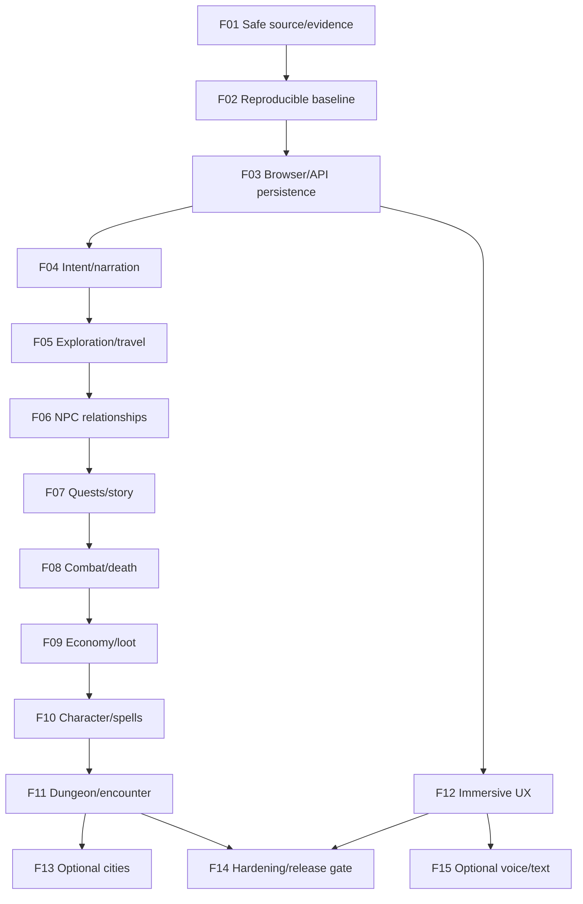

# AI-DND — Future Project Bible v2
## Vizyon • 15 Gelecek Phase/Patch • Kabul Anayasası • Değişiklik ve Yeni Fikir Protokolü

**Belge kodu:** `AI-DND-FPB-2.0-PROPOSED`  
**Tarih:** 9 Ekim 2026  
**Durum:** **TASLAK / OWNER APPROVAL REQUIRED — UYGULAMA YETKİSİ DEĞİLDİR**  
**Dil:** Türkçe; dosya, API, test ve sözleşme adlarında teknik İngilizce kullanılabilir.  
**Çalışma hattı:** Yerel Windows → Cursor (birincil uygulama), Codex (bağımsız inceleme/uygulama), ChatGPT (mimari, kabul ve koordinasyon) → Python/FastAPI/SQLite → yerel Ollama/Qwen → gerçek Experience web istemcisi. **Replit kullanılmaz.**

> **Önemli adlandırma:** Bu belge, mevcut `AI-DND_Master_Handoff_v3_Project_Bible.md` belgesini geri almaz, yeniden adlandırmaz, geriye düşürmez veya yürürlükten kaldırmaz. `v2`, yalnızca **geleceğe dönük yol haritası belgesinin kendi sürümüdür**. Mevcut v3 mimari/handoff otoritesi ile resmî D&D/Forgotten Realms kaynak öncelikleri korunur. Eski Phase 0–9 ve Stage 10A/10B kayıtlarına yeni tarihsel anlam atanmaz. Aşağıdaki **F01–F15**, ileriye dönük *önerilen* kimliklerdir; fazlar ancak ayrı owner kabul sözleşmeleriyle aktif olur.

---

# I. Yönetici özeti ve karar haritası

## I.1 Bu belge neden var?

AI-DND'nin amacı birbirinden bağımsız yeşil testler üretmek değil, **uzun süre oynandığında da tutarlı kalan, Forgotten Realms'te geçen gerçek bir D&D macerası** sunmaktır. Stage 10A/10B'nin öğrettikleri açık: çalışan kod ile doğrulanmış kabul, tek bir testle tüm oyun, model çıkışı ile kampanya kanonu, bir Git HEAD ile kirli çalışma ağacındaki tam kaynak snapshot'ı aynı değildir. Başlangıç kabul sözleşmesi kaybolmamalı; başarısız koşular korunmalı; kısmi PASS tam sürüm PASS'e dönüşmemelidir.

Bu Bible dört görevi birlikte görür:

1. **Ürün pusulası:** Hangi RPG deneyimini inşa ediyoruz, neleri bilerek yapmıyoruz?
2. **Mimari anayasa:** Python, lore authority, campaign events, Qwen ve frontend yetki sınırları nedir?
3. **Gelecek portföyü:** En az on aşamanın hedefi, sırası, bağımlılığı ve somut kabul kapısı nedir?
4. **Yaşayan ama kontrollü plan:** Sonradan gelen fikir, deneysel patch, hotfix veya öncelik değişikliği hiçbir eski sözleşmeyi sessizce bozmadan nasıl eklenir?

## I.2 Bilinen durum ile öneri arasındaki duvar

| Etiket | Kesin anlamı |
|---|---|
| `REPORTED-HISTORICAL` | Handoff veya kullanıcı raporunda bir tarihte gözlenmiş sonuç; bugün yeniden koşturulmuş sayılmaz. |
| `VERIFIED-IN-THIS-DOCUMENT` | Bu belgenin oluşturulması sırasında bizzat açılarak incelenen kaynak dosyası/metni. Oyun testinin PASS'i değildir. |
| `FROZEN-APPROVED` | Owner'ın belirli tam dosya sürümünü açıkça kabul ettiği, hash'i ve kapsamı saklanan sözleşme. |
| `PROPOSED` | Gelecek plan; mevcut ürün özelliği, onay ya da başlamış geliştirme değildir. |
| `NOT TESTED` | Kontrol çalıştırılmadı; yok sayılarak PASS yapılamaz. |
| `BLOCKED` | Gerekli meşru mekanik, veri, karar ya da ortam yok; güvenlik kuralını delerek doldurulamaz. |
| `FAIL` | Çalıştırılan belirli kabul kontrolünün gerçek sonucu beklenene uymadı. |
| `PASS — SCOPED` | Yalnız tanımlı senaryo ve kaynak snapshot'ı için ispatlanmış başarı. |
| `UNCONFIRMED` | Olası olay raporu var, kök neden/tekrarlanabilirlik yok. |

**9 Ekim 2026 bağlamında raporlanan durum:** Stage 10A `reconstructed local acceptance: PASS / OWNER-APPROVED / CLOSED`; Stage 10B'nin yerel kabulünde 296 lore/API/persistence/weather ve 634 zorunlu seçici yürütmesi exit 0, ilgili sahne/Qwen/tarayıcı/çatışma kanıtları handoff'larda kayıtlı. Bu **tüm repository veya production sertifikası değildir**. Stage 10A'nın özgün tam kabul listesi bulunamamıştır. S10B-INV-001 tarihsel HTTP 500, `UNCONFIRMED` kalır. Merge, production, şehir aktivasyonu ve bir sonraki tarihsel Phase 9 için otomatik izin yoktur. Bu Bible bunları olmuş gibi iddia etmez.

**Git/evidence riski, tarihsel rapor:** `phase8/emergent-storytelling-expansion`, tarihsel HEAD `f63d952506064cd59e960f1e3efa6627d4e52053`; 129 daraltılmış dirty statü, 176 açılmış yol, 17 anlamlı tracked diff, 91 untracked, 68 içerikçe aynı görünen tracked yol; `.local/evidence` ignore edilmiş ve bağımsız kopyası doğrulanmamış. `core.autocrlf=true` ile Castle Ward ve `pack_index.json` pinli CRLF baytları başka checkout'ta kırılabilir. Bu değerler **yeni çalışma başında tekrar ölçülmelidir**. Commit/push/merge hiçbir durumda bu belgenin onayıyla otomatik açılmaz.

## I.3 Ana ürün vizyonu — Oyuncunun hissetmesi gereken şey

> *“Ben Neverwinter'a döndüğümde, beni tanıyan birinin gözlerindeki değişimi, verdiğim sözlerin bedelini ve geçen zamanın dünyaya etkisini hissediyorum. Zarlar beni her zaman kurtarmıyor; oyun verdiğim kararları hatırlıyor. Bir sohbet botuyla değil, yaşayan bir Forgotten Realms macerasıyla karşı karşıyayım.”*

**Beş ürün sütunu:**

- **Ajans ve sonuç:** Oyuncu özgür niyet bildirir; oyun desteklenen eylemi dürüstçe çözer. Başarı gibi başarısızlık da anlamlıdır. `Continue` oyuncunun yerine seçim yapmaz.
- **Sürekli dünya:** Kişiler yalnız bildikleri bilgileri hatırlar, olayların sonuçları persist edilir; yoldan dönünce aynı yer aynı kimliği korur. İki kampanya birbirine bulaşmaz.
- **Gerçek D&D:** 2024 kurallarındaki mekanikler, check'ler, combat ve ilerleme Python tarafından çözülür; Qwen bunları değiştiremez.
- **Faerûn'a sadakat:** 1501 DR baseline ve güncel setting kitapları esas alınır; olası macera geçmiş olay değildir; çelişki açık kaydedilir.
- **Sinema hissi, mekanik dürüstlük:** Sahne; sıcak, görkemli, gergin ya da korkutucu olabilir. Atmosfer katmanı sahte görev, eşya, kişi bilgisi, hava ya da savaş sonucu yaratamaz. Oyun arayüzü dashboard gibi görünmez.

### North Star oyuncu yolculuğu (HEDEF, uygulanmış olduğu iddiası değil)

Karakter kimliği ve seçimleri → Forgotten Realms'te anlamlı başlangıç → keşif ve yön bulma → doğrulanmış NPC ilişkileri → gerçek görev/ikilem ve sonuç → kurallı encounter → sürdürülebilir envanter/ilerleme → kampanya kaydet/kapat/aç → aynı dünya gerçeğinden devam. Oyuncu `Python`, `model`, `server`, `backend`, `debug`, `canonical record` ya da altyapı hatası jargonunu macera metninde görmez; teknik inceleme yalnız yönetici/test yüzeyinde yapılır.

### Başarı metrikleri — sayılar şimdilik öneri, onaylanmadan release kapısı değil

- **Doğruluk:** Mekanik, state, lore ve UI uyumsuzluğu kabul senaryolarında sıfır olmalı; bir adet gerçek doğruluk ihlali FAIL.
- **Model güvenliği:** Her oyuncu turunda 0–2 gerçek çağrı; reddedilmiş anlatımda 0 model retry.
- **Süreklilik:** Tanımlı tüm save/restart ve çoklu kampanya sınırları için eşitlik kanıtı.
- **Deneyim:** Manuel incelemede kampanya state'ini çarpıtmayan akıcı anlatım, teknik kelime sızıntısı ve yanlış NPC hitabı yok.
- **Performans:** Her yeni patch için p50/p95 browser input→API→render, model latency, storage commit ve memory baseline ölçülür; kabul edilen tolerans patch sözleşmesinde sayı olarak sabitlenir. Ölçülmeyen performans PASS değildir.
- **Dayanıklılık:** İzin verilen idempotent istek tekrarı yeni zar/hasar/ödül üretmez; geçersiz istek state'i bozmaz.

---

# II. Değişmez mimari anayasa ve kaynak otoritesi

## II.1 Beşlü yetki zinciri

```text
PLAYER INTENT
   ↓
Python validates and resolves authoritative game mechanics/state
   ↔ Lore authority supplies verified setting facts, not outcomes
   ↓
Accepted campaign events/persistence define this campaign's past
   ↓
Optional Qwen intent + bounded grounded narration (never canon author)
   ↓
Frontend presents authoritative state and verified narrative
```

1. **Python:** canonical state, RNG, attacks, HP, combat, initiative/action economy, spells/conditions, distance, time, weather owner, NPC memory, inventory, currency, quest offers/status, event acceptance, save/load, rollback/idempotency, isolation.
2. **Lore authority:** mevcut Forgotten Realms kaynak hiyerarşisinin setting doğruları; lore provenance/admission pin/era/restriction denetimi. Lore evren olgusunu belirler ama hiçbir macera sonucunu yaşanmış yapmaz.
3. **Campaign canon:** yalnız ilgili kampanyanın engine tarafından kabul edilmiş ve persist edilmiş event/state gerçekleri. Published adventure sonuçları otomatik geçmiş sayılmaz.
4. **Qwen:** en fazla iki çağrı/tur; niyeti anlayabilir, Python kararı sonrası doğrulanmış bağlamı anlatabilir. Zar, görev sonucu, eşya, hasar, yeni resmi NPC/lore veya save gerçeği yazamaz. Gate reddederse deterministic fallback; **retry yok**.
5. **Frontend:** gerçek `artifacts/ai-dnd-experience/src/pages/game-browser.tsx` ve ilişkili sunum bileşenleri mevcut kontratı kullanır; state üretmez. Teknik / debug yazılarını oyuncuya sızdırmaz.

**Özel sınır:** Python'un doğrudan combat veya karakter/lore sorgu yanıtının 0 model çağrısı geçerlidir. Çağrı sayısını doldurmak için Qwen çağrılmaz. `model timeout` öncesi ve çözülmüş sonuç sonrası arıza davranışı her patch'te mevcut transaction owner'a ve kabul sözleşmesine göre incelenir; genel rollback kuralı rastgele değiştirilmez.

## II.2 Kaynak önceliği ve çelişki politikası

| Alan | Otorite | Sınır / çatışma politikası |
|---|---|---|
| Bu kampanyada ne yaşandı? | Persisted campaign state + accepted events | Retcon yalnız owner onayıyla; örnek adventure canon değil. |
| Genel mekanik | PHB 2024, DMG 2024, yüklenmiş Monster Manual edition | Specific setting-specific rule genel kurala üstün olabilir; actual resolution Python. |
| Güncel Forgotten Realms | `Forgotten Realms: Heroes of Faerûn`; `Adventures in Faerûn` (bölünmüş PDF'ler) | 1501 DR baseline; yıl/edition/context ve source page kaydı; eski materyal sessiz override yapamaz. |
| Tarihsel/ek kaynaklar | Daha eski FR kitapları ve published adventures | Kaynak sınıflandırması: current setting / history / hypothetical adventure / rule addition / opinion. |
| Mühendislik | Mevcut proje talimatı + Master Handoff v3 + onaylı patch sözleşmesi | Oyun/lore kaynaklarını override etmez; roadmap önerileri runtime hakikat değildir. |
| Yeni oyun durumu | Python ownership + campaign-event acceptance | Qwen/React/tesadüfi narration bunu üretemez. |

**Çatışma kaydı zorunlu alanları:** `CF-ID`, iki kaynak/edition/sayfa, tarih/era, claim, kampanya ile ilişki, provisional karar, hangi katman yetkili, owner'a sorulan seçenekler, kabul tarihi, çözüm/retcon ID; açık çatışma saklanır, yaratıcı uydurma yapılmaz.

**Lore belge bütünlüğü:** Exact SHA-256 ve dosya baytları contract'tır. Castle Ward CRLF ve `pack_index.json` gibi pinli dosyalarda Git line-ending dönüşümü hassastır; `-text` gibi dosyaya özel çözüm ancak exact-byte Git storage/portable checkout kanıtıyla onaylanır. Belge onayı ≠ lore admission ≠ şehir aktivasyonu ≠ campaign canon. `OWNER_APPROVED_CONTINUITY` resmi source tier olmaz; runtime/official flags false kalır.

## II.3 Kesin yasaklar

- Sessiz `game.py` yeniden yazımı, mekanik ownership devri veya oyuncu namına model çözümü.
- Model-call ceiling yükseltme; red sonrası model retry.
- Doğrulanmamış lore, quest, NPC geçmişi, tavern/venue, fiyat, ödül, envanter veya hava bilgisini canon'a geçirmek.
- Oturumun state'ini varsayılan `_DEFAULT_SESSION` üzerinden yanlış serialize edip farklı kampanyaya sızdırmak.
- UI'nin client timing/roll/guess ile HP, hava, quest, economy veya movement doğrusu üretmesi.
- Retcon/migration/şehir aktivasyonu/production/commit/push/merge/force-push/reset/clean/stash işlemlerini roadmap onayı saymak.
- Testin FAIL kanıtını silip tek yeşil son koşuyu bırakmak; eski handoff'u üzerine yazmak.
- Yeni fikri, test kapsamını veya model davranışını onaysız şekilde mevcut frozen sözleşmeye eklemek.

---

# III. Proje portföyü, bağımlılık ve gelişim dizisi

## III.1 Fazların adlandırma kuralı

Önerilen yol haritası **F01–F15** olarak adlandırılır; `F` = *Future Roadmap*. Bunlar mevcut tarihsel `Phase 9`, `Stage 10A/B`, `Phase A/B` ya da repository build numarası yerine geçmez. Owner isterse ileride yayın sürümlerine resmi mapping ayrı RFC ile yapılır. Her F fazı küçük `Fxx-P01`, `Fxx-P02` paketlerine; her paket kararlı `Fxx-AC-001` kabul kimliklerine ayrılır. `FX-YYNNN` ise beklenmeyen **yeni fikir/patch** kayıtları içindir (bkz. Bölüm VI).

### Tek satırlık portföy

| Faz | Ana hedef | Gate / bağımlılık | Başlatma kararı |
|---|---|---|---|
| **F01** | Kanıt, Git bayt taşınabilirliği ve yedek | Stage 10B mevcut yerel snapshot | Ayrı owner approval |
| **F02** | Bütün-repo durum envanteri ve reproducibility | F01 kanıt ve restore yolu | Ayrı owner approval |
| **F03** | Browser–API oturum ve transaction güvenilirliği | F01–F02 | Ayrı owner approval |
| **F04** | Oyuncu niyeti, anlatı ve DM sürekliliği | F02–F03 | Ayrı owner approval |
| **F05** | Keşif, yolculuk, kampanya zamanı/hava | F03–F04 | Ayrı owner approval |
| **F06** | NPC ilişkileri, hafıza, faction sonuçları | F03–F05 | Ayrı owner approval |
| **F07** | Gerçek görev, event ve macera örgüsü | F06 + lore admission | Ayrı owner approval |
| **F08** | Combat/encounter derinlik ve ölüm döngüsü | F03–F07 | Ayrı owner approval |
| **F09** | Ekipman, loot, shops ve ekonomi | F07–F08 | Ayrı owner approval |
| **F10** | Character creation, sınıflar, büyü, progression | F08–F09 + rules review | Ayrı owner approval |
| **F11** | Authored dungeons ve prosedürel macera bağlama | F05–F10 | Ayrı owner approval |
| **F12** | İmmersive UI/UX, accessibility ve mobile | F03 stabil + ilgili alanların API sözleşmesi | Ayrı owner approval |
| **F13** | World-scale expansion ve şehir readiness | F07/F11 + lore provenance | **Şehir başına özel owner approval** |
| **F14** | Uzun kampanya, güvenlik, performans, release hazırlığı | F01–F13 seçili onaylı kapsam | Ayrı owner approval |
| **F15** | Opsiyonel voice-to-text ve metin yardımcısı | **Phase 8 tamamen kapandıktan sonra**, F12 | Ayrı owner approval |

Bu bir **hedef sıralaması**, bütün içeriklerin zorunlu yapılacağı vaadi değildir. F13 ve F15 özellikle isteğe bağlıdır. F14 belirli milestone'larda F08–F13 tamamlanmadan da sadece o güne dek onaylı kapsama yönelik release readiness sağlayabilir; bu karar acceptance amendment ile belgelenir. Sahiplik kuralları F fazlarının hepsinde geçerlidir.

## III.2 Yüksek seviye bağımlılık haritası



**Kontrollü paralellik:** F12'nin yalnız frontend sunum işi, başka fazın aynı dosyalarına dokunmadan yürüyebilir. F03/F04 ve F10/F11 gibi owner'ı çakışan işler paralel yazılmaz. “Bağımsız” ifade eden iki paket bile kabul sözleşmeleri aynı source SHA'ya bağlı değilse eşzamanlı merge edilemez.


---

# IV. Ayrıntılı faz sözleşmeleri — F01–F15

> **Her faz için okuma kuralı:** Aşağıdaki AC maddeleri yalnız *önerilen başlangıç kabul taslağıdır*. Faz başlamadan önce mevcut source/state ile yeniden doğrulanır, gerekiyorsa ölçülebilir alt maddelere bölünür, tam sürümlü `ACCEPTANCE_CONTRACT_v1` olarak owner tarafından açıkça imzalanır. Sonraki FAIL, bu Bible'ın izin verdiği yeni özellik gerekçesiyle otomatik PASS sayılamaz.

## F01 — Kanıt ve kaynak güvenliği: geri döndürülebilir başlangıç

**Oyun değeri:** Aylarca geliştirilen kalıcı maceranın kodu, lore kanıtı ve save testleri yanlış bir Git veya disk işlemiyle kaybolmaz. Geliştirici bakımının oyuncu kayıtlarını riske atma ihtimali düşer.

**Başlangıç sorusu:** Stage 10A/10B yerel PASS'i hangi *gerçek içerik* üzerinde doğrulandı ve aynı baytlar başka checkout'ta yeniden üretilebilir mi?

**Önerilen paketler:**

- `F01-P01 / Envanter`: Dirty worktree'de gerçek byte diff, line-ending phantom, untracked modül, generated/ignored dosya, gizli bilgi ve mevcut evidence envanteri. Git HEAD tek başına snapshot kimliği değildir; source-hashes + branch + dirty statü eklenir.
- `F01-P02 / Evidence backup`: `.local/evidence` için SHA-256 manifest, şifre/sır sızıntısı taraması, tercihen ikinci fiziksel disk veya güvenli uzak depolama, **orijinal + bağımsız kopyanın iki hash karşılaştırması**. Aynı diskte ikinci klasör tam felaket yedeği sayılmaz.
- `F01-P03 / Pin portability`: Castle Ward, `pack_index.json`, frozen Neverwinter kaynakları; mevcut `core.autocrlf` / `.gitattributes` analizi; yalnız tam path'e uygulanacak Git bayt koruması; staging/commit onaylanmadan index'e yazma yok.
- `F01-P04 / Publication readiness`: Gereken lore provenance dosyaları ve taslaklar ayrılır; path-driven dependencies kontrol edilir; machine-specific path içeren handoff'ların orijinali korunup sanitized successor önerilir; commit grupları yalnız öneri olur.

**Kod/otorite sahipleri:** `.gitattributes`, Git config (read-only inceleme), lore manifests/admission yalnız hash okunması, documentation inventory. `game.py`, lore kaynağının anlamı, save schema ve pin değeri **değişmez**. Cursor uygulama hazırlığı; Codex exact-byte bağımsız kontrol; owner her Git yazma/push işlemi için ayrı izin.

**Başlangıç koşulu:** İçerik SHA'ları alınmış ve üzerinde kimsenin eşzamanlı dosya yazmadığı doğrulanmış worktree.

**Önerilen acceptance:**

- `F01-AC-001`: Kritik kaynak/evidence envanteri tamdır; ignored/untracked dahil; 1:1 dosya ↔ digest eşlemesi vardır.
- `F01-AC-002`: Pinned Castle Ward ve pack index baytları hedef SHA-256'yı farklı işletim sistemi checkout örneklemesinde tutar; yalnız working-tree digest'i PASS değildir.
- `F01-AC-003`: Bağımsız yedek okunabilir ve manifestten örnek değil **tüm kapsam** hash'leri eşleşir; hedef yoksa `BLOCKED`.
- `F01-AC-004`: Korunacak/ileride yayınlanabilecek/excluded yol listesi için bağımsız review ve açık kullanıcı kararı vardır.

**Negatif durumlar:** `autocrlf` baytı değiştirirse fail closed; eski hash beklenen metin ile tutmazsa pin çevrilmez; `git add -A`, `clean`, `reset`, `checkout restore` yasağı; snapshot'ın üzerinde çalışan başka agent varsa STOP.

**Kanıt:** `evidence/F01/<run-id>/raw-vs-git-digests.json`, `backup-manifest.json`, `diff-inventory.csv`, `publish-scope.md`, redacted `git-status.txt`, bağımsız hash report. **Durdurma:** doğrulanmamış backup, pin mismatch, gizli bilgi veya izinsiz Git staging. **Performans:** büyük evidence işlemleri için transfer/checksum süresi ve boş alan ölçülür; sonuç hızla değil bütünlükle kabul edilir.

## F02 — Reproducibility ve gerçek tüm-repo tabanı

**Oyun değeri:** Bir geliştirme makinesinde “yeşil” olup başka makinede açılmayan oyun riskini azaltır; tasarım genişlemeden gerçek mevcut kaliteyi görürüz.

**Paketler:**

- `F02-P01`: Windows, Python/npm sürümleri, bağımlılık kilit dosyaları, Ollama sürüm/model tag, SQLite/OpenAPI kontratı, startup script ve gerçek Experience istemci yolu envanteri. Secret'lar rapora yazılmaz.
- `F02-P02`: Seçili eski Stage 10A/10B testleri ile tüm-repository keşfi **ayrı** değerlendirilir. `unittest discover` veya proje `development_checks.json` seçicilerinin tam kapsamı belgelenir; tarihsel 296/634 sayıları yeni koşu sayılmaz.
- `F02-P03`: clean-room / disposable copy üzerinde bağımlılık, import, generated code ve locale/CRLF farklarının en az bir yeniden üretim testi. Kaynak dosyalarının byte eşitliği önce kanıtlanır.
- `F02-P04`: Mevcut açık kusurların kayıt defteri. Tarihsel, yeniden üretilemeyen HTTP 500 `UNCONFIRMED`, tekrarlanırsa traceback ve somut kapsamla bug'a dönüştürülür.

**Owner:** build/test tooling, local startup/OS environment, read-only repo analysis; gameplay davranışına dokunulmaz. Değişiklik gerekiyorsa ayrı minimal “build compatibility” patch açılır.

**Acceptance:**

- `F02-AC-001`: source manifest, lockfile/env manifest, exact run commands ve exit codes ile bir makinede testi tekrarlamak mümkündür.
- `F02-AC-002`: `selected regression`, `full discovery`, `browser`, `live Qwen`, `manual review` test türlerinin her biri ayrı sonuç gösterir; koşulmayanlar NOT TESTED.
- `F02-AC-003`: F01 pinlerinin paketlerken/kurarken bozulmadığı gösterilir.
- `F02-AC-004`: Başlangıç kritik bug listesi her kayıt için `confirmed/unconfirmed`, sahibi, tekrar adımı, risk ve gerekli gate taşır.

**Negatif:** Eksik test modülü import error verirse skip ile örtülmez; localhost Ollama yokken “live Qwen PASS” yazılmaz; build PASS'i oyun PASS değildir. **Kanıt:** `run-matrix.yaml`, `dependency-manifest.json`, `logs/`, `repro-check.md`, `source-hashes.json`. **Durdurma:** edit gerektiren destructif restore, izin verilmeyen CI credential veya kaynak pin değişimi. **Performans:** cold/warm build ve başlatma zamanı baseline olarak saklanır; sonraki fazlarda regresyon eşiği ayrıca onaylanır.

## F03 — Gerçek tarayıcı oturumu, transaction ve devamlılık

**Oyun değeri:** Oyuncu turunu iki kez yanlışlıkla uygulamadan, kampanya değiştirdiğinde eski oyunun cevabını görmeden, sayfa yenilemesinden sonra macerasına devam eder.

**Paketler:**

- `F03-P01`: Gerçek Experience `game-browser.tsx` / ilgili hook → FastAPI → Python → SQLite → API public projection → UI render alanlarının tek tek izlenmesi. İstemci preview veya eski `ai-dnd-web` ile karıştırılmaz.
- `F03-P02`: action_id replay: aynı payload tek resolution, farklı payload conflict, eşzamanlı double-click/Enter, response geçikmesi, browser retry; idempotency sahibi `session_manager`, `campaign_store`, `core_resolution` korunur.
- `F03-P03`: refresh, campaign switching, in-flight response invalidation; ekran A'dan gelen geç cevap B'nin karakter/HP/narration state'ini değiştiremez.
- `F03-P04`: rollback, disk hatası, API process kill, model availability ayrımı; yürütülmüş turn ile commit edilmiş event sınırı belgelenir.

**Owner:** API and persistence owners; frontend yalnız session-scoped presentation. Save/schema değişikliği ayrı RFC gerektirir; callback veya UI canonical write yasak.

**Acceptance:**

- `F03-AC-001`: HP, XP, inventory, time, location, combat, shop, quest, NPC, narrator text, active campaign identity görünen UI ile aynı API `campaign_id` state'indedir.
- `F03-AC-002`: Dört idempotency/replay tipi turlar/zarlar/ödüller için tekrar oluşturmamayı kanıtlar.
- `F03-AC-003`: Browser refresh/restart active combat dahil aynı battle ID/HP/action economy'yi taşır; farklı kampanya kaydı erişemez.
- `F03-AC-004`: Save başarısızlığında mevcut transaction owner'ın bildirdiği rollback sınırı korunur; kısmi state/no duplicate yoktur.
- `F03-AC-005`: API/Qwen unavailable kullanıcıya anlaşılır mesaj verir ama yeni lore/mekanik gerçek üretmez.

**Negatif:** HTTP200 fakat save commit edilmemiş; 503 geldiğinde işlenmiş turn yeniden yürütülmüş; browser B'de A'nın delayed reply; contextvar session leak; yanlış id'nin NPC hafızasını açması. **Kanıt:** çalışan tarayıcı video/screenshot (gizli bilgi redacted), request/response correlation IDs, isolated SQLite state diff, model phase traces, restart logs. **Durdurma:** save incompat, isolation bug, idempotency guarantee kaybı; migration/protokol genişletmesi onaysız yok. **Performans:** request latency p50/p95, DB lock duration ve duplicate ratio baseline.

## F04 — Niyet anlayışı, grounded anlatı ve Dungeon Master sürekliliği

**Oyun değeri:** Oyuncunun normal Türkçe komutu yanlışlıkla yeni dükkân, NPC veya görev yaratmaz. Zar sonucunu veren anlatım canlı fakat dürüsttür.

**Paketler:**

- `F04-P01`: Türkçe/İngilizce serbest eylem niyeti; açık action vs inquiry vs refusal vs hypothetical. `find merchant` ≠ `create shop`; `tavernaya gidiyorum` ≠ yalnız tavern bilgisi sormak.
- `F04-P02`: Known/unknown vocative, NPC stable target, explicit name disclosure and historical recall; anlatımın memory poisoning'e dönüşmemesi.
- `F04-P03`: Skills, exploration, encounter, combat doğrulanmış sonucu; başarılı Investigation'ı belirsizlik diye gizleme, başarısız investigation'ı başarılı anlatma.
- `F04-P04`: Optional storyteller: state-aware texturization, no claim creep; narrator voice/POV, Türkçe dil tutarlılığı ve gerektiğinde Python fallback'in güzel ama dürüst olması.
- `F04-P05`: *İsteğe bağlı tasarım* `Continue` / `Wait` / `Suggestion`: Continue oyuncu yerine karar/konum/commitment yapamaz; suggestion tıklanana kadar state değiştirmez. **Bu alt paket aktivasyonu ayrıca sözleşme onayı ister.**

**Owner:** `game.py` current routing, `local_dialogue.py`, `living_world.py`, `resolved_presentation.py`, narrative gate; model direkt mechanics owner değil. Bug fix `game.py` wholesale rewrite demek değildir.

**Acceptance:**

- `F04-AC-001`: Tek seferde iki model çağrısını aşan turn yok; redden sonra **sıfır ek Qwen çağrısı**.
- `F04-AC-002`: Karma intent, inquiry, negation ve entity reference alt durumlarında sadece meşru Python eylemi state değiştirir.
- `F04-AC-003`: False memory/lore/quest/shop/progression iddiası canonical state'e geçmez; bilinen hedef doğru NPC'dir.
- `F04-AC-004`: True/failure/critical resolution narration, gerçek zar, HP/konum ve verified lore ile çelişmez; manual review zorunludur.
- `F04-AC-005`: Gerçek Qwen çıktıları ve deterministic fallback birbirinden ayrılmış izlerle, human narration PASS kayıtlıdır.

**Negatif:** Dar safety gate güzel ama uydurma prose'u kabul ederse FAIL; model kapalıyken mekanik yanlış çözülürse FAIL; no-op dialogue'nin beklenen history bookkeeping'i ile gameplay mutation birbirine karıştırılmaz. **Kanıt:** multi-seed bounded turn traces, gate reject/fallback matrix, human reviewer samples, no-retry call sequence. **Durdurma:** model prose state write, false NPC, over-budget, save history poisoning. **Performans:** narration size/latency/token footprint baseline; daha fazla Qwen kullanımı otomatik kalite sayılmaz.

## F05 — Keşif, seyahat, kampanya saati ve hava sürekliliği

**Oyun değeri:** Han kapısından çıkmak saatler süren bilinmeyen bir yolculuk olmaz; ormanda yürüyüşün zamanı, mesafesi ve çevre koşulları makul ve kayıtlıdır.

**Paketler:**

- `F05-P01`: Scene graph: parent/exit, local venue identity, repeated entry, valid/invalid movement. Basit `tavern`, `forest`, `castle` template'lerine keyfi parent/travel time eklenmez.
- `F05-P02`: Location anchors ve timed travel: mevcut Python route owner meşru evidence/route yoksa mesafe uydurmaz; validated route varsa doğru world clock ilerler.
- `F05-P03`: Weather/environment/time-of-day only authoritative projection; `weather=unknown` ile `clear` default ilişkisi belgelenir. Oyuncuya gösterilen hava alanı gerçekten API state ile eşleşir.
- `F05-P04`: Ambient BLUE events/referents ile gerçek entity/event separation; görsel tema metadata'yı sunar, kaynak olmaz.

**Owner:** `living_world`, `timed_gameplay`, location owners, public world metadata, Experience presentation. Engine hour/day writes Python'dan; frontend saat üretemez.

**Acceptance:**

- `F05-AC-001`: Giriş–çıkış–yeniden giriş aynı stable venue ID ve doğru parent'a döner, gereksiz duplicate yoktur.
- `F05-AC-002`: Tanımsız rota için yolculuk süresi/mesafesi konulmaz; doğrulanmış rota authoritative elapsed/time ile uyumludur.
- `F05-AC-003`: Combat active veya movement yasakken lokasyon değişmez; action economy sözü gerçek.
- `F05-AC-004`: Hava için “dolu API”, “boş API” ve “unknown API” ayrı browser kanıtı vardır; live ve sentetik fixture etiketleri karışmaz.
- `F05-AC-005`: Restart sonrası location/time/weather/scene referent state ve UI aynı kalır.

**Negatif:** unbound scene template parent yazma, aynı yere iki tavern üretme, UI'nin duvar saatini kampanya zamanı sanması, farklı region'a bedava teleport, combat sırasında local exit. **Kanıt:** route graph fixture + canlı Neverwinter turu, serialized snapshot diff, movement-denial negative traces, browser weather observations. **Durdurma:** undefined route / persistence owner change. **Performans:** çok lokasyonlu lookup ve movement evaluation, uzun save büyümesi baseline.


## F06 — NPC hafızası, ilişkiler, faction aidiyeti ve kampanya sonuçları

**Oyun değeri:** Bir NPC oyuncunun daha önce ne söylediğini hatırlar, bilmediği adı kullanmaz, ilişkiler ve faction tepkileri kampanyaya özgü bir geçmişten doğar. Her karşılaşma aynı generic sohbet değildir.

**Paketler:**

- `F06-P01`: NPC kimliği: stable ID, visible vs hidden name/role, real location, active interlocutor, legacy save görünürlüğü. Kişi “Sade pelerinli” diye betimlense bile bu appearance otomatik kişisel ad olmaz.
- `F06-P02`: Player-origin disclosures, individual NPC-scoped memories, verified interaction events, unknown historical claims. `Arven`in npc_001'de kayıtlı olması npc_002'ye kopyalanmaz.
- `F06-P03`: Relationship ve reputation: sadece Python tarafından kabul edilmiş conversation/action/event evidence; tablo/score için yetki sahibi belli olmadan yeni relationship state yazılmaz.
- `F06-P04`: Faction bilgisi: official lore faction existence ≠ oyuncunun membership veya faction quest'i. Faction stance yalnız campaignde kabul edilmiş olaylarca etkilenebilir.
- `F06-P05`: Restart, duplicate dialogue, NPC displacement, identity alias, session-crossing ve transcript contamination sınırları.

**Owner:** NPC memory, dialogue, relationships, lore facts, persistence. Qwen yalnız teyit edilmiş ilişkileri açıklar; gerçek faction score engine'e aittir.

**Acceptance:**

- `F06-AC-001`: Açık ad bildirimi doğru stable NPC ID'de persist olur; restart sonrası doğru NPC hatırlar, diğerleri bilmez.
- `F06-AC-002`: Belirsiz/olmayan hitap yetkisiz aktif barmene yönlendirilmez; clarification veya invalid target, no memory mutation.
- `F06-AC-003`: Faction/reputation değişimi varsa accepted event ve exact state diff'e bağlıdır; model prose kaynak değildir.
- `F06-AC-004`: Eski save ve iki eşzamanlı kampanyada persona/name/role sızıntısı yoktur.
- `F06-AC-005`: NPC'nin konuşma tarihçesi tutmasının meşruluğu ile yanlış isim öğrenmesi ayırt edilir; “memory list completely empty” gibi yanlış test önermeyiz.

**Negatif:** oyuncunun yanlış geçmiş iddiasını onaylamak, yanlış konumdaki NPC ile tanışmış saymak, unknown NPC kimliğini reveal etmek, published NPC'nin kampanya ölümünü adventure kitabından varsaymak. **Kanıt:** per-NPC memory diff, event provenance, same-session/restart/multi-session and UI label matrix, manual multi-turn dialogue review. **Durdurma:** Qwen memory owner'a yazma veya faction canon invention. **Performans:** 10/100/1000 interaction corpus'ta memory retrieval/selectivity ve persistence boyutu ölçülür, threshold sözleşmede belirlenir.

## F07 — Görev, hikâye yöneticisi, event ve oyuncu ajansı

**Oyun değeri:** Oyuncu gerçek bir amaç peşinde ilerler; görevler Qwen'in rastgele “meyhanede iş var” demesiyle değil, kabul edilmiş olaylarla doğar. Her kararın sonucu saklanır; taraflar, zaman ve NPC ilişkileri macerayı etkiler.

**Paketler:**

- `F07-P01`: Offer vs accepted vs completed vs failed vs rumor vs hint ayrımı; quest catalog boşken negatif yanıt meşrudur. Quest creation teklif mekanizması gerçek Python owner bulunduktan sonra düşünülür.
- `F07-P02`: Event eligibility: hangi meşru konum/özellik/NPC/campaign durumundan quest/incident tetiklenebilir? Çakışan accepted campaign events duplicate olmadan persist edilir.
- `F07-P03`: Story arcs ve NPC/world reaction: mevcut `adventure/`, `incidents/` modüllerinin kanıtlı kontratı incelenir; yeni lore, mission history veya historical faction event yazılmaz.
- `F07-P04`: Choice/consequence, deadlines and time: gerçekte kabul edilen seçimle aktarılan risk ayrılır; model bir tavsiyeyi oyuncu taahhüdüne çeviremez.
- `F07-P05`: İsteğe bağlı published adventure module: metindeki olaylar *olasılık* olarak kalır; NPC ölümleri/zaferler yalnız gerçek campaign events ile oluşur.

**Owner:** Python quest/event/incident owners, game time, persistence; lore authority yalnız setting facts. Qwen motive edici anlatımı grounded context üzerinden kurar.

**Acceptance:**

- `F07-AC-001`: Kayıtlı olmayan offer veya quest model tarafından invented active mission olarak sunulmaz; accepted/offer sorguları birbirine karışmaz.
- `F07-AC-002`: Offer→accept→progress→complete/fail lifecycle, her değişimde Python-authorized event ve correct journal state ile bağlantılıdır.
- `F07-AC-003`: Aynı trigger/action_id tekrarı yeni görev/ödül/XP yazmaz; farklı kampanya izolasyonu vardır.
- `F07-AC-004`: Published adventure outcome campaign history'ye eklenmez; lore classification ve provenance kaydı korunur.
- `F07-AC-005`: Choice sonuçları ve NPC/faction etkileri save/restart ardından tutarlı kalır; zamanlı görev varsa Python clock owner doğrulanır.

**Negatif:** “bir görev duydum” => actual offer, geçmiş macera olmuş sayılması, görev tamamlanmadan ödül alınması, reddedilen quest hakkında Qwen'in kalıcı log üretmesi. **Kanıt:** quest transition tables, authored trigger trace, duplicate HTTP replay, event stream/save diff, lore review, manual quest experience. **Durdurma:** original Stage 10B gibi “her şeyi doğrulayan genel test” yerine her yeni quest tipinin özel source/rule acceptance'ı yoksa BLOCKED. **Performans:** quest evaluator ve event fanout p95, event log boyutu, revisit maliyeti.

## F08 — 2024 kurallarına bağlı combat, encounter ve ölüm döngüsü

**Oyun değeri:** Saldırı, büyü, hareket ve hayatta kalma için gerçek risk vardır; 20 doğal zar anlamlıdır ama oyuncunun niyetinden bağımsız bir masal sonucuna dönüşmez. Düşmanların hamleleri oyuncuya açık anlatılır.

**Paketler:**

- `F08-P01`: Existing encounter provenance: monster statblock source edition, real participant ID, spawn source, initiative, round/current_actor, hostility; canlı smoke içine sahte düşman eklenmez.
- `F08-P02`: Action economy and movement: attack, Dash, Dodge, reaction, target/range/line-of-sight ve turn ownership gibi doğrulanan 2024 mekanikler için owner-by-owner test. Uygulanmamış kuralları şimdi varmış sayma.
- `F08-P03`: Damage, HP, damage types, conditions, death saves/defeat and lifecycle; critical outcomes ve death cleanup sadece Python; düşmanı “dead” yerine “unconscious” sunmak için mekanik uydurma yok.
- `F08-P04`: AI intent/prose ile resolved combat isolation; direct Python narration sıfır Qwen çağrısıyla geçer. Attack summary enemy action alias'ı iki kez sayılmaz.
- `F08-P05`: Combat save/resume, active rollback, post-encounter reward ledger (yalnız Python-authorized), out-of-turn denial ve replay.

**Owner:** `bounded_encounter`, combat lifecycle, initiative/action economy, game.py call site, persistence. Savaş mekaniklerini model çözmez.

**Acceptance:**

- `F08-AC-001`: Combat başlatma yalnız legitimate canonical participant ile, statblock kaynak bağlantısıyla ve unique IDs ile gerçekleşir.
- `F08-AC-002`: Zar→hit/miss/crit→damage→HP, conditions ve round/sıra exact Python trace ile eşleşir; anlatım yalanlamaz.
- `F08-AC-003`: Dash/movement ve illegal out-of-turn actions HP, konum, economy açısından doğru; negatif istek mutation yok.
- `F08-AC-004`: Active combat process restart aynı combat ID/HP/initiative/current_actor/remaining economy ile devam eder; ikinci kampanya bulaşmaz.
- `F08-AC-005`: Reward/death consequences yalnız engine-authorized; replay ikinci loot/XP veya ikinci attack üretmez.

**Negatif:** invalid target, duplicate attack, combat sırasında izinsiz travel, kör sözlü hit, 0 HP ile illegal turn, initiative actor mismatch, modelin öldürme/ödül ilanı. **Kanıt:** deterministic unit test + real unpatched dice encounter, public narration manual review, actual restart and action_id receipts, source-edition trace. **Durdurma:** karşılaştırılamayan 2024 kural çatışması, participant injection veya save break; rules conflict owner'a gider. **Performans:** 1/5/20 enemy combat turn processing ve rendering p95; ölçek artışı onaysız combat yeniden yazımı değildir.

## F09 — Eşya, ekipman, ganimet, dükkân ve ekonomi

**Oyun değeri:** Oyuncunun bir sandıktan bulduğu, satın aldığı ya da kaybettiği şey gerçekten envanterine yazılır; para iki kez harcanmaz; bir dükkâncının varlığı, desteklenmeyen fiyat/stock anlamına gelmez.

**Paketler:**

- `F09-P01`: Inventory/equipment canonical IDs, capacities, equip/unequip validation; frontend listesi hem eksiksiz hem API'ye bağlı.
- `F09-P02`: Shop world owner ile economy transaction owner ayrımı. Stage 10A'daki `shop_creation` stable identity/idempotency korunur; “merchant bul” yeni shop yaratmaz.
- `F09-P03`: Fiyat, stok, alış/satış/takas işlemlerine yalnız resmi item/stat ve gerçek ekonomi contract'ı varsa geçilir. “No transaction support” teknik dump yerine in-world ve doğru ret.
- `F09-P04`: Loot, consumables, gold, XP reward only authorized quest/combat event; stacking/weight/currency/status rollback. 2024 item source review.
- `F09-P05`: Cross-session transaction idempotency, save migration risk ve UI presentation.

**Owner:** inventory/equipment/economy, shop entity owner, reward ledger, persistence; lore setting-specific items yalnız kaynak onayıyla eklenir. Yeni economy sistemi ayrıca kabul edilmeden bu fazın ilk paketi yalnız mevcut doğrulama olabilir.

**Acceptance:**

- `F09-AC-001`: Oyuncu view'deki item/equipment kimlikleri API owner listesiyle birebir örtüşür; sessiz satır kaybı veya duplicate yok.
- `F09-AC-002`: Shop creation, search, denial ve existing keeper idempotency testi tekrar geçer; yeni müşteriyi model “stock sahibi” yapmaz.
- `F09-AC-003`: Supported transfer exact source/destination/quantity/currency diff üretir; unsupported purchase hiçbir state yazmaz.
- `F09-AC-004`: Replay, crash ve iki kampanya arasında altın/item/loot çoğaltma veya kaçak transfer yoktur.
- `F09-AC-005`: Kurallı item/rarity/attunement/spell interactions yalnız ilgili referans ve Python validation ile çalışır.

**Negatif:** olmayan ürünü Qwen'in satması, unknown price uydurma, satılan item'ın iki yerde bulunması, read-only shop scene'in işlem yapması, player'ın kanıtlanmamış bulduğunu çantaya sokması. **Kanıt:** ledger transaction receipts, quantity assertions, roundtrip saves, UI diff, rules provenance, negative narratives. **Durdurma:** owner kaynağı olmayan para sistemi, schema migration ihtiyacı, sourcebooks conflict. **Performans:** büyüyen inventory/save JSON boyutu, transaction contention ölçümü.

## F10 — 2024 karakter sistemi, sınıflar, büyüler ve gelişim

**Oyun değeri:** Karakter seçimleri gerçek D&D hissi verir; sınıf, background, feat, spell ve level artışı kozmetik etiket değil, Python'un hesapladığı sonuçlardır.

**Paketler:**

- `F10-P01`: Character creation wizard ve character sheet owner validation: ability scores, ancestry/species, class, background, proficiencies, level, health, equipment. Kaynağa göre bazı seçimler uygulanmamış olabilir; hiçbiri varmış gibi iddia edilmez.
- `F10-P02`: Spell catalog source registry: name, level, components, range, duration, concentration, slot/resource, condition; 2024 PHB/setting-specific newer source precedence. PDF içerikleri telifli büyük kopyalar halinde frontend'e aktarılmaz.
- `F10-P03`: Cast intent→Python target eligibility/slots/resources→resolve→effects/conditions→narration; model combat magic result seçmez.
- `F10-P04`: Progression, level-up choices, hit points and feature unlock; migration ve legacy character uyumu. Varsayılan karakteri ya da eski save'i sessiz retcon etme.
- `F10-P05`: Character UI clarity, accessibility, combat integration and rollback.

**Owner:** 2024 rules reviewer + Python character/spells/combat/resource modules + persistence. Qwen source textten kendi rules çözümü üretmez. Setting-specific spell mekanikleri resmi kaynağına göre eklenir.

**Acceptance:**

- `F10-AC-001`: Her uygulanmış class/background/spell/feature için rulebook edition, sayfa, specific override ve Python resolver test bağlantısı vardır.
- `F10-AC-002`: Invalid target, insufficient slot, forbidden action, concentration interaction gibi negatif durumlar canonical resources değiştirmez.
- `F10-AC-003`: Gerçek cast/level up sonrası HP/slots/conditions/inventory exact engine state ile tutar, Qwen sadece anlatır.
- `F10-AC-004`: Character creation→save/restart→combat/use feature→save/restart akışı ve geçmiş karakterlerle compatibility kanıtlanır.
- `F10-AC-005`: Frontend seçim sırasında gerçek olmayan class/spell seçeneklerini sunmaz; keyboard/mobile erişilebilirliği manuel incelenir.

**Negatif:** yanlış edition, slotu iki kez tüketmek, Qwen'in yeni spell eklemesi, legacy karakterin level'ının değişmesi, unauthorized subclass, spell cast sadece anlatı ile hasar yaratması. **Kanıt:** rules matrix, owner-by-owner unit suites, live turn resource diffs, long save migrations proposal (şema değişecekse STOP), D&D manual review. **Durdurma:** mekanik authority conflict, schema break, broad `game.py` refactor bağımlılığı. **Performans:** target resolution/condition processing ve character-sheet payload maliyeti.


## F11 — Authored dungeon, kampanya bağlantılı encounter ve gerçek macera akışı

**Oyun değeri:** Oyuncu bir mahzene girdiğinde rastgele sohbet paragrafı değil, konumu ve tehlikeleri olan bir macera alanı bulur; keşif, çözüm ve geri dönüşün kayıtlı sonuçları vardır.

**Paketler:**

- `F11-P01`: Authored scene/dungeon graph: rooms, doors, visibility, position, exits, exploration eligibility ve erişilebilirlik. Yeni dungeon fixture'ı canonical diziye engine tarafından kabul edilmedikçe eklenmez.
- `F11-P02`: Encounter provenance: 2024 Monster Manual statblock, setting reality, campaign-specific probability/trigger ve challenge assumptions; published module'de boss yazıyor diye daha önce öldürülmüş sayılmaz.
- `F11-P03`: Clue/secret/discovery ve skill check → verified outcome; deception, stealth, puzzle resolution; oyuncu zaten görmediği objenin sahibini bilmiyor olmalı.
- `F11-P04`: Rest/resource/time, quest/relationship context ve dungeon consequence; gain/loss authorization and save/resume.
- `F11-P05`: Accessibility/UX: görsel yön bulma, sahne anlatımı, combat anticipation, journal, map/known area ayrımı; frontend yalnız öğrenilmiş bilgiyi gösterir.

**Owner:** `adventure/` and engine-scoped authored encounters, lore guard, persistence, quest bridge, public projection. Önceki incident/dungeon kütüphanesinin gerçekten mevcut kapsamı current source'tan incelenmeden yeni manager yazılmaz.

**Acceptance:**

- `F11-AC-001`: Meşru dungeon giriş/çıkış stable graph ve state kayıtlarıyla doğrulanır; unsupported wall-cross/teleport yok.
- `F11-AC-002`: Discovery ve enemy participant gerçek source/trigger/identity ile görünür; modelden rastgele dungeon canon doğmaz.
- `F11-AC-003`: Combat, skill, inventory/quest ve time sonuçları aynı kampanyada nedensel sırayı bozmadan persist olur.
- `F11-AC-004`: Restart active exploration/encounter idempotent devam eder; önceki clue tekrar ödül üretmez.
- `F11-AC-005`: Manuel inceleme, sahnenin duygusunu ve belirsizliğini korurken meta bilgileri oyuncuya sızdırmaz.

**Negatif:** resmî published adventure'ı tamamlanmış geçmiş sayma, hak edilmemiş secret revelation, dungeon sırasında Qwen'in trap hasarı yazması, duplicate chest/encounter, NPC bilmediği kapıyı haritada gösterme. **Kanıt:** annotated authored fixture, rules/lore provenance, one continuous authenticated campaign smoke, restart/state diff, manual transcript. **Durdurma:** adventure canon coercion, unknown trap owner, save schema migration. **Performans:** büyük scene graph'ta scene lookup/render ve persistent log büyümesi baseline.

## F12 — İmmersive oyun arayüzü, atmosfer ve erişilebilirlik

**Oyun değeri:** AI-DND bir test paneli değil; karakterini ve çevresini anlayan, sakin sahnelerde sıcak, savaşta gergin, büyüde görkemli ama okunabilir bir RPG hissi verir.

**Paketler:**

- `F12-P01`: Information hierarchy: merkezde DM anlatımı ve eylem, destekleyici character sheet, journal, inventory ve combat contextual display. Full developer dashboard oyuncu yüzünde yok.
- `F12-P02`: Atmosfer sistemi: mevcut canonical location/time/weather/combat metadata'ya bağlı görsel/ses atmosferi. Yağmur yoksa fırtına resmi oyuna yağmur yazmaz; lore ve campaign state değişmez.
- `F12-P03`: UI state authority: API HP/conditions/quest/event/known NPC ve narration birebir; gelişmiş tooltip mevcut 2024 kurallarını doğru referansla gösterir.
- `F12-P04`: Responsive/mobile, input focus, keyboard, screen-reader labels, contrast/reduced-motion, loading/error/loading retry states. Geciken campaign A yanıtı B ekranına düşmez.
- `F12-P05`: Character creation ve combat experience art direction: bronze/dark fantasy temel, amber inn, organik forest, soğuk crypt, sınırlı combat tension; oyuncuyu rahatsız eden aşırı efekt yok.

**Owner:** active Experience React/TypeScript, UI theme, actual FastAPI public contract. UI'dan Python/rules/lore owner'a sessiz alan eklenmez; new API fields ayrı contract gerektirir.

**Acceptance:**

- `F12-AC-001`: Bilinen API state ile desktop/mobile frontend görüntüsündeki her kritik gameplay değeri eşleşir.
- `F12-AC-002`: UI hiçbir canonical field'i kullanıcı girdisi olmadan üretmez; testte API response değiştirildiğinde sadece sunum değişir.
- `F12-AC-003`: Oyuncu metinlerinde model/server/engine/debug gibi teknik jargon yoktur; geliştirici ayarları player akışında görünmez.
- `F12-AC-004`: Keyboard, small-screen, reduced motion ve screen-reader temel akış testleri; gerektiğinde alternatif statik sunum vardır.
- `F12-AC-005`: Combat gerilim ve atmosferi human review'de okunabilirliği azaltmaz; narrasyon identity ve event doğruluğu PASS.

**Negatif:** `1501 DR`'yi tüm legacy save'lere hardcode etmek, UI'dan quest tamamlama, optimistic HP azaltma canonical kalır sanmak, yağmur animasyonunu source weather olarak backend'e yazmak. **Kanıt:** tested actual browser screenshots/video, API response fixture mapping, visual comparison, accessibility checks, manual RPG usability session. **Durdurma:** API contract discrepancy veya accessibility regression; state owner değişikliği. **Performans:** initial load p95, render responsiveness, turn-to-paint, bundle-size/mobile memory; baseline + owner-approved eşik.

## F13 — Faerûn dünya ölçeği ve şehirleri güvenli açma (opsiyonel)

**Oyun değeri:** Neverwinter dışına çıktığında Waterdeep veya Baldur's Gate gerçekten o şehrin doğrulanmış kültürünü, kurumlarını ve coğrafyasını yansıtır; iki kampanya aynı şehrin farklı geçmişini taşıyabilir.

**Paketler:**

- `F13-P01`: Yeni şehir için ayrı lore source audit: `Heroes of Faerûn` / `Adventures in Faerûn` current 1501 DR grounding; eski kaynak tarihsel evidence; named NPC current-era status, factions, geography, year, source page.
- `F13-P02`: Lore pack restricted/public/source-tier admission and digest/byte portability. Owner-approved continuity official setting fact değildir. Eksik veya uyuşmayan pin fail closed.
- `F13-P03`: City travel/binding/scope: valid location anchors, unverified route refusal, deterministic travel owner; yeni şehrin varlığı kampanyanın oraya gitmiş olduğu anlamına gelmez.
- `F13-P04`: City-specific authored encounter/content only separately accepted mechanics/lore; published adventure outcome campaign canon yapılmaz.
- `F13-P05`: City-by-city operational gate: Neverwinter regression unaffected, isolated campaigns; owner explicitly signs specific city activation, not just F13 phase acceptance.

**Owner:** Lore ingestion/admission, world traversal/venue binding, campaign events, Python route owner; Qwen lore/rules authority değil. **Waterdeep ve Baldur's Gate aktivasyonu bu Bible'ın kendisiyle kesinlikle açılmaz.**

**Acceptance:**

- `F13-AC-001`: Yeni pack'te her public claim verified current-era source veya açık approved supplement/provenance ve exact digest ile eşleşir.
- `F13-AC-002`: Restricted/owner decision/published possibility/public setting classification karışmaz; unauthorized exposure yoktur.
- `F13-AC-003`: Eski Neverwinter/legacy save aynı davranır; yeni route ancak meşru owner ile çalışır; unsupported geography/distance uydurulmaz.
- `F13-AC-004`: City activation yokken oyuncu view ve engine hiç bu şehri aktif sanmaz; activation için **ayrı owner sign-off** ve admission PASS gerekir.
- `F13-AC-005`: Yeni şehirde genuine Qwen lore question + real browser/manual review ve restart/isolation testi yapılır, original adventure content otomatik tarih olmaz.

**Negatif:** freeze pin yanlışsa “fallback lore” diye public göstermesi, Waterdeep macera sonunu Neverwinter kampanyasına nakletmek, yanlış yıl Neverember/şehir yönetimi, owner continuity record official source rank almak. **Kanıt:** book page register, conflict ledger, public/restricted manifest, raw pinned digests, fake-pin adversarial tests, city-isolated live smoke, human lore review. **Durdurma:** unresolved source conflict, no exact file/digest, false public claim, owner activation absent. **Performans:** fact retrieval latency/token budget ve city-pack overlap ölçülür.

## F14 — Uzun kampanya, güvenlik, performans ve gerçek release hazırlığı

**Oyun değeri:** Oyun 20 turda değil, onlarca oturum ve yüzlerce tur boyunca tekrar edilebilir; yavaşlama, kayıt şişmesi, context leak veya beklenmedik rollback kayıpları olmadan sürdürülebilir.

**Paketler:**

- `F14-P01`: Long-run cadence: çok oturum, process restart, two campaigns, active combat, disabled model, tool overload, SQLite contention, network delay, journal growth, known NPC memory boundaries.
- `F14-P02`: Recovery and security: credential redaction, prompt injection from untrusted lore/model/attachments, API auth boundaries, request ID collision, malicious NPC claim, corrupted save, transactional rollback.
- `F14-P03`: Stability/performance: p50/p95 turn latency, CPU/memory, SQLite locking, save size, browser rendering, model calls, lore retrieval quality and gate rejections. Yerel ölçüm release performansını garanti etmez.
- `F14-P04`: QA matrix: 2024 rules cases, browser desktop/mobile, lore source coverage, actual qwen3:8b (mock ayrı), reproducible build, smoke, manual RPG and accessibility review.
- `F14-P05`: Release readiness: exact source snapshot, pins/evidence+backups, versioned changelog, user acceptance, rollback recovery drill, explicit distribution target and privacy/licensing review. Deploy/commit/push/merge için ayrı onay.

**Owner:** All authoritative owners, audit/test harness, local infrastructure security; kullanıcı release kararı ve dağıtım kanalını ayrıca belirler. Üretim ortamı varsayılmaz, Replit önerilmez.

**Acceptance:**

- `F14-AC-001`: Owner-approved duration/turn-count multi-session stress, no cross-campaign leak, no unaccounted duplicate actions or save corruption.
- `F14-AC-002`: Negative/model/DB/network failure cases fail safe; exact rollback policy proven, no extra narration calls; unconfirmed HTTP500 açık kalabilir ama testte yeniden üretilirse ilgili gate FAIL.
- `F14-AC-003`: Full-scope selected regression + whole-repo status **ayrı** raporlanır; release-blocker failures/exceptions kapatılmadan PASS yok.
- `F14-AC-004`: Performance baselines/thresholds frozen; aşım varsa tek değer gizlenip ortalama ile PASS sayılmaz.
- `F14-AC-005`: Human functional/story/accessibility sign-off, exact immutable source manifest, backup restore drill and independent reviewer evidence bulunur.
- `F14-AC-006`: Commit/merge/deploy yalnız owner'ın ayrı risk-aware kararlarıdır; F14 local PASS bunların hiçbirine otomatik izin değildir.

**Negatif:** 100 turda sadece Qwen kapalıyken test yapıp real PASS demek, JSON exit 0 ile human narration PASS'i atlamak, corrupt save default dünyaya sessiz dönmek, slow browser overlay’i “loading” diye kabul etmek. **Kanıt:** soak logs, per-turn call phase trace, performance CSV, DB restore report, security redaction audit, independent review and sign-off dossier. **Durdurma:** data loss/security leak, nondeterministic state mutation, pin failure, insufficient rollback/evidence. **Performans:** P95/P99 budget, memory growth slope, storage growth, API concurrency explicit contract.

## F15 — İsteğe bağlı voice-to-text ve oyuncuya saygılı yazı yardımcısı

**Oyun değeri:** Oyuncu macerayı konuşarak yönetebilir; Türkçe/İngilizce yazım yardımı isteğe bağlıdır; normal oyun girdisi üzerinde gizli düzeltme veya otomatik eylem yapılmaz.

**Zaman kuralı:** **Tüm Phase 8 Expansion kapatılmadan F15 başlanmaz.** Sesli giriş, Project Bible'ın varlığı nedeniyle aktif özellik yapılmaz. Mevcut 2-call Qwen oyun turu limitini aşan STT mimarisi ayrı tasarım/onay gerektirir; sessiz çağrı artırımı yoktur.

**Paketler:**

- `F15-P01`: Local speech-to-text/privacy seçenekleri, izin/mikrofon gösterimi, kayıt saklama yoksa bunu açık kanıtlama; harici servise otomatik ses aktarımı yapılmaz.
- `F15-P02`: Transcription as draft: final kullanıcı onayından önce hiçbir tur resolve edilmez; yanlış özel isim/oyun terimi ayrıştırma UI'da görünür.
- `F15-P03`: Optional spellcheck Türkçe/English; proper noun lore spellings korunur, toggle kapalıysa ham girdi bozulmaz.
- `F15-P04`: Accessibility ve latency; keyboard/text fallback her zaman var, kayıtlı transcript'e sonradan farklı metin yazılmaz.

**Owner:** UX input adapter, privacy permissions; Python oyun niyeti ve state çözümünü yine yürütür; model-call budget ve narration gate değişmez.

**Acceptance:**

- `F15-AC-001`: Mikrofon izni açık değilse ses alınmaz; audio retention/network behavior açıkça test edilir.
- `F15-AC-002`: Oyuncu onaylamadan ses/metin önerisi action_id veya world mutation yaratmaz.
- `F15-AC-003`: STT/transcription sonuçlarının current turn input metnine dönüştürülmesi idempotent; iki kez gönderim yeni zar yaratmaz.
- `F15-AC-004`: Türkçe/İngilizce isimlerin yanlış autocorrect edilmesine karşı override; kapalı mod ham metni korur.
- `F15-AC-005`: Olumsuz connection/device halinde tamamen çalışan text-only fallback ve 0–2 Qwen oyun çağrısı kuralı.

**Negatif:** arka planda mikrofon açma, istenmeyen ses depolama, otomatik tur oynatma, büyü ismini düzeltip farklı spell cast etme, ses servisi kapanınca campaign state değiştirme. **Kanıt:** privacy permission audit, browser demo, action_id trace, text-only fallback, accessibility manual review. **Durdurma:** mahremiyet belirsizliği, cost/budget creep veya user-confirmed input olmadan mekanik eylem. **Performans:** STT latency onaylı ayrı medya/latency budget; Qwen tur limitiyle karıştırılmaz.


---

# V. Her patch için zorunlu mühendislik ve kabul protokolü

## V.1 Tek master plan; çok küçük, gözden geçirilebilir değişiklik

**Kural:** Kullanıcının tercihi gereği her yeni F fazının başlangıcında **tek kapsamlı master plan** üretilir ve bir kere açık onaylanır. Bu plan P01…Pn alt paketlerini, bağımlılığı, source owner ve PASS/FAIL'i baştan tanımlar. Cursor onaylı kapsam içindeki rutin alt adımlar için tekrar tekrar izin istemez; ancak **her pakette küçük diff + test checkpoint** bırakır. Tek plan ≠ tek büyük rewrite ≠ tek büyük commit.

Örnek kalıcı belge zinciri:

```text
ai-dnd/docs/roadmap/F04/
  F04_MASTER_IMPLEMENTATION_PLAN_v1.md      ← owner freeze, unchanged
  F04_OWNER_ACCEPTANCE_v1.md               ← exact scope/hash sign-off
  F04_DELTA_FX-2026-004_v1.md              ← varsa sonradan açık ek patch
  F04_CHECKPOINT_P01_2026-...md            ← actual test + exact source state
  F04_CHECKPOINT_P02_2026-...md
  F04_FINAL_ACCEPTANCE_v1.md               ← all gates + human review
  F04_CURSOR_HANDOFF_v1.md                 ← staged integration/handoff
```

**Bu yollar önerilen isimlerdir; repo içinde mevcut oldukları iddia edilmez.** Eski v1 hata verse dahi değiştirilmez; v2 successor ve explicit supersedes record eklenir. Bir sözleşme güncellenirse önceki tam sürümün hash'i korunur ve yeni OWNER kararı bağlantısı zorunludur.

## V.2 Definition of Ready (DoR): kod başlamadan geçmesi gereken 15 kapı

| DoR | Kriter | Başarısızsa |
|---|---|---|
| `DR-01` | Owner gerçekten bu phase/patch'i açtı mı; tam sürüm ve hash belli mi? | BLOCKED |
| `DR-02` | Oyuncu değeri ve mevcut sorunun kanıtı ayrı mı? | PLAN REVISION |
| `DR-03` | Historical/verified/proposed ayrımı ve current source state var mı? | BLOCKED |
| `DR-04` | Git HEAD, branch, dirty-tree hash manifest, untracked envanteri alınmış mı? | BLOCKED |
| `DR-05` | Aynı sahip dosyada başka ajan yazıyor mu? | STOP |
| `DR-06` | Değişecek owner ve **dokunulmayacak** modüller yazılı mı? | BLOCKED |
| `DR-07` | Rules/lore provenance, 1501 DR ve campaign canon etkisi sınıflandırıldı mı? | BLOCKED |
| `DR-08` | Save schema/legacy save/session isolation etkisi değerlendirildi mi? | BLOCKED |
| `DR-09` | Model çağrısı, gate, no-retry etkisi açık mı? | BLOCKED |
| `DR-10` | İlişkili testler ve yanlış fixture olasılığı okundu mu? | BLOCKED |
| `DR-11` | Her requirement'a stable AC ID ve run/evidence beklentisi yazıldı mı? | BLOCKED |
| `DR-12` | Unit/API/browser/live Qwen/manual ihtiyaçları ve çalıştırma ortamları ayrıldı mı? | BLOCKED |
| `DR-13` | Yeni kanıt yolu, eski başarısız kayıt ve hash saklama yöntemi açık mı? | BLOCKED |
| `DR-14` | Stop/escalation ve izin gerektiren Git/production/lore kararları listelendi mi? | BLOCKED |
| `DR-15` | Yakın bağımlılıklar, source compatibility ve delivery/handoff sahibi açık mı? | BLOCKED |

Owner yalnız belgeyi “hazırla” dediyse planlama iznidir, implementation acceptance değildir. Owner belirli `PLAN_v1` içeriğini “uygulama için onaylıyorum” diye kabul edince kapsam dondurulur.

## V.3 Definition of Done (DoD): bütün fazı kapatmak için

1. `AC-001..AC-N` **tamamı** gerçek kanıtla PASS; herhangi biri FAIL/BLOCKED/NOT TESTED ise faz PASS olamaz.
2. Gerekli testler gerçekten çalışmış, exact command/exits/logs saklanmış; 0 exit ≠ human narration PASS.
3. Yeni source manifest, son kodun tam SHA-256'sı ve dirty tree bileşenleriyle uyuşur; değişiklikten önceki PASS'i yeni kodla karıştırmayız.
4. Gerçek browser acceptance istendiyse çalışan Experience ile API equality; static source incelemesi geçmez.
5. Qwen isteniyorsa gerçek `qwen3:8b` phase trace; mock/live ayrımı; gerekli direct Python 0-call turn'ler korunur.
6. Save/resume/restart, idempotency, cross-campaign isolation ve negatif yollar etki alanına göre doğrulanır.
7. Rulebook, official lore, source digest ve adventuring possibility sınırları düzgün; campaign canon yalnız owner eventi.
8. Manual story/RPG review, Türkçe, player jargon, target identity, failure outcomes, state consistency için explicit signed PASS.
9. Hata raporları ve gerekirse eski FAIL'ler saklı; acceptance gate/lore pins/safety testleri hiçbir zaman PASS uğruna gevşetilmedi.
10. Affected files, touched/protected owner, migration impact, known limitations, risk, next steps ve handoff yazıldı.
11. Owner'ın **scope acceptance** kararı kaydedildi; tam eski orijinal sözleşme bulunamıyorsa `reconstructed` diye etiketlendi, eş değer resmi sertifika denmedi.
12. Commit/push/merge/production/release **ayrı karar**; yerel Done bunların izni değildir.

## V.4 Kanıt katmanları ve yanlış PASS'i önleme

| Katman | Ne kanıtlar? | Ne kanıtlamaz? |
|---|---|---|
| `UNIT` | Algoritma/owner sınırı; sentetik fixture ile kesin hal | Gerçek Qwen/browser ve player campaign deneyimi |
| `API` | FastAPI + persistence turn sonucu, receipt/idempotency | Oyuncunun ekranda gördüğü değer |
| `INTEGRATION-LOCAL` | Gerçek local service + SQLite/Ollama dependency | Başka makinelerde portable checkout veya production |
| `LIVE-QWEN` | Meşru oyuncu turunda gerçek model çağrısı/gate | Tüm türlerde model iyi anlatır veya canonical state owner olabilir |
| `BROWSER-REAL` | Çalışan Experience UI ile public API gerçek eşitliği | Tüm karakter sınıfı/şehir/cihazlar |
| `LONG-RUN` | Belirli tur/campaign sayısına kadar süreklilik | Sonsuz stabilite/gelecek yayın garanti |
| `MANUAL-STORY` | İnsan gözünden okunabilir, grounded RPG anlatımı | Mekanik/persistence doğru diye kendi başına kanıt |
| `SOURCE-LORE` | Belirli rule/fact için sayfa ve edition uygunluğu | Tüm kitap veya tüm Forgotten Realms'in doğrulandığı |
| `PORTABLE-BUILD` | Aynı byte sources farklı checkout'ta işlenir | Production readiness veya şehir aktivasyonu |

**Minimum test sözleşmesi:** (a) positive path, (b) negative path, (c) no-op/replay, (d) failure/rollback, (e) restart, (f) second campaign isolation, (g) model budget/gate, (h) API↔UI consistency etki eden alanlarda ayrı ayrı karşılanır. Gereksiz bir katman varsa gerekçesi acceptance'ta belirtilir, otomatik PASS verilmez.

## V.5 Test fixture ve gerçek gameplay ayrımı

- Unit testler sahte NPC/roll/konum yaratabilir; **yalnız etiketli fixture** olduklarını belirtir. Canlı oyun smoke sahte düşman enjekte ederek PASS yapamaz.
- Combat testleri 2024 mechanics sonucunu gerçek `start_combat` owner'dan aldığı valid combat state ile doğrular; yarım `combat` sözlüğü ile `KeyError: 'player'` ürün kusuru diye sunulmaz.
- Test, her turn'den sonra state snapshot alır; aynı final state üzerinde hem tavern içinde hem şehirde olmayı bekleyen çelişkili assertion yasaktır.
- Save testleri doğru `GameSession.serialize_game_state()` veya explicit `session=session` kullanır; yanlışlıkla default session kaydını başka session diye test etmez.
- NPC memory testinde “başka NPC'nin listesi tamamen boş” yerine “başka NPC yanlış ismi bilmiyor” ölçülür; meşru konuşma geçmişi olabilir.
- Accommodating assertion edit yapılacaksa old vs new behavior, neden fixture hatası olduğu, gerçek product regresyonu gizlenmediği bağımsız reviewer tarafından açıklanır.

## V.6 Performance, kalite ve güvenlik bütçesi

| Alan | Her patch'te ölçülür | Kabul şekli |
|---|---|---|
| Model çağrısı | Her turn phase count, post-rejection çağrı | **Sert:** <=2, rejected narration no retry |
| Game-state doğruluğu | HP, quest, item, combat, time, location, owner memory | **Sert:** unauthorized mutation = FAIL |
| Save/idempotency | duplicate resolution, DB rollback, event count | **Sert:** kabul edilmiş eylem iki kez uygulanmaz |
| Lore | source date/edition/page, pin, restricted/public | **Sert:** unverified official claim / bad digest = FAIL |
| Latency | p50, p95, test-machine baseline, network/model split | Sayısal tolerans faz sözleşmesine yazılır |
| Browser | render/interaction p95, small-screen, accessibility | Senaryo ve cihaz adı faz sözleşmesine yazılır |
| Long run | tur sayısı, DB size, memory growth, timeout | Test kapsamı ve fail threshold faz sözleşmesine yazılır |
| Human RPG | scene continuity, authenticity, technical leakage | Manual checklist ve örnek bazlı sign-off |

Performans sayıları ölçülmeden keyfi evrensel SLO iddiası yapılmaz. Model call bütçesi ise şimdiden mutlak sınırdır.

---

# VI. Yeni fikirlerin ve ek patch'lerin resmen serbest olduğu değişiklik anayasası

> **Kullanıcının istediği temel kural:** “Aklıma yeni bir özellik gelirse mevcut 15 fazın arasında da yeni patch açabileyim.” **EVET.** Yol haritası yeni fikre kapalı değildir. Ancak fikir eklemek, eski PASS/FAIL şartını silmek veya mimariyi sessizce değiştirmek anlamına gelmez.

## VI.1 Üç şeritli fikir giriş sistemi

| Şerit | Ne zaman? | Örnek | Onay/gate |
|---|---|---|---|
| `IDEA` | Her zaman, kullanıcı/agent önerisi | “NPC'ler birbirlerine oyuncuyu anlatsın” | Backlog'a kayıt, **kod yok** |
| `FX-FEATURE` | Kanıtlı oyuncu değeri, onaylı parent faz | “Doğal yağmur teması + ses tasarımı” | Yeni scoped patch contract + owner acceptance |
| `FX-HOTFIX` | Veri kaybı/security/critical regression | “Yanlış campaign'e shop yazılıyor” | Acil sınırlı sözleşme, önce mitigation sonra kalıcı test; gerekli izin sınırları değişmez |

**Deneysel (`FX-EXPERIMENT`)** fikrin UI prototipi olabilir ama production/campaign owner state'e bağlı değildir. A/B veya metin örneği gerçek oynanış testinden ayrı saklanır. Ürüne terfi için yeniden acceptance gerekir.

## VI.2 Zorunlu yeni fikir kaydı

Bir yeni fikir geldiğinde `IDEA-YYYY-NNN` açılır ve şu alanlar doldurulur:

- Başlık / kullanıcı cümlesi (değiştirilmeden), tarih, öneren taraf.
- Oyuncu problemi, sahne ve hedeflenen duygu; tek cümlelik player value.
- Neden mevcut Fxx kapsamında çözülemiyor; mevcut implementasyonun bug'ı mı yeni feature mı?
- Parent `Fxx`, bağımlılıkları ve önerilen yer (önce/sonra/araya).
- Değişecek / korunacak Python, lore, Qwen, frontend ve persistence owners.
- Yeni mechanics/rules/lore/event/campaign canon gerektiriyor mu? Official source/sayfa ne?
- Save migration/API schema/security/privacy/model call etkisi.
- Rollback/release toggles, idempotency ve isolation etkisi.
- Dört negatif risk ve en az iki player-visible acceptance örneği.
- Ölçülebilir maliyet/performans önerisi ve öncelik puanı.
- `PROPOSED`, `DEFERRED`, `REJECTED` veya `APPROVED` durumu; owner kararı ve exact plan hash'i.

Agent fikir üretirken kendiliğinden `APPROVED` yazamaz; güzel öneri “bu patch zaten roadmap'te var” demek değildir.

## VI.3 Patch ID ve sözleşme türleri

- `FX-2026-001` → *yeni fikir/patch başvurusu*; sabit ID, yeniden kullanılmaz.
- `FX-2026-001_PLAN_v1.md` → yeni özellik kapsam taslağı; onaylanmadan kod yok.
- `FX-2026-001_OWNER_APPROVAL_v1.md` → exact plan digest'ine bağlı kabul.
- `FX-2026-001_AC-001..N` → ayrı ölçülebilir test/acceptance.
- `F06-P03` gibi phase subpackage mevcut roadmap kapsamı için; `FX` ayrı kapsam değişikliği içindir.
- `F06_PLAN_v2` → ancak planın material kapsamı değişmişse yeni sürüm; `v1` asla üzerine yazılmaz.
- `PATCH-EMERG-YYYY-NNN` → kritik hata için hızlı onarım, ama eski AC'leri gevşetmez.

### Otomatik değil, kontrol altında patch ekleme algoritması

1. **Capture:** fikri tam kullanıcı sözüyle yaz, karar değil öneri olarak backlog'a koy.
2. **Classification:** bug / risk hotfix / UX enhancement / new mechanics / lore expansion / experimental / documentation.
3. **Impact scan:** owner file map, source hierarchy, save/API/UI contract, model budget, tests, security ve iki kampanya.
4. **Priority:** PLAYER VALUE (1–5), canonical risk (1–5), dependency (1–5), effort (1–5), urgency (1–5). Puan örneklemesi tavsiye üretir, yetki devretmez. Kritik save leak puanı beklemez: hotfix şeridi.
5. **Placement:** parent faz ve sıra seç. Kritik düzeltme Fxx öncesi gelebilir; isteğe bağlı UI ancak stabil ownership üzerinde.
6. **Proposal:** yeni patch planı + AC matrix + source/evidence baseline + exit/stop risks; eski frozen AC'lerle iki yönlü trace.
7. **Owner decision:** kabul/ret/defer; net sınır. Onay sadece adlandırılmış patch için.
8. **Implement:** küçük diff'ler, yeni evidence klasörü, dokunulmayacak owner'lar; ara checkpoint.
9. **Verify:** yeni AC + parent regresyon + Stage 10A/10B korunmuş etkilenmiş owner testleri; real Qwen/browser gerekiyorsa canlı kanıt.
10. **Close:** source hashes, ACCEPTED/FAIL/DEFERRED, handoff, updated roadmap index. Eski plan versiyonları ve FAIL koşuları korunur.

## VI.4 Frozen acceptance nasıl korunur?

**Örnek:** F07 planı owner tarafından imzalandı. Sonra “oyuncu quest sırasında bir han inşa edebilsin” fikri geldi.

**Yanlış:** F07-AC-006 değiştir, han olmayan eski smoke'u PASS say, shop owner'ın schema'sını sessizce genişlet.  
**Doğru:** `IDEA-2026-014 → FX-2026-014`, impact review (shop/economy/quest/lore/save), owner onaylı yeni patch ve `FX-AC` testleri; F07'nin orijinal AC'leri yerinde kalır. Bir etkilenmiş kriterin gerçekten değişmesi gerekiyorsa F07 contract **v2** oluşur; v1 mevcut hash ile arşivlenir, v2 ile v1 farkı/değişiklik gerekçesi ve sahibin açık kararı bulunur. Eski v1'in PASS/FAIL tarihi yeniden yazılmaz.

**Kural:** İlave acceptance maddesi eklemek eski maddelerin zorunluluğunu düşürmez. Yeni patch'in güvenliği için gereksiz test “optional” yapılmaz. Gereken features, savunulabilir dependency ile ertelenebilir ama BLOCKED açık kalır.

## VI.5 Mini senaryolar: hangi patch nerede açılır?

| Yeni kullanıcı fikri | Önerilen konum | Neden / sınır |
|---|---|---|
| “Sahnede hafif yağmur sesi olsun” | F12 veya küçük FX sunum | Canonical weather alanından, UI state yaratmaz |
| “NPC beni başka hanlarda tanısın” | F06 ↔ F05 arası FX | Identity visibility ve NPC-scoped transfer yetkisi; lore/memory leak riski yüksek |
| “Dükkânda iksir satın alayım” | F09 feature patch | Stock/currency/item owner ve rollback olmadan Qwen fiyatı üretemez |
| “Dün öldürdüğüm canavar ertesi gün dönmesin” | F08/F11 test/hotfix | Campaign canon ve persistent encounter identity |
| “Haritada daha çok şehir olsun” | F13 ayrı city RFC | Lore provenance, pin ve owner activation şart |
| “Oyunu sesle yöneteyim” | F15, Phase 8 kapanış sonrası | Privacy, input confirmation ve call budget |
| “Model sadece tek çağrı kullansın” | F04 research RFC | Çağrı azaltma deneysel olabilir; global ceil ve yetki değişmez |
| “Arkadaşla co-op” | Ayrı yeni F16 önerisi | Çoklu oyuncu/shared canonical turn ownership büyük mimari risk; F01–F15'in otomatik kapsamı değil |

## VI.6 Acil hotfix prosedürü

**Kriter:** Kampanya save kaybı, başka kampanyaya veri sızması, yanlış lore admission, çift ödeme/loot, security leak, bozulan pin veya yüksek etkili crash.

1. Hata kanıtını, exact dirty source manifest ve etkilenen kampanyayı kaydet; kişisel kayıt kopyasını paylaşmadan redacted evidence üret.
2. **Durdur:** Eğer gerçek veri kaybı varsa ilgili canlı yol için yeni turn oynatma; güvenlik önlemi owner'a raporlanır.
3. Fail closed veya rollback yalnız mevcut owner'ın güvenli kontratıyla; “hemen düzeltmek” bahanesiyle model/gate bypass yok.
4. Sadece etkilenen owner ve regression için `HOTFIX_PLAN_v1`; yetki gerekiyorsa kullanıcıdan **tek, açık karar**; otomatik production değişimi yok.
5. Focused reproduction → negative/replay/restart/isolation → affected regression → manual player explanation → re-run source manifest.
6. Önceki kırmızı evidence'i koru; exact patch sign-off; parent faz sırası sürüm kaydıyla güncellenir.

---


# VII. Stage 10A/10B retrospektifi — tekrar yaşanmaması gerekenler

Bu tablo **kullanıcı ve Cursor/Codex raporlarından elde edilen tarihsel dersleri** özetler; belgede tekrar çalıştırılmış test iddiası yoktur.

| Olay / neden | Gözlenen sonuç | Gelecekte zorunlu önleme |
|---|---|---|
| **Özgün kabul sözleşmesi bulunamadı** | Reconstructed local PASS için ayrı owner sign-off gerekti; özgün tam sertifika verilemedi | `DR-01`, ilk iş frozen versioned contract + hash + explicit owner approval |
| **Tek testin final state'i çelişkili assert etmesi** | Tavern giriş/dönüş/reentry sonrası aynı final lokasyonda iki şey bekleniyordu | Her komut sonrası state snapshot; negative test fixture independent review |
| **Default session'dan save alma** | NPC adının reload sonrası hatırlanmaması yanlış serialize'dan kaynaklandı | Explicit GameSession binding, save/load/restart and isolation gate |
| **NPC2 memory listesinin boş olmasını zorunlu kılmak** | Meşru soru geçmişi memory'ye yazıldığı halde yanlış test | “Yanlış isim sızıntısı yok” test et, tüm dialogue history boş olmalı deme |
| **Gerçek combat fixture yerine yarım sözlük** | `KeyError 'player'` yanlışlıkla oyun hatası gibi görünebildi | Canonical `start_combat` owner ve valid action economy test fixture |
| **Find/Create niyet çakışması** | “Find merchant” yaratma isteği diye yorumlandı | Intent predicate table: find/inspect/deny/create; owner separation |
| **Unknown Elara'nın barmene düşmesi** | Yanlış NPC geçmiş cevabı | Stable target + unknown vocative fail-closed regression |
| **Lore fallback'in başarısız/başarılı check'i gizlemesi** | Mekanik doğru fakat anlatı yanlış/eksik | Outcome-bounded `resolved_presentation`; success/failure seed and human review |
| **Uydurma ambience'in canon gibi konuşulması** | Shop crowd, items, 1st-person drift | Harmless texture vs unsupported actions/props separation; deterministic scene guard |
| **`limit_reached` dünya gerçeğine çevrilmesi** | Şehirde fiziksel “yer kalmadı” uyduruldu | Technical boundary → truthful player language; no physical claim |
| **Model transport vs malformed prose ayrımı** | API rollback ile çözülen eylemin fallback beklentisi çelişti | Pre/post resolution phase trace ve existing transaction contract; no blanket rollback |
| **Canlı combat'ta Qwen 0 çağrı** | Yanlışlıkla eksik model testi sayılabildi | Direct Python-owned combat narrative 0 call valid; accepted contract says when real Qwen required |
| **AC-004 hava yanlış JSON katmanına bakıldı** | `player.weather` yok diye `world.weather` gözardı edildi | API public projection + **görünür** browser test, live vs synthetic label |
| **Kirli worktree eski düzeltmeleri maskeledi** | 10A onarım bağlantıları 10B başlangıcında yok; HEAD aynı olsa da kaynak değişmiş | Source-hash per checkpoint, touched-file diff, stage closure snapshot, other-agent edit lock |
| **CRLF pinned lore hash** | LF copy hash farklı; admission fail-closed, 165 lore testte çok sayıda hata | Raw-byte pin/line-ending portability, never blindly repin, exact-byte Git verify |
| **Kayıp provenance modeli** | `OwnerContinuityRecord` import error diğer assertion'ları çalıştırmadı | Import/owner contract gate, missing module coverage, no dummy stub |
| **68 phantom dirty status / untracked evidence** | Git publish scope belirsiz, `git add -A` riskli | Real byte-diff inventory, source manifest, selective Git authorization |
| **Ham kanıtın yalnız ignore altında olması** | Git yayınlansa bile SQLite/log/smoke kanıtı başka cihaza geçmez | Independent evidence backup and manifest before risky Git operations |
| **Aralıklı HTTP 500** | Kök neden doğrulanmadı; diğer 500 diagnostic kaynaklıydı | `UNCONFIRMED` kaydı, yalnız tam traceback+repro ile bug closed |

**Çıkarılan mühendislik kuralı:** Handoff üretmek yeterli değildir; handoff'a bağlı exact source snapshot, orijinal kabul sözleşmesi ve çalışan test kanıtının üçü birbirini doğrulamalıdır. Bir kaynak hash'i değiştiğinde eski PASS otomatik taşınmaz; gerekli etki alanı retest edilir. “Şu 20 tur geçti” ifadesi “bütün oyun çalışıyor” demek değildir.

---

# VIII. Belgeler, evidence ve audit şeması

## VIII.1 Her aşama için belge zinciri

1. `IDEA/WHY` — sorun, kullanıcı değeri ve original request transcript/quote.
2. `PLAN_v1` — frozen scope proposal, work packages and risk; değişiklik izni değildir.
3. `OWNER_APPROVAL_v1` — tam plan path + SHA-256 + kabul edilen scope + net exclusions + tarih.
4. `BASELINE` — Git HEAD, branch, dirty source-hashes, module owner table, environment manifest.
5. `CHECKPOINT_Pxx` — gerçek diff, tests, exits, errors, evidence and stop decision.
6. `FINAL_ACCEPTANCE_v1` — bütün AC ID'leri, her birine raw evidence pointer, manual review.
7. `CURSOR_HANDOFF_v1` — next implementer'a protected code/decision/known pitfalls.
8. `CLOSURE_OWNER_SIGNOFF_v1` — yalnız gerekli owner kararı, broad release/merge izni değil.
9. `RELEASE/DEPLOY_AUTHORIZATION` — **ayrı**, ancak kullanıcı isteğiyle.

**Arşiv kuralı:** Kırmızı ve yeşil raporlar her zaman ayrı run-id ile korunur. `status: MECHANICAL_PASS_NEEDS_MANUAL_NARRATION_REVIEW` raw output'u human review sonra değiştirilmez; ayrı manual sign-off eklenir. Eski kaynak metnini değiştirme; ayrı errata/addendum ve supersedes pointer tut.

## VIII.2 Önerilen evidence klasörü ve dosya adları

```text
.local/evidence/F06-P02-2026-11-xx-run03/
  baseline/
    git-head.txt
    git-status.txt
    source-sha256.json
    environment-redacted.json
  unit/
    command.txt
    stdout.log
    exit.txt
  api/
    turn-receipts.json
    state-before-after.json
    restart.json
  model/
    phase-trace.json
    safety-decisions.json
    model-identity.json
  browser/
    actual-screen-notes.md
    api-ui-parity.json
  human/
    narrative-review.md
    lore-conflicts.md
  summary.json
  evidence-hashes.json
```

Gerçek historical `.local` yolu ignored kalır; bu örnek **yeni klasör oluşturulduğu iddiası değildir**. Ham SQLite/API logs/audit'in kişisel verileri veya credentials'ı olabileceği için paylaşım öncesi tarama/redaction gerekir. Bağımsız yedek, tüm orijinal baytları veya izin verilen şifreli depolamayı doğrulamalıdır; Git'e ham oyun verisi koyulmaz.

### `summary.json` önerilen asgari sözleşme (örnek; gerçek data değil)

```json
{
  "phase": "F06",
  "package": "F06-P02",
  "contract_file": "F06_MASTER_IMPLEMENTATION_PLAN_v1.md",
  "contract_sha256": "<actual sha256>",
  "owner_signoff": "F06_OWNER_APPROVAL_v1.md",
  "head": "<git full sha>",
  "dirty_source_manifest_sha256": "<actual sha256>",
  "run_id": "<unique run id>",
  "environment": "windows-local-fastapi-sqlite-ollama-experience",
  "tests": [{"command_file":"unit/command.txt","exit_code":0,"tests_run":0,"evidence":"unit/stdout.log","kind":"UNIT"}],
  "model_calls_per_turn_max": null,
  "manual_review": "NOT TESTED",
  "acceptance": {"F06-AC-001":"NOT TESTED"},
  "open_blockers": [],
  "summary_status": "NOT TESTED"
}
```

**Önemli:** `tests_run: 0` örnek alan doldurma değeridir; gerçek bir çalıştırma iddiası değildir. Real run'da `None/null` yerine tahmin edilmemiş sayı yazılır, yoksa `not_measured` ayrıca belirtilir.

## VIII.3 Source→requirement→test→evidence traceability

Her kabul satırı aşağıdaki birimle bağlanır:

`REQ-ID → PLAN-FILE+SHA → OWNER-FUNCTION+SOURCE-SHA → TEST-ID → COMMAND+EXIT → EVIDENCE-URI+SHA → HUMAN-REVIEW → DECISION-ID`

Örnek:

`F05-AC-001 → F05_PLAN_v1 [sha] → living_world scene exit [sha] → test_local_exit_snapshot → .../api/state-before-after.json [sha] → manual N/A → SIGNOFF-F05-...`

Kriterin testi yoksa “PASS” yazılamaz. Test ifadesi sağlam değilse “fix test” ayrımı ve önceki FAIL kanıtı korunur. Test güncelleyicisi, ürün bug'ını gizlemek için assertion gevşetemez.

## VIII.4 Handoff'un zorunlu alanları

- Handoff kimliği, tam tarih/saat, reviewer/agent, hangi parent contract, source path.
- Approved plan exact SHA, en son owner scope kararı, yapılmış/izinli/izin dışı işlemler.
- Git branch, full HEAD, dirty tracked/untracked/ignored gerçek diff envanteri; `HEAD=...` tek başına tested snapshot değil.
- Değişen dosyalar ve exact `SHA256`, protected files'in before/after digest'i.
- Gerçek testleri tabloyla: komut, ortam, sınıf (unit/API/real-Qwen/browser/manual), test sayısı, exit code, run id.
- Model-call trace, no-retry ve rollback sınırı; failed-run'lar dahil.
- Save/schema/compatibility ve multi-session sonuçları.
- Lore/rules source page + pin/integrity ve unresolved conflict records.
- Player visible language/atmosphere review, falsifiability ve oyuncu ajansı.
- Open blockers and decisions; owner sign-off scope; production/merge ayrı.
- Korunan önceki handoff ve evidence yolları; geliştiricinin bir sonraki tek güvenli adımı.

## VIII.5 Bağımsız Codex/Cursor review kuralları

- Bir seferde aynı dosyanın tek primary yazarı olur; Cursor ve Codex aynı dirty dosyaya paralel write yapmaz.
- Owner tek onayla *approved master planın tamamında rutin* uygulamaya izin verebilir; iki-agent approval geleneği ancak kullanıcı değiştirirse güncellenir. Buradaki future proposal kullanıcıya yeni gereksiz onaylar dayatmaz; fakat Git/production/architecture gibi açık reserved gates korunur.
- Reviewer önce actual source, handoff, evidence ve status okur; “testler geçti” demek için raw exit/command kanıtı ister.
- Cursor handoff'larını unutma: sonraki phase başında önce hepsinin zinciri ve source hash karşılaştırılır.
- Terminal öğrenimi için kullanıcıya tek tehlikeli komut bir seferde, risk ve geri dönüş etkisi anlaşılır Türkçeyle açıklanır.
- Documentation-only düzeltme ile Git write veya release approval birleştirilmez.

---

# IX. Sözleşme ve karar şablonları (kopyala, sürümlendir, sakla)

## IX.1 Stage/Patch master plan şablonu

```markdown
# FXX — Master Implementation Plan v1
Status: PROPOSED / APPROVED (approval reference required)
Owner request: exact quote + date
Scope: precise player value, existing functionality, verified gap
Source context: Project Bible v3, Future Bible v2, related official book pages
Starting source: branch, HEAD, dirty source manifest
Ownership: Python / lore / campaign / Qwen / UI; prohibited modules
Packages: P01..Pn with dependencies, ordered checkpoints, separate test requirements
Acceptance: FXX-AC-001..N, every criterion falsifiable
Regression: rules, lore, save, isolation, no-retry, 2-call ceiling, browser/manual
Runtime: Windows local; real Qwen available where required
Evidence: unique run root, manifest, commands, negative results preserved
Stop conditions: architecture/schema/city/prod/Git writes separately approved
Exclusions: feature creep and non-objectives
Owner approval: separate file exact SHA; no auto-activation
```

## IX.2 Tek kabul maddesi şablonu

```markdown
FXX-AC-001 — [short title]
Why: [player impact]
Owner: [function/module, exact authority]
Positive setup: [legitimate action/state]
Negative setup: [unverified/invalid/duplicate]
Expected state: [exact keys/IDs/equality]
Expected narration/UI: [observable grounded behavior]
Model expectation: [0, 1, or <=2 legitimate calls; no retry]
Restart/isolation: [specific cases / explicitly N/A with rationale]
Required evidence: [unit/API/browser/real-Qwen/manual, paths]
Performance threshold: [exact measured threshold or N/A and reason]
Result: PASS / FAIL / BLOCKED / NOT TESTED
Reviewer: [independent review / owner]
```

## IX.3 Yeni fikir / FX patch kabul kaydı şablonu

```markdown
# FX-YYYY-NNN — Proposal v1
State: IDEA / PROPOSED / DEFERRED / REJECTED / OWNER-APPROVED
User request (verbatim):
Player value / intended fantasy:
Parent phase and insertion point:
Why existing contract cannot cover this:
Affected official rules/lore and campaign canon:
Changed vs protected owners:
Save/API/model budget/security/accessibility impact:
Dependencies and options (minimum safe viable patch):
New FX-AC-001..N + inherited parent AC:
Evidence collection and rollback/stop plan:
Exact SHA of proposal:
Explicit owner decision/date:
```

## IX.4 Owner sign-off örneği — kapsamı aşmaz

> `F06_MASTER_IMPLEMENTATION_PLAN_v1.md` dosyasının SHA-256'sı `[...]` olan içerik ve `F06-AC-001…` maddelerini **yalnız onaylı yerel kapsam uygulaması için** kabul ediyorum. Cursor onaylı alt işleri sıralı gerçekleştirebilir. Bu onay Git commit/push/merge, production/deployment, save schema migration, yeni official lore fact, şehir aktivasyonu veya başka F phase başlangıcı değildir. Plan kapsamındaki gerçek FAIL'ler kapatılmadan local PASS verilemez.

Bu metin **örnek** olup kullanıcı tarafından söylenmiş gerçek bir kabul olarak arşive girmez.

## IX.5 Son kabul tablosu şablonu

| AC-ID | Sonuç | Kaynak snapshot | Kanıt | Manuel not | Sınır |
|---|---|---|---|---|---|
| FXX-AC-001 | PASS / FAIL / BLOCKED / NOT TESTED | sha | path/run-id | PASS/PENDING/N/A | branch, campaign, UI scope |

`FINAL = PASS` ancak contract içindeki bütün zorunlu acceptance maddeleri PASS ve gerekli insan incelemesi tamam ise yazılır. `runtime unavailable` veya `could not reproduce` PASS yerine geçmez.

---

# X. Gelecek ürün fikirleri için kontrollü backlog

Bu alan **onaylı özellik listesi değil**, kullanıcının “yeni patch ekleme” hakkının açık olduğuna ilişkin örneklerdir. Yeni fikir karar sürecinin kısa yolu vardır ama scope bypass yoktur.

| Fikir | Oyuncu değeri | Önerilen owner/faz | İhtiyaç / risk |
|---|---|---|---|
| Kampanya özeti / “dün ne olmuştu?” | Oturuma dönmek kolay | F04/F06 | Yalnız accepted events; narration geçmişi canon diye kullanılmaz |
| NPC dedikodu ağı | Dünya tepki verir | F06 | Knowledge propagation engine, rumor vs fact ayrımı |
| Dinamik faction tepkisi | Kararların siyasi bedeli | F06/F07 | Yalnız known lore + campaign accepted events |
| Kamp ateşi ve dinlenme anları | Ritmi oyuncu belirler | F05/F10 | 2024 rest mechanics and clock owner |
| Companions/party loyalty | D&D parti hissi | F06/F08 | Companion identity, action economy, session/save owner |
| Diegetic journal/codex | Teknik panel olmadan hafıza | F12 | Public known facts only; no hidden NPC |
| Map/waypoint | Keşifte yön bulma | F05/F12 | Known routes; UI teleport yapamaz |
| Branching consequences | Sözlerin oyun üzerinde etkisi | F07 | Event ID and replay, quest authorization |
| Encounter foreshadowing | Combat daha gerilimli | F08/F11 | No fabricated hostile, no unverified DM knowledge |
| Dungeon puzzles | Oyuncu yaratıcılığı | F11 | Deterministic resolver and source-bound result |
| Treasure/item identification | Keşif ödülü | F09/F10 | D&D item authority and inventory atomicity |
| Character appearance/portrait | Karakter bağını güçlendirir | F12 | UI-only; canonical identity immutable |
| Accessibility presets | Daha fazla oyuncu erişir | F12 | Contrast/keyboard/reduced-motion evidence |
| Dynamic weather sound | Atmosferin canlanması | F12 | Read-only authoritative weather |
| Local offline continuation | Bağlantı kesintisine direnç | F03/F14 | Commit/replay consistency, no client canon |
| Long-campaign recap search | Eski olayları bulma | F06/F14 | Event provenance and no invented history |
| Multiple languages | Türkçe/İngilizce seçenek | F04/F12 | Proper nouns and lore fidelity |
| Local voice transcription | Eller serbest oynanış | F15 | Privacy and explicit user confirmation |
| Spell explanation glossary | Yeni oyuncuya yardım | F10/F12 | 2024 rules source, no illegal long quotes |
| New playable city | Faerûn ölçeği | F13 | City-specific admission & separate activation |

### Fikir öncelik tavsiyesi

**P0:** Save/security/canon breach, model state authority, idempotency corruption.  
**P1:** Oyun akışını kıran UI/API/quest/combat regression, gerçek sürekli kampanya hataları.  
**P2:** Mevcut mekaniğin güvenli oynanabilirliğini artıran geliştirme, accessibility.  
**P3:** Estetik, opsiyonel yeni dünya/content/voice, büyük refactor.

P1/P2/P3 bir patch'in kullanıcıca özel önceliklendirilmesini engellemez; risk/gate seviyesi düşmez.

---

# XI. Bilinçli olarak ertelenen kararlar ve sınırlar

## XI.1 Hâlâ kanıt gerektiren alanlar

- **Repo kaynak taşınabilirliği:** Stage 10B yerel PASS, cross-platform byte-preserved Git checkout kanıtı değildir. Pinned `pack_index.json`, Castle Ward ve protected source files için Git blob/checkout testleri F01'e aittir.
- **Tam depo sertifikasyonu:** 296+634 ilgili testin exit0 olması tüm repository testlerinin exit0 olduğunun kanıtı değildir. F02 bunu listeler.
- **Gerçek dağıtım ortamı:** Yerel Windows/Ollama başarısı production dağıtım onayı değildir; gelecekte deploy hedefi ayrıca belirlenir. Replit kullanılmaz.
- **Tarihsel HTTP500:** Tekrar doğrulanmadığı için `UNCONFIRMED`; farklı bir terminal tanı kodlaması hatasıyla karıştırılmaz.
- **Faz sınıflandırması:** F01–F15, eski tarihsel Phase 8/9 adı yerine geçmez; bütün Phase 8 resmi kapanışı ve ardından feature aktivasyonu ayrıca verilir.
- **Şehirler:** Waterdeep/Baldur's Gate dossier, extraction candidate ve eski kitap kaynakları otomatik runtime activation vermez. Açılması için ayrı owner kararı şarttır.
- **Mevcut protokoller:** Yeni owner map görmeden idempotency API schema, model adapter exception semantics veya Save format tasarlanmaz.
- **Yüklenmiş kitapların kapsamı:** PDF varlığı full source ingestion, content doğruluğu veya rules engine complete anlamına gelmez.
- **Handoff zinciri:** Tarihsel FAIL → onarım → yeni PASS dosyaları hep korunur; zaman içinde aynı kaynak hash'inin korunup korunmadığı yeniden doğrulanır.

## XI.2 Risk kaydı ve escalation

| Risk ID | Etki | Tetikleyici | Sonuç | Kim karar verir? |
|---|---|---|---|---|
| R-CANON | Çok yüksek | Qwen/frontend state yazmak istiyor | STOP; owner boundary review | Kullanıcı + mimari reviewer |
| R-LORE | Çok yüksek | Pin / source conflict / restricted exposure | Fail closed; public publish yok | Kullanıcı + lore reviewer |
| R-SAVE | Çok yüksek | Legacy save uyumsuz, schema change | Freeze; explicit migration RFC | Kullanıcı |
| R-SESSION | Çok yüksek | Başka kampanyaya memory/inventory sızıyor | Critical hotfix + no production | Kullanıcı |
| R-MODEL | Yüksek | >2 call veya narration retry | FAIL, owner review | Mimari owner |
| R-PERSIST | Yüksek | Duplicate reward/attack, partial transaction | Stop affected write path | Persistence reviewer |
| R-PUBLISH | Yüksek | Untracked code, dirty tree, bad CRLF | No bulk add/commit | Kullanıcı |
| R-UX | Orta | Yanlış NPC label, jargon, generic fallback | Manual FAIL, scoped fix | UX reviewer |
| R-PERF | Ölçüme bağlı | p95 veya bellek sınırı aşıldı | PERF FAIL/REVIEW | Sözleşmedeki owner |
| R-SCOPE | Yüksek | Yeni feature mevcut AC'ye gizlice eklendi | FX RFC required | Kullanıcı |

## XI.3 Karar yetkisi matrisi

| İşlem | Cursor/Codex rutin yürütme | Owner açık kararı gerekir mi? |
|---|---|---|
| Onaylı faz kapsamındaki küçük kod ve test düzeltmesi | Evet; source/evidence kaydıyla | Master plan zaten onaylıysa tekrar değil |
| O fazın manuel review ve handoff hazırlanması | Evet | Final sign-off ayrı kayıt olabilir |
| Yeni FX patch ekleme veya frozen AC değiştirme | Yalnız teklif/inceleme | **Evet**, exact sürümle |
| Lore fact/admission pin/owner continuity kararı | Araştırma önerisi | **Evet**, kaynak yetkisine uygun |
| Save schema/migration/ownership değişimi | Etki raporu | **Evet**, ayrı migration/RFC |
| Yeni şehir aktivasyonu | Plan ve test | **Evet**, her şehir için |
| `git add`, commit, push, merge, destructive Git, tag | Talimat hazırlanabilir | **Evet**, ilgili operasyon için |
| Production/deploy/release | Readiness paketi | **Evet**, ayrı hedef/geri alma |
| Phase 9 / tarihsel başka faz başlangıcı | Plan ve öneri | **Evet** |
| Bu gelecek v2 Bible'ı yürürlüğe alma | Draft/review | **Evet** |

## XI.4 Dürüst ilerleme raporu örneği

Yanlış: “633 test yeşil, bu yüzden bütün AI-DND kusursuz.”

Doğru:

> `F03-P02` üzerinde `abc...` source hash'iyle 67 hedefli test exit 0; canlı iki-kampanya browser testi PASS, Ollama kesintisi senaryosu NOT TESTED. `F03-AC-004` bu nedenle açık. Eski başarılı Stage 10B run'ı ayrı evidence klasöründe korunur. Repo genel sertifikası ve Git publication izni verilmedi.

---

# XII. Bu Project Bible'ı kullanmaya başlama prosedürü

## XII.1 Bu taslaktan onaylı “Future v2”ye geçiş

Owner, bu dosyanın **tam sürümünü** okuyup `AI-DND_Future_Project_Bible_v2_PROPOSED_2026-10-09.md` içeriğini geleceğe dönük roadmap çerçevesi olarak açıkça kabul eder. Bu onay sadece roadmap ve değişiklik yönetimi içindir; F01–F15'i otomatik başlatmaz. Kabul kaydı **ayrı sürümlü** dosyada tarih, SHA-256 ve onay cümlesiyle saklanır. Taslak metnine sonradan geriye dönük onay eklenmez.

### Cursor'a belge entegrasyonu için örnek talimat

```text
AI-DND Future Project Bible v2 taslağını oku. Master Handoff v3 ve Stage
10A/10B kapanışlarını override etme. Önce belgenin SHA-256 değerini,
mevcut branch/HEAD/dirty snapshot'ı ve predecessor handoff'ları doğrula.
Yalnız owner tam dosyayı açıkça kabul ettiyse ayrı versioned ROADMAP_OWNER
onay kaydını hazırla. Yeni F fazı, FX patch, Git, deploy, lore aktivasyonu,
save migration veya oyun kodu değişikliğini BU belgeyi okuyarak başlatma.
İlk uygulama önerisi F01 olsun ama ayrıca owner faz onayı olmadan kod yazma.
```

## XII.2 İlk önerilen sıra

1. **Mevcut Stage 10B durumu korunur:** Yerel acceptance PASS tarihi/kanıtları, kaynak hash'leri ve HTTP500 `UNCONFIRMED` aynen saklanır.
2. **Git/evidence koruması önce:** F01 için gerçek source-hash, raw pinned files, `.gitattributes`, external backup, safe publish dependency incelemesi. Commit/push otomatik yok.
3. **Genişletme değil doğrulama:** F02 bütün-repo baseline ve cross-platform local reproducibility olmadan büyük yeni mechanic/rewrite başlamaz.
4. **F03 browser/API bütünlüğü:** yanlış kampanya/iki kez çözülme/save leak varsa öncelikli hotfix.
5. **F04–F15:** Her faz yalnız owner kapsam onayı + ölçülebilir contract + prior gate PASS ile açılır; owner fikir eklerse FX protokolü kullanılır.

## XII.3 Tek sohbetlik devir özeti

> AI-DND persistent Forgotten Realms RPG projesinde çalışıyoruz. Mevcut Master Handoff v3 mimari otorite; `AI-DND_Future_Project_Bible_v2` yalnız önerilen gelecek roadmap ve change-control çerçevesidir. Stage 10A reconstructed local PASS owner approved closed ve Stage 10B local PASS tarihsel kanıt olarak kayıtlıdır; bunlar whole-repo/production sertifikası değildir. Yerel Windows + Cursor/Codex + FastAPI/SQLite + Ollama/qwen3:8b + gerçek Experience tarayıcı hattı kullanılır; Replit yok. Python mechanics/state owner, current Forgotten Realms books 1501 DR setting owner, campaign events canon, Qwen verified narration <=2 calls and no retry, frontend presentation only. Önce exact branch/HEAD/dirty-source hashes ve tüm Cursor handoff'larını oku; iki ajan aynı dosyada yazmasın. 15 önerilen F aşamasından hiçbirini ve yeni FX patch'i owner plan onayı olmadan başlatma. Yeni fikir her zaman backlog'a eklenebilir, eski frozen acceptance sessizce değiştirilemez. Commit/push/merge/schema/şehir/deploy ayrı owner onayıdır.

---

# XIII. Kaynakça ve belgenin kendi kanıt sınırı

## XIII.1 Bu belgeyi temellendiren mevcut materyaller

- `AI-DND_Master_Handoff_v3_Project_Bible.md` — 2 Ekim 2026; mevcut proje mimarisi, hierarchy, phase A/B ve çalışma disiplini. **Bu Future v2'nin üzerinde** mimari bağlayıcılığı devam eder.
- `AI-DND_Master_Handoff_v2_Complete.md` — 30 Eylül 2026; tarihsel teknik kayıt ve Narrative Authority kuralları, 2 model çağrısı/no-retry.
- `STAGE10B_MASTER_IMPLEMENTATION_PLAN_v1.md` — Stage 10B browser/API, unified campaign, idempotency, manual acceptance kapsamı; sonraki onaylı v2 sözleşme ile karıştırılmaz.
- Kullanıcının bu sohbette aktardığı Stage 10A final closure, Stage 10B onarım/kapanış handoff raporları ve güncel Git portability risk envanteri. Bu proje dosyaları **bu belge oluşturulurken yerel runtime'da tekrar test edilmiş değildir**.
- İlgili lore source authority listesi: `Forgotten Realms - Heroes of Faerun.pdf`, `Forgotten Realms - Adventures in Faerûn` iki PDF parçası; 2024 PHB/DMG/current uploaded Monster Manual. Belge özel yeni setting/mechanics claim doğrulaması yapmaz.

Kaynaklarda daha eski Replit iş akışı tarihsel olarak geçebilir. **Kullanıcının güncel kararı bağlayıcıdır: Replit kullanılmayacak.** Eski belgelerin tarihsel raporlarını sessizce değiştirmeyiz, yeni çalışma planında o altyapıyı kullanmayız.

## XIII.2 Bu dosyanın statüsü

- Gelecek **15** ayrı F fazı/patch hattı ve araya sonsuz sayıda kontrollü `FX` fikir/patch önerisi içerir.
- Bu bir roadmap **taslağıdır**, approved phase execution contract değildir.
- Yeni faz veya patch başlatıldığında tam original source/handoff, mevcut repo files, exact source hash ve current tests yeniden incelenmeden owner yetkisi/teslim sonucu iddia edilemez.
- **Tek plan, ölçülebilir kapılar, açık patch insertion, bağımsız kanıt, dürüst PASS/FAIL** yaklaşımı temelidir.

**SON DURUM:** `PROPOSED — OWNER REVIEW PENDING`. Mevcut oyun dosyaları, Git index/history, lore pinleri, official kaynaklar veya production bu belgenin yazılmasıyla değiştirilmemiştir.
