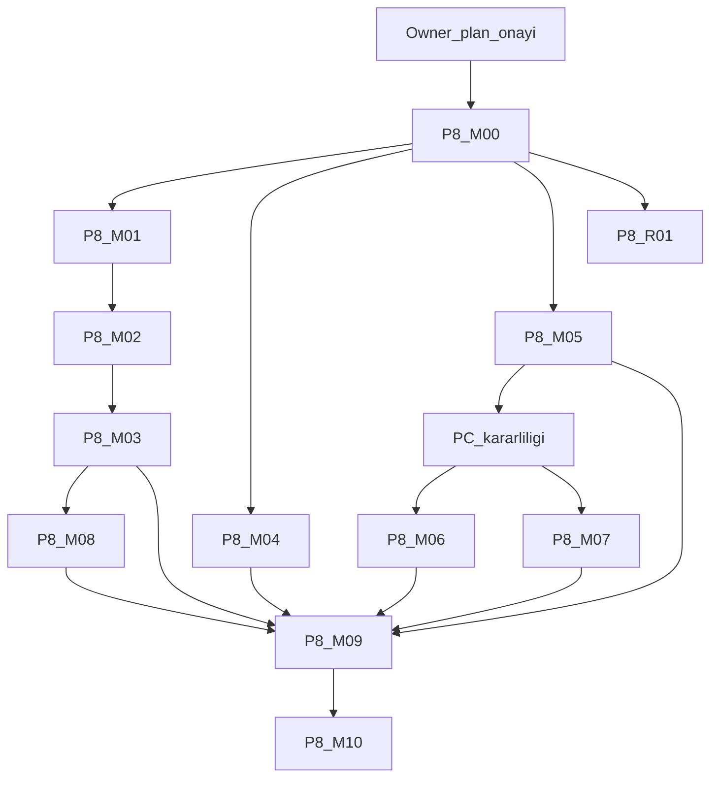

# AI-DND — Phase 8 Expansion Master Execution Plan v1

**Belge kodu:** `AI-DND-P8-MASTER-EXECUTION-v1`  
**Tarih:** 2026-10-09, Europe/Istanbul  
**Durum:** **PLAN. KAPANIŞ DEĞİLDİR. PASS DEĞİLDİR. ONAY BEKLER.**

Bu, kalan Phase 8 Expansion işinin tek yürütme sözleşmesidir. Yeni belirsizlik için ayrı plan açılmaz. Rutin bulgular, onaydan sonra bu planın kanıt defterine yazılır. Kapsam büyümesi Bible değişiklik denetimine gider.

Onaylı Bible v2.3.2 ve owner onay kaydı bu planla değişmez. v1 ve v2 kapanış taslakları silinmez. Bu plan onların yerine geçer. Onların onayı yoktur.

## 1. Karar özeti

Phase 8 Expansion kapanışı bugün yazılamaz. Tek zorunlu açık madde **S10B-AC-027**’dir. 165 komutunun argv’si yoktur. 296 ve 634, o FAIL’i otomatik kapatmaz. Eşdeğerlik **UNVERIFIED**.

S10B-INV-001 **UNCONFIRMED** kalır. Plan v2, kök neden bulunmasını kapanış önkoşulu yapmaz. Bible, doğrulanmadan fixed yazılmasını yasaklar. Kabul koşusunda yeni beklenmeyen HTTP 500 çıkarsa ilgili AC FAIL olur. Üç temiz deneme fixed değildir.

Yerel checkpoint `4fadca4` CLOSED’dur. Bu, Phase 8 Expansion kapanışı değildir. Production **NO-GO**. Waterdeep ve Baldur’s Gate **DISABLED**. F01, F13 admission ve Phase 9 ayrı kapılardır.

Bu plan onaylanırsa ilk paket **P8-M00**’dır. Onay, Git yazısı, şehir aktivasyonu veya production GO değildir.

## 2. Doğrulanmış taban

| Kontrol | Sonuç |
|---|---|
| Kök | `C:\Users\Kadir\Desktop\AI-DND-phase8-expansion` |
| Dal | `phase8/emergent-storytelling-expansion` |
| HEAD ve upstream | `0c7b24cd7ec9e32f0a54412769f85851b30d11a2` |
| `f503d99` ve `4fadca4` | HEAD’in atası |
| Çalışma ağacı | Temiz değil. Yalnız iki izlenmeyen taslak: closure scope v1 ve v2 |
| Bible SHA-256 | `7685bc4318bea56a5b23713af712d22b3a4749d2e5c2d97b551b1e545ef3fcb3` |
| Owner onay SHA-256 | `8995494324a8dde73e2aab03a2d0d551f5f9682634a6b9fe08a3daca7bfe942d` |
| v2 taslak | Var. SHA-256 `b8abe1f3752f12a6da8ce7996f1c15832a824782010dff8dcd8121b90d5c28c6` |
| Kurulu şehir | `installed_region_catalog.json`: yalnız `fr:pack:the_north:neverwinter:v1`, `VERIFIED_PARTIAL` |
| İndeks | Waterdeep ve Baldur’s Gate `INCOMPLETE`. Test beklentisi `DISABLED = {waterdeep.v1, baldurs_gate.v1}` |

`f503d99..HEAD` doküman ve arşiv `.gitattributes` satırıdır. Oyun modülleri bu aralıkta değişmemiştir. Bu cümle taze test PASS’i değildir. Başka bir worktree’ye geçilmez.

## 3. Yetki sırası

1. Python mekanik, zar, HP, XP, envanter, görev, zaman, hareket ve persistence.  
2. Lore authority, 1501 DR setting gerçekliği. Owner continuity ayrı provenance’dir. 2025 kaynak fact’i değildir.  
3. Kabul edilmiş campaign event, kampanya canon’udur.  
4. Qwen niyeti anlar ve doğrulanmış sonucu anlatır. Metin dünya gerçeği değildir. Mantıksal turda en fazla iki çağrı. Reddedilen anlatıdan sonra retry yoktur.  
5. Frontend sunar. HP, XP, hava, zaman veya lore uydurmaz.  
6. Bible v2.3.2 yönetim ve mimariyi bağlar. Faz, şehir, production veya Git açmaz.  
7. Stage 10B plan v2, AC-001…AC-028 ve INV-001 satırlarını bağlar.  
8. Repair-v2 FAIL kaydı tarihsel olarak durur.  
9. Bu plan, onaydan sonra yürütme sözleşmesidir.

Ürün UI: `artifacts/ai-dnd-experience`. `artifacts/api-server` oyun API’si değildir. `game.py` bölünmez.

## 4. Tarihsel kabul defteri

Eski FAIL silinmez ve PASS diye yeniden adlandırılmaz.

| Kayıt | Hüküm | Kanıt | Bu plandaki statü |
|---|---|---|---|
| Stage 10A v2 | Reconstructed yerel kabul CLOSED. Özgün tam sözleşme yok. Production NO-GO. | `STAGE10A_FINAL_CLOSURE_CURSOR_HANDOFF_v2_2026-10-09.md`, `.local/evidence/stage10a-final-acceptance-v1-20261009` | PASS — HISTORICAL ONLY |
| Repair-v2 | Final kabul FAIL. Kapanış yazılmadı. | `STAGE10B_REPAIR_FINAL_ACCEPTANCE_CURSOR_HANDOFF_v2_2026-10-09.md`, `.local/evidence/stage10b-repair-v2-20261009-085201` | FAIL durur |
| `boundary-persistence-weather-final` | 165 test, 4 failure, 14 error, exit 1. S10B-AC-027 FAIL. | Aynı kök, `protected-lore-blockers.json` | FAIL durur. Argv yok. |
| `regressions-final` | 633 test, 3 failure, 2 error, exit 1. CP1254. | `regressions-final.log` | FAIL olayı durur. INV-001 değildir. |
| `regressions-final-02` | 634 yürütme / 632 kimlik, exit 0. Komut `regressions-final-command.json`. | Aynı repair-v2 kökü | PASS — HISTORICAL ONLY. Lore modüllerini içermez. |
| Lore-integrity | 296 exit 0, 634 exit 0. Handoff AC-027 PASS der. HEAD kaydı `f63d952`, çalışma kopyası kirli. | `.local/evidence/stage10b-lore-integrity-20261009-1805` | Tarihsel iddia. Eşdeğerlik UNVERIFIED. Taze PASS değil. |
| Closeout | Yerel checkpoint CLOSED. Live-release NO-GO. 67 frontend, Vite, 20 adım `qwen3:8b`. Taze tarayıcı yok. Erken 503 korundu. | `PHASE8_LOCAL_CHECKPOINT_CLOSEOUT_2026-10-09.md` | PASS — HISTORICAL ONLY olanlar taze sayılmaz |
| Taslak v1 / v2 | Owner onayı yok. | `ai-dnd/docs/PHASE8_EXPANSION_CLOSURE_SCOPE_DRAFT_v1_2026-10-09.md`, v2 | Girdi. Kapanış değil. |
| Gate ledger | `release: NO-GO` | `ai-dnd/docs/evidence/phase8-expansion/gate-ledger.json` | Production kapısı. Phase 8 listesine ithal edilmez. |

## 5. Zorunlu Phase 8 kabul matrisi

| ID | Sözleşme | Şimdiki statü | Kapanış kuralı |
|---|---|---|---|
| S10B-AC-001 … AC-026, AC-028 | Plan v2 | PASS — HISTORICAL ONLY | İlgili sahip dosyası `f503d99`’dan beri değişmediyse tarihsel kanıt durur. Değişirse o AC yeniden koşulur. |
| S10B-AC-027 | Plan v2 ve repair-v2 FAIL kaydı | FAIL / eşdeğerlik UNVERIFIED | Dört lore modülünün güncel, verbose, disposable koşusu ve kayıp argv notu olmadan kapanmaz. |
| S10B-INV-001 | Plan v2 | UNCONFIRMED | Fixed yazılmaz. Kök neden, kapanış önkoşulu değildir. Kabul koşusunda yeni 500, ilgili AC’yi FAIL yapar. |
| Stage 10A | 10A v2 el devri | PASS — HISTORICAL ONLY | Yeniden açılmaz. |
| F01-AC-004, F01-AC-005 | Bible F01 | Bu kapının işi değil | Phase 8 kapanışına ithal edilmez. F15’i ayrı tutar. |
| F13 admission / aktivasyon | Ayrı imza | DISABLED | Phase 8 kapsamına girmez. |
| Production | Gate ledger | NO-GO | Phase 8 GO, yayın GO’su değildir. |

## 6. S10B-AC-027 yöntemi

Kayıp komut uydurulmaz. Tarihsel 165 FAIL yerinde kalır. Güncel doğrulama, aynı yükümlülüğün bugünkü baytta geçtiğini gösterebilir.

1. 18 kırmızı kimlik ve imza, v2 taslaktaki log dökümüdür. Kaynak: `boundary-persistence-weather-final.log` satır 4128 sonrası.  
2. Dört FAIL assertion’ı bugünkü dosyada aynı satırdadır: `test_lore_1501_freeze_admission.py` 27 ve 124, `test_lore_1501_admission_boundary.py` 23 ve 41.  
3. 12 ERROR, assertion’a varmadan `KeyError` veya `ImportError: OwnerContinuityRecord` ile düşmüştür.  
4. setUpClass, Castle Ward özeti `d8accdf6…` iken düşmüştür. Pin `be4b2f8a…` durur.  
5. 296 komutu bu dört modülü içerir ve exit 0’dır. Test başına PASS satırı yoktur. Kaynak snapshot kırmızı koşuyla aynı değildir.  
6. 634 komutu bu dört modülü içermez.

Onaylanan güncel komutlar, komut A değildir. Komut B adayıdır:

- **B1, dar yükümlülük:** `python -m unittest -v api.tests.test_lore_1501_freeze_contract api.tests.test_lore_1501_integration api.tests.test_lore_1501_freeze_admission api.tests.test_lore_1501_admission_boundary`  
- **B2, saklanmış süperküme adayı:** `lore-boundary-command.json` modül listesi, `-q` yerine `-v`.

B1, 18 kırmızı yükümlülüğün tamamını kapsar. B2, handoff’un “eski logun modülleri de koştu” iddiasını verbose yeniden ölçer. İkisi de 165 argv’sinin kendisi değildir. Bu planın onayı, bu iki komutun B adayı olarak kabulüdür. PASS yazısı ancak P8-M09 bağımsız incelemesinden sonra kapanış adayına girer. İnceleyen, koşuyu yazan kişi olamaz.

Assertion, pin, skip veya sahte sınıf değişikliği bu planın izni değildir. B1 kırmızıysa en küçük onarım ayrı diff olur. Onarım pin, save şeması veya şehir bayrağına dokunursa durulur ve ek onay istenir.

## 7. Tarihsel FAIL ile bugünkü yükümlülük

| Tarihsel olay | Bugünkü yükümlülük |
|---|---|
| 4 FAIL, Castle Ward mismatch | Aynı `assertEqual(integrity_errors, ())` ve `assertIn("not_in_public_freeze_manifest")` bugün duruyor. Pin değiştirilerek geçilemez. |
| 12 KeyError | Public küme boşken oluşan takip hataları. Küme, pin hizası ve admission ile dolar. Yeni claim yazılmaz. |
| Integration import | `OwnerContinuityRecord` import’u duruyor. Gövde 165’te çalışmadı. B1 o gövdeleri ilk kez verbose döker. |
| 633 CP1254 | Ayrı olay. Dar kodlama testi tarihsel olarak yeşildi. INV-001 sayılmaz. |
| Lore-integrity AC-027 PASS cümlesi | Tarihsel iddia. Bu plan onu taze PASS saymaz. |

## 8. HTTP 500 programı

Beş durum karıştırılmaz: yeni olay, yeniden üretim, INV-001 bağı, kök neden, onarım.

Disposable SQLite. Kampanya save’i açılmaz. Kollar: Qwen kapalı, sonra owner kararlı PC derse `qwen3:8b` açık. Tek kampanya, çift gönderim, süreç yeniden başlatma, ikinci kampanya. Saklanır: traceback, endpoint, `action_id`, istek kimliği, HTTP durumu, kaynak özeti.

Bir 500 olay açar, tarihsel kimliği kanıtlamaz. Üç temiz tur fixed değildir. Çıkmazsa kapsam yazılır ve statü UNCONFIRMED kalır. Kapanış yalnız bu yüzden bekletilmez. Çıkarsa en küçük yama önerilir. Yama bu planın dosya listesi dışına taşarsa durulur.

CP1254, kasıtlı save-failure, proxy drop ve Ollama yokken 503 ayrı kayıttır.

## 9. PC güvenilirliği

Bellek bozulması ve GPU timeout kanıtı vardır. GPU profili sıfırlandı. Kararlılık doğrulanmadı. Bu plan RAM testi, BIOS, sürücü veya yeniden başlatma yapmaz.

Kısa gruplar. Çıktı hemen diske yazılır. Qwen ve tarayıcı aynı anda yüklenmez. Çökme otomatik kod FAIL’i değildir. Kirlenen koşu **INVALID / INCONCLUSIVE** olur. Ağır P8-M06 ve P8-M07, owner “PC yeterince kararlı” demeden **BLOCKED** kalır. Zorunlu test sessizce düşmez.

## 10. Paketler

Ortak kurallar her paket için geçerlidir.

- **Yetki:** Bu plan ve bölüm 3.  
- **Kapsam dışı:** `game.py` bölme, yeni özellik, şehir bayrağı, pin, save şeması, `production_authorized`, `.gitattributes`, Git yazısı, production.  
- **Veritabanı:** Yalnız disposable SQLite. `ai-dnd/saves/campaigns.sqlite3` ve `AI_DND_CAMPAIGN_DB` açılmaz.  
- **Kanıt kökü:** `.local/evidence/phase8-master-v1-20261009/`. Eski köklerin üzerine yazılmaz.  
- **Geri alma:** Kod değiştiyse yama geri alınır. Kanıt klasörü silinmez. Save ve pin’e dönüş gerekmez çünkü onlara yazılmaz.  
- **Dur:** Beklenmeyen 500, pin kayması, ikinci kampanyaya sızıntı, üçten fazla model çağrısı, reddedilen anlatıda retry, PC çökmesi, kapsam dışı dosya.  
- **Onay:** Bu planın tek onayı M00–M05, M08 ve M10’u başlatır. M06 ve M07 ek olarak PC kararlılık cümlesi ister. M09 ayrı kişidir. Git ve şehir yine ayrıdır.

### P8-M00 — Taban ve kanıt dondurma

- **Amaç:** Yazmadan önce HEAD, taslak özetleri, pin gözlemi ve ağaç durumunu yeni kanıt köküne kopyalamak.  
- **Bağımlılık:** Bu planın onayı.  
- **Dosyalar:** Yalnız yeni kanıt kökü. Oyun dosyası yok.  
- **AC:** Bölüm 5’in statüleri.  
- **Komut:** `git status --short`, `git rev-parse HEAD`, Bible ve pin dosyalarının SHA-256’sı.  
- **Ortam:** Ağ yok. Model yok.  
- **Çıktı:** `baseline.json`.  
- **Pozitif:** HEAD `0c7b24c` ve Bible özeti bölüm 2 ile aynı.  
- **Negatif:** Fark varsa yazma durur.  
- **Idempotency, restart, izolasyon, model:** Yok.  
- **PASS:** Özetler tutarlı. **FAIL:** Beklenen HEAD değil. **BLOCKED:** Başka süreç aynı dosyayı yazıyorsa.  
- **Bağımsız inceleme:** Gerekmez.

### P8-M01 — Tarihsel defter

- **Amaç:** Bölüm 4’ü kanıt yollarıyla dondurmak. Eski log taşınmaz, yolu yazılır.  
- **Bağımlılık:** M00.  
- **Dosyalar:** Kanıt kökünde `historical-ledger.json`.  
- **AC:** AC-027 FAIL ve INV-001 UNCONFIRMED satırları zorunlu.  
- **Komut:** Yok. Okuma.  
- **PASS:** 165, 633, 296, 634 sayıları kaynak logla aynı. **FAIL:** Bir FAIL satırı düşmüşse.  
- **Model:** 0.

### P8-M02 — AC-027 yükümlülük haritası

- **Amaç:** 18 testi bugünkü fonksiyona bağlayan `ac027-map.json`.  
- **Bağımlılık:** M01.  
- **Dosyalar:** Dört test modülü ve `freeze_admission.py` yalnız okunur.  
- **AC:** S10B-AC-027.  
- **Komut:** Yok.  
- **Pozitif:** Her kırmızı kimliğin bugün bir fonksiyonu vardır.  
- **Negatif:** Skip, sahte sınıf veya gevşetilmiş assertion bulunursa STOP.  
- **PASS:** Harita tam. **BLOCKED:** Bir kimlik bugün yoksa ve yükümlülük yeniden kurulamıyorsa.  
- **Model:** 0.

### P8-M03 — Disposable AC-027 tekrarı

- **Amaç:** B1 ve B2’yi boş SQLite ile `-v` koşmak.  
- **Bağımlılık:** M02 ve bu plandaki B kabulü.  
- **Dosyalar:** Koşu sırasında kod yok. Kırmızı çıkarsa en küçük yama yalnız sahip modüldedir. Pin ve save yok.  
- **AC:** S10B-AC-027.  
- **Komut:** Bölüm 6 B1, sonra B2.  
- **Ortam:** Disposable SQLite. Qwen gerekmez.  
- **Çıktı:** Ham log, exit code, toplanan test kimlikleri, kaynak SHA-256.  
- **Pozitif:** Pin hizalı public küme ve bilinen Neverwinter fact.  
- **Negatif:** Yanlış hash hiçbir kayıt kabul etmez. Waterdeep ve Baldur’s Gate kapalı kalır. `production_authorized` false.  
- **Idempotency / restart / izolasyon:** Bu paketin işi değil. M05.  
- **Model:** 0.  
- **PASS — CURRENT VERIFIED:** B1 exit 0, 18 kimlik logda, assertion metni değişmemiş. B2 aynı dört modülü de geçirir.  
- **FAIL:** Zorunlu assertion kırmızı.  
- **BLOCKED:** Komut veya ortam kurulamazsa.  
- **Bağımsız inceleme:** PASS yazısı M09’a kalır.  
- **Dur:** Pin dosyasına yazma ihtiyacı doğarsa.

### P8-M04 — HTTP 500

- **Amaç:** Bölüm 8 provası.  
- **Bağımlılık:** M00. M03 ile seri koşulur. PC aynı anda ağır yük almaz.  
- **Dosyalar:** `api/main.py` yalnız okunur. Yama ancak tekrarlanan traceback sahip modülü gösterirse.  
- **AC:** INV-001 kaydı. İlgili tur AC’si, yeni 500 çıkarsa.  
- **Komut:** Disposable API. Kapalı model kolu, sonra açık kol yalnız PC kararı varsa.  
- **Pozitif:** Çift gönderim ikinci zar üretmez. Restart aynı receipt’i döner.  
- **Negatif:** İkinci kampanya birincinin NPC, dükkân ve konumunu almaz.  
- **Model:** Kapalı kolda 0. Açık kolda tur başına en fazla 2.  
- **PASS:** Prova biter ve yeni 500 yoktur. Statü yine UNCONFIRMED, fixed değil.  
- **FAIL:** Beklenmeyen 500.  
- **INVALID:** Çökme veya elektrik kesintisi.  
- **Dur:** Kök neden pin veya save göçü gerektirirse.

### P8-M05 — API, persistence, oturum

- **Amaç:** Tarihsel AC-013…AC-017 ve AC-019’un sahip dosyası değişmediyse tarihsel kanıtı bağlamak. Değiştiyse yalnız o seçiciyi disposable tekrarlamak.  
- **Bağımlılık:** M00 kaynak özeti.  
- **Dosyalar:** `api/main.py`, `api/session_manager.py`, `api/persistence/campaign_store.py`, `api/model_phase.py` okunur.  
- **Komut:** Değişen dosya yoksa koşu yok. Varsa `regressions-final-command.json` içinden yalnız ilgili modül.  
- **Pozitif:** Replay aynı sonucu verir.  
- **Negatif:** Çakışan istek ikinci etki yazmaz. Çözüm öncesi arıza 503 ve rollback. Çözüm sonrası anlatı arızası sonucu tutar, ikinci anlatı çağrısı yoktur.  
- **Restart ve izolasyon:** Zorunlu, disposable.  
- **Model:** 0, mock sınırında. Canlı Qwen M06.  
- **PASS — CURRENT VERIFIED** yalnız yeni log varsa. Aksi **PASS — HISTORICAL ONLY**.  
- **Dur:** Save şeması 5, game save 3, lore payload 2, campaign format 1 değişmek zorunda kalırsa.

### P8-M06 — Qwen

- **Amaç:** S10B-AC-018 ve AC-028.  
- **Bağımlılık:** M05 ve owner PC kararlılık cümlesi.  
- **Ortam:** Yerel `qwen3:8b`. Üretim anahtarı yok.  
- **Komut:** Tek disposable kampanya, en az bir meşru çağrı, bir doğrudan Python turu, bir reddedilen anlatı.  
- **Pozitif:** Çağrı niyet veya doğrulanmış sonuç içindir. Canonical digest çağrıdan önce ve sonra tutarlıdır.  
- **Negatif:** Üçüncü çağrı yok. Retry yok. Combat yolu 0 çağrı olabilir.  
- **PASS — CURRENT VERIFIED:** Ham trace ve exit 0.  
- **BLOCKED:** PC kararı veya Ollama yok. 503, INV-001 değildir ve kaydedilir.  
- **INVALID:** Süreç çökerse.  
- **Dur:** Tavanı yükseltme ihtiyacı.

### P8-M07 — Tarayıcı ve frontend

- **Amaç:** S10B-AC-001, AC-002, AC-026 ve görünen alan eşitliği.  
- **Bağımlılık:** M05 ve PC kararı. M06 ile aynı anda koşmaz.  
- **Dosyalar:** `artifacts/ai-dnd-experience` okunur. `artifacts/api-server` oyuncu yolu değildir.  
- **Komut:** Mevcut frontend test betiği kısa grup. Sonra gerçek Experience, `http://127.0.0.1:22785/ai-dnd-experience/`, API `127.0.0.1:8008`.  
- **Pozitif:** HP ve konum API ile aynı.  
- **Negatif:** Desteklenmeyen lore, görev veya eşya yazılmaz.  
- **Model:** Tarayıcı turunda tavan 2.  
- **PASS:** Birim testi ile gerçek tarayıcı ayrı yazılır. Birim testi, tarayıcı PASS’i değildir.  
- **BLOCKED:** PC kararı yok. Tarihsel tarayıcı kanıtı HISTORICAL ONLY kalır.  
- **Dur:** UI’nin yeni alan uydurması gerekirse.

### P8-M08 — İlgili regresyon ve lore sınırı

- **Amaç:** AC-027’nin seçici yarısı. Tam depo iddiası yok.  
- **Bağımlılık:** M03 exit 0.  
- **Komut:** Saklanmış `regressions-final-command.json`, disposable DB, kısa parçalar. 634 sayısı amaç değildir.  
- **Pozitif:** Seçici exit 0.  
- **Negatif:** Şehirler DISABLED. Yanlış pin boş kabul.  
- **PASS — CURRENT VERIFIED:** Bu snapshot’ta exit 0.  
- **FAIL:** Zorunlu seçici kırmızı. CP1254 yeniden çıkarsa ayrı olay, INV-001’e bağlanmadan FAIL.  
- **INVALID:** PC çökmesi. Kalan parça BLOCKED yazılır, düşmez.  
- **Model:** Bu seçicide canlı çağrı zorunlu değildir.

### P8-M09 — Bağımsız kabul incelemesi

- **Amaç:** B1/B2’nin A olmadığını, 18 yükümlülüğü örtüğünü ve negatiflerin durduğunu başka bir kişinin yazması.  
- **Bağımlılık:** M03, M04, M05, M08. M06 ve M07 BLOCKED ise kapanış adayı onları BLOCKED diye taşır, PASS saymaz.  
- **Kural:** Koşuyu yazan kişinin notu bağımsız değildir.  
- **PASS:** Yazılı eşdeğerlik notu.  
- **BLOCKED:** İkinci kişi yoksa kapanış adayı yazılmaz.

### P8-M10 — Kapanış adayı

- **Amaç:** Owner’ın evet veya hayır diyeceği tek aday.  
- **Bağımlılık:** M09.  
- **Çıktı:** `phase8-closure-candidate.json` ve kısa karar notu.  
- **İçerik:** Kaynak özeti, matris, B kararı, AC-027 logu, INV-001’in beş durumu, regresyon, tarayıcı, Qwen, izolasyon, lore sınırı, açık kusurlar.  
- **PASS:** Aday tutarlıdır. Bu, kapanışın kendisi değildir.  
- **NO-GO:** Zorunlu AC eksikse aday kapanış için NO-GO der. Sahte PASS yazılmaz.  
- **Git:** Yok.

## 11. Paralel şehir şeridi

### P8-R01 — F13-RESEARCH hazırlık envanteri

- **Amaç:** Waterdeep, sonra Baldur’s Gate, salt okuma.  
- **Bağımlılık:** M00 ile paralel. Phase 8 kapanışını genişletmez.  
- **Dosyalar:** `waterdeep_v1.extraction.json`, `baldurs_gate_v1.extraction.json`, `pack_index.json`, `installed_region_catalog.json` okunur.  
- **Sıra:** Owner hedefi oynanabilir şehirdir. Önerilen sıra Waterdeep, sonra Baldur’s Gate. Bu plan aktivasyon değildir.  
- **Pozitif:** İndeks `INCOMPLETE`, runtime DISABLED, kurulu katalog yalnız Neverwinter.  
- **Negatif:** Yeni claim, pin, admission, `production_authorized`, save göçü veya canon yok.  
- **PASS:** Envanter yazılır. Admission PASS değildir.  
- **Dur:** Bayrak değişikliği önerisi uygulamaya dönüşürse.

## 12. Test ve kanıt matrisi

| Paket | Kanıt | Statü bu planda |
|---|---|---|
| M00–M02 | Yeni JSON | NOT TESTED |
| M03 B1/B2 | Verbose log | NOT TESTED |
| M04 | Beş durum tablosu | UNCONFIRMED, prova NOT TESTED |
| M05 | Tarihsel veya yeni seçici | PASS — HISTORICAL ONLY, ta ki dosya değişmiş olsun |
| M06 | Canlı trace | BLOCKED, PC kararı yok |
| M07 | Gerçek tarayıcı ayrı | BLOCKED, PC kararı yok. Birim test NOT TESTED |
| M08 | Seçici log | NOT TESTED |
| M09 | İmza | PENDING |
| M10 | Aday | PENDING |
| R01 | Okuma notu | NOT TESTED |
| Eski 165 | Repair-v2 log | FAIL |
| Eski 633 | Repair-v2 log | FAIL |
| Eski 296 / 634 / 67 / Vite / 20 adım | İlgili kökler | PASS — HISTORICAL ONLY |

## 13. Bağımlılık

M06 veya M07 BLOCKED kalırsa M09 bunu gizlemez. M10 o satırları BLOCKED taşır.

## 14. Korunan dosyalar

Okunur, bu planda yazılmaz:

- `ai-dnd/docs/AI-DND_Future_Project_Bible_v2_3_2_PROPOSED.md`  
- `ai-dnd/docs/AI-DND_Future_Project_Bible_v2_3_2_OWNER_APPROVAL_2026-10-09.md`  
- İki closure taslağı, Stage 10A ve 10B el devirleri, closeout  
- `.local/evidence/stage10a-*` ve `stage10b-*`  
- Castle Ward belgesi, `pack_index.json`, üç Neverwinter dosyası, `installed_region_catalog.json`  
- `ai-dnd/saves/`  
- `.gitattributes`  
- Şehir DISABLED kümesi ve `production_authorized`

`game.py` ancak mevcut bir AC’nin sahip yolu oradan geçiyorsa ve diff küçükse açılır. Bölünmez. Yeni özellik yok.

## 15. Risk ve STOP

| Risk | STOP |
|---|---|
| Başka ajan aynı dosyayı yazıyor | M00 farkı. Yazma yok. |
| 165 komutunu geri üretme baskısı | Komut uydurulmaz. |
| B1 kırmızı ve onarım pin istiyor | Ek onay. |
| Yeni HTTP 500 | Olay açılır. INV-001’e otomatik bağlanmaz. |
| PC çökmesi | INVALID. Zorunlu paket BLOCKED. |
| İkinci kampanyaya sızıntı | FAIL. Kapanış yok. |
| Model tavanı veya retry | FAIL. |
| Şehir bayrağı veya yeni claim | Bu planın dışı. Dur. |
| Git yazısı | Ayrı onay yoksa dur. |

## 16. Owner onay matrisi

| Karar | Bu planın tek onayı yeter mi |
|---|---|
| M00–M05, M08, M10 ve R01’in tanımlı işi | Evet |
| B1 ve B2’nin komut B adayı olması | Evet. Bu onay o karardır. |
| M06 ve M07 | Hayır. Ayrıca “PC yeterince kararlı” cümlesi gerekir. |
| M09 inceleycisi | Hayır. İkinci kişi ayrıca adlandırılır. |
| AC-027 onarımı pin, save veya şehir istiyorsa | Hayır |
| Yeni HTTP 500 yaması plan dışı dosyaya gidiyorsa | Hayır |
| Git add, commit, push, merge, reset | Hayır |
| F13 admission, aktivasyon, production, Phase 9 | Hayır |
| INV-001’i kapanış önkoşulu yapmak | Hayır. Bu, plan v2’yi değiştirir. |

## 17. Kapanış kuralları

Aday ancak şunlar varken owner’a gider:

- M03 B1 güncel exit 0 ve 18 kimlik logda.  
- B’nin A olmadığı yazılı. M09 notu var.  
- Eski 165 ve 633 FAIL dosyaları duruyor.  
- INV-001 fixed yazılmamış. Kabul koşusunda yeni 500 yok.  
- M05 izolasyon ve replay, güncel veya değişmeyen dosya için tarihsel, dürüstçe etiketli.  
- M06 ve M07 ya CURRENT VERIFIED ya da BLOCKED. BLOCKED, sessiz PASS değildir.  
- Şehirler DISABLED. Production NO-GO ayrı cümle.  
- F01 ve F13 aktivasyonu kapanış bahanesi değil.

Eksik zorunlu AC varsa sonuç **NO-GO FOR PHASE 8 CLOSURE**’dır. Owner’ın ayrı “kapanışı onaylıyorum” cümlesi olmadan CLOSED yazılmaz. O cümle production GO değildir.

## 18. Onaydan sonraki ilk paket

**P8-M00.** Kanıt kökünü açar, HEAD ve Bible özetini yazar, fark varsa durur. Oyun kodu, test, Qwen, save ve Git yok.

## 19. Açık noktalar

Bu plan bunları kapatmaz.

1. İkinci inceleycinin adı yok. M09 onsuz kapanış adayı yazamaz.  
2. PC kararlılık cümlesi yok. M06 ve M07 BLOCKED başlar.  
3. 165 argv hiçbir zaman bulunmayabilir. B1/B2 bu boşluğu kapatmaz. Tarihsel FAIL durur.  
4. INV-001’in özgün traceback’i tek vakaya bağlı değildir.  
5. v1 ve v2 hâlâ izlenmiyor. Bu plan onları commit etmez.  
6. Closeout’taki 12 dosyalık checkout listesi, arşive taşınan beş Bible yolu için eskidir. Lore pin yolları o commit’te değişmedi. F01 bunu ayrıca ele alır. Phase 8 kapanışına ithal edilmez.

**SON DURUM:** `MASTER PLAN v1 — OWNER APPROVAL REQUIRED`. Kapanış yoktur. Yürütme başlamamıştır.
