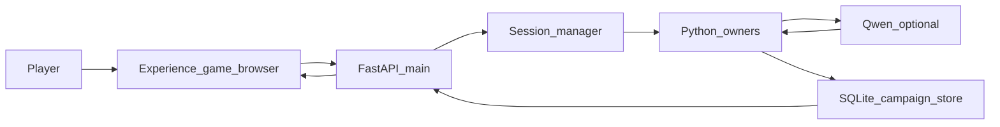

# Stage 10B master implementation plan v1

9 Ekim 2026, Europe/Istanbul. Yalnızca plan. Gameplay, API, frontend, test, smoke, lore, şema ve git değişmedi.

Bu belge, owner onayından sonra Stage 10B’nin tek uygulama ve kabul sözleşmesidir. Onaydan sonra rutin alt adımlar için ayrı plan açılmaz. Kabul maddesi sessizce silinmez, gevşetilmez veya yeniden tanımlanmaz. Maddi değişiklik yeni sürüm ve yeni owner onayı ister.

## 1. Starting Git/project baseline

- Checkout: `C:\Users\Kadir\Desktop\AI-DND-phase8-expansion`
- Branch: `phase8/emergent-storytelling-expansion`
- HEAD: `f63d952506064cd59e960f1e3efa6627d4e52053`
- Worktree bu belge eklenmeden önce dirty idi. HEAD tek başına test edilmiş snapshot değildir.
- Stage 10A kapanışı: `ai-dnd/docs/STAGE10A_FINAL_CLOSURE_CURSOR_HANDOFF_v2_2026-10-09.md`
- Durum: reconstructed yerel kabul **PASS / OWNER-APPROVED / CLOSED**. `S10A-SIGNOFF-01` kapalı.
- Özgün Stage 10A kabul sözleşmesi bulunamadı ve bu belgede kurtarılmış sayılmaz.
- Kayıtlı 10A kanıt kökü: `.local/evidence/stage10a-final-acceptance-v1-20261009`
- O klasörde kayıtlı: 401 ilgili regresyon, 8.919s, OK; `qwen3:8b` 20 tur ve restart; opt-in avlu combat; tur başına en fazla 2 çağrı; red sonrası retry yok.
- Bu 401’lik grup tüm repository değildir.
- Ortam: Windows, Cursor uygulama, Codex bağımsız inceleme, ChatGPT mimari ve kabul, Python + FastAPI + SQLite, yerel Ollama. Replit bu iş akışında yoktur.

P1, kod değişmeden önce aynı HEAD ve dirty ağaç için kaynak SHA-256 manifestini yeni evidence klasörüne yazar. Eski 10A klasörü değişmez.

## 2. Document/source authority

Okunan otorite:

- `STAGE10A_FINAL_CLOSURE_CURSOR_HANDOFF_v2_2026-10-09.md` ve önceki Stage 10A handoff’ları
- `replit.md` oyuncu yolu
- `ai-dnd/scripts/development_checks.json`
- `C:\Users\Kadir\.codex\.chatgpt-projects\g-p-6abd4c46ccb08191b12a0d30ad81ba28\sources\AI-DND_Master_Handoff_v3_Project_Bible.md` bölüm 16

Bağlayıcı ayrım:

- Python oyun gerçekliğini belirler.
- Resmî 2024 PHB, DMG ve Monster Manual kural otoritesidir.
- Forgotten Realms kaynakları 1501 DR zemininde setting gerçekliğini belirler.
- Kabul edilmiş kampanya olayları kampanya canon’udur.
- Qwen niyeti anlar ve doğrulanmış sonucu anlatır.
- Frontend otoriter gerçekliği gösterir.
- Tur başına en fazla 2 model çağrısı. Reddedilen anlatı deterministik fallback alır. Retry yoktur.
- Model ve istemci canonical state yazamaz.
- Yayımlanmış macera ihtimali tamamlanmış kampanya olayı değildir.
- Combat mekaniği ve çözülmüş combat anlatısı Python’dadır. Qwen combat anlatıcısı eklenmez.

## 3. Original specification status

**Özgün Stage 10B spesifikasyonu bulunamadı.** Handoff’larda “Stage 10B” yalnız tarihsel BLOCKED kaydı olarak geçer. Bible Phase B ayrı bir UI toparlamasıdır ve Stage 10B sözleşmesi değildir.

Bu belgedeki kapsam **reconstructed / yeni öneridir ve owner onayı gerektirir.** Onaydan sonra aşağıdaki madde kimlikleri donar.

## 4. Owner-approval requirements

Owner bu v1 belgesinin tamamını onaylayana kadar uygulama başlamaz.

Onay şunları açar: P1’den P4’e kadar bu belgedeki sıra, mevcut sahipler üzerinde doğrulama ve yalnız kanıtlanmış doğruluk kusurunun en küçük düzeltmesi.

Onay şunları açmaz: production, merge, deployment, Phase 9, Waterdeep veya Baldur's Gate, yeni şehir, görev, canavar, ekonomi, save şema göçü, model bütçesi artışı, anlatı retry’si, `game.py` yeniden mimarisi.

Rutin alt görev için yeniden onay istenmez. Plan dışı mimari genişleme veya yıkıcı git işlemi gerekirse durulur.

## 5. Frozen acceptance matrix

Karar sözlüğü:

- **PASS:** madde koşuldu, beklenen otoriter eşitlik tuttu, evidence yolu yazıldı.
- **FAIL:** madde koşuldu ve eşitlik tutmadı. Evidence silinmez.
- **BLOCKED:** meşru mekanik veya gerekli ortam yok. PASS uydurulmaz.
- **NOT TESTED:** madde durur, o checkpoint henüz koşulmamıştır.

| ID | PASS koşulu | Sahip | Kanıt | Bağımlılık | Dışarıda |
|---|---|---|---|---|---|
| S10B-AC-001 | Experience ekranındaki current HP ve max HP, aynı `campaign_id` için son API state ile aynı sayılardır | API state; UI yalnız gösterir | Tarayıcı oturumu artı API JSON | P2 | Yüzde çubuğu hesabı gerçek yazmak sayılmaz |
| S10B-AC-002 | Görünen konum adı ve id, API’deki güncel konumdur. Tavern girişi, çıkış ve yeniden giriş parent’ı `fr:city:neverwinter` olan aynı yerel sahneyi kullanır | `living_world`, location owner | API state önce/sonra | P3 | Şablon mekân parent’ı değiştirilmez |
| S10B-AC-003 | Görünen kampanya zamanı API saatidir. Duvar saati veya istemci süresi yazılmaz | `timed_gameplay` / campaign clock | API ve ekran | P2 | Yeni takvim yok |
| S10B-AC-004 | Hava yalnız API alanı varsa gösterilir. Alan yoksa mevcut “belirsiz” sunumu kalır; yeni hava uydurulmaz | exploration/clock public projection | API alanı boş ve dolu iki gözlem | P2 | Yeni hava sistemi yok |
| S10B-AC-005 | Combat aktifliği, round, sıra ve HP, API combat state ile aynıdır | `bounded_encounter`, combat lifecycle | Avlu oturumu | P2, P3 | Yeni combat sistemi yok |
| S10B-AC-006 | Envanter ve ekipman satırları API envanterinin alt kümesidir. İstemci eşya eklemez | inventory owner | önce/sonra diff | P2 | Yeni eşya yok |
| S10B-AC-007 | Boş görev kataloğunda ekran ve API “sunulmuş etkin görev yok” durumundadır. Görev kaydı yazılmaz | `quest_catalog` | birleşik kampanya | P3 | Yeni görev yok |
| S10B-AC-008 | Açıklanmış oyuncu adı yalnız o NPC belleğindedir. Bilinmeyen NPC public adıyla görünür. Kayıtsız ad hatırlanmaz | NPC memory, `living_world.public_npc_name` | izolasyon assert | P3 | Yeni NPC biyografisi yok |
| S10B-AC-009 | Açık dükkân isteği bir dükkân yaratır. Aynı keeper ikinci yaratımda çoğalmaz. “Bul” yaratım değildir | `shop_creation.py` | mevcut shop testleri artı P3 | P3 | Shop owner yeniden yazılmaz |
| S10B-AC-010 | Ekrandaki anlatı, o turun `narration` alanının metnidir | play response | tarayıcı ve API | P2 | Yeni anlatıcı yok |
| S10B-AC-011 | Kampanya A’nın geciken cevabı kampanya B ekranını ve state’ini değiştirmez | experience campaign scope | iki kampanya, gecikmeli cevap | P2 | Yeni istemci mimarisi yok |
| S10B-AC-012 | Yenileme ve resume aynı kampanyanın HP, konum, dükkân ve combat kaydını gösterir | campaign store | restart | P2, P3 | Production DB yok |
| S10B-AC-013 | Birleşik izole kampanya bu belgenin 8. bölüm sırasını meşru mekaniklerle geçer | mevcut sahipler | yeni smoke klasörü | P3 | Hostile enjeksiyonu, zorlanmış zar, sahte ödül yok |
| S10B-AC-014 | Aynı `action_id` ve aynı istek ikinci kez kaynak, zar veya hasar tüketmez. Çatışan gövde ikinci tur sayılmaz | `campaign_store.get_turn_action`, `session_manager`, `core_resolution` | mevcut idempotency testleri artı bir combat replay | P3 | Protokol yeniden tasarımı yok |
| S10B-AC-015 | Kayıt başarısız olursa otoriter state kısmi kalmaz. Mevcut rollback sahibi ne yapıyorsa o gözlenir | persistence owner | mevcut failed-save testleri | P3 | Yeni rollback politikası yok |
| S10B-AC-016 | İkinci kampanya birincinin NPC, dükkân, isim ve avlusunu almaz | session isolation | P3 ikinci kampanya | P3 | — |
| S10B-AC-017 | Aktif dövüş sırasında restart aynı combat id ve aynı HP ile döner. Resume sonrası meşru tur devam eder | combat persistence | P3, ölümden önce | P3 | Final 10A dövüşü NPC ölünce bitti; o klasör yeniden iddia edilmez |
| S10B-AC-018 | Oyuncu turunda model çağrısı 0, 1 veya 2’dir. 3 yasaktır. Reddedilen anlatıdan sonra model retry yoktur | narration budget | trace | P3, P4 | Bütçe artmaz |
| S10B-AC-019 | Ollama yok, timeout veya bozuk model çıktısı canonical olay yazmaz. Otoriter işlem, mevcut işlem sınırında kalır. Anlatı deterministik fallback alır | ollama adapter, narration gate | izole birim veya API; canlı PASS sayılmaz | P4 | Yeni rollback yok |
| S10B-AC-020 | Desteklenmeyen lore, NPC geçmişi, görev, ödül, fiyat veya envanter iddiası state yazmaz | reality gate | negatif yollar | P4 | Gate gevşetilmez |
| S10B-AC-021 | Anlatı çözülmüş zar, hasar ve hareketle çelişen kalıcı gerçek yazamaz. Combat cümlesi Python sonucudur | combat narration | avlu turları | P3 | Qwen combat anlatıcısı yok |
| S10B-AC-022 | Aktif combat sırasında yasak seyahat konumu değiştirmez | `combat_lifecycle` | tavernaya gitme denemesi | P3 | — |
| S10B-AC-023 | Sıra oyuncuda değilken saldırı ikinci bir vuruş veya hasar üretmez | action economy | negatif combat | P4 | — |
| S10B-AC-024 | Yanlış konumdaki veya var olmayan NPC hedefi o NPC’ye bellek veya hasar yazmaz | NPC targeting | önce/sonra | P4 | — |
| S10B-AC-025 | Hiç olmamış konuşma veya doğrulanmamış tarih iddiası kampanya olayı olmaz | campaign canon | negatif anlatı | P4 | — |
| S10B-AC-026 | Manuel okuma: Türkçe, çözülmüş sonucu söyler, motor/Python/sunucu/model sözcüğü oyuncuya görünmez, restart sonrası aynı gerçek sürer | narration review | insan notu | P4 | Tüm anlatıyı jenerik cümleye çevirmek yok |
| S10B-AC-027 | İlgili regresyon grubu yeni evidence klasöründe exit 0. Eski 8.919s log durur ve tüm suite sayılmaz | `development_checks.json` seçicileri artı 10A ilgili grup | yeni log | P4 | Tüm repository iddiası yok |
| S10B-INV-001 | Tarihsel HTTP 500 araştırılır, çözülmüş bug sayılmaz. Tekrarlanırsa FAIL ve traceback saklanır. Çıkmazsa NOT TESTED kalır | `api/main.py` turn sınırı | eski tanı notu | P4 | Kök neden uydurulmaz |

## 6. Current system/owner dependency diagram

Doğrulanan istemci: `artifacts/ai-dnd-experience/src/pages/game-browser.tsx`. Dayanak: `replit.md` oyuncu yolu, `development_checks.json` `frontend_package`, `start_local.ps1`. `usePlayGameTurn` `action_id` gönderir. `artifacts/ai-dnd-web` yalnız session yüzeyidir; bu planda kampanya özelliği almaz. `artifacts/api-server` oyun API’si değildir.

## 7. Complete browser/API verification strategy

Yol: oyuncu yazısı, Experience, FastAPI, Python çözümü, gerekirse Qwen, doğrulanmış cevap, Experience sunumu.

P2 masaüstü ve dar genişlikte şunları okur: kampanya ve karakter kimliği, konum, kampanya zamanı, varsa hava, HP ve combat, envanter, görev günlüğü, bilinen ve bilinmeyen NPC, dükkân, anlatı, seyahat veya encounter durumu.

Kontroller: yenileme, resume, kampanya değiştirme, bekleyen istek. A’nın geciken cevabı B’yi ezmez. Klavye ile tur gönderilir. Hata oyuncuya görünür ve lore uydurmaz.

Yeni UI sistemi, dashboard veya panel eklenmez. Doğrulanmış bir sunum kusuru varsa yalnız o alan API değerine bağlanır.

## 8. Unified real campaign scenario

Tek kullanımlık SQLite. Ayrı API süreci. Production DB seçilmez. Sıra, meşru mekanik varsa:

1. Neverwinter, 1501 DR, The North başlangıcı.
2. Geçerli karakter kimliği.
3. Mevcut konum ve yerel sahne.
4. Açık dükkân yaratımı, sonra aynı dükkânı bulma, ikinci yaratım yok.
5. Tavernaya giriş, Neverwinter’a çıkış, aynı tavernaya dönüş.
6. Bir NPC’ye açık isim. Restart sonrası aynı NPC hatırlar.
7. Kayıtsız ad reddi.
8. Boş katalogda görev sorusu. Görev yazılmaz.
9. Opt-in avlu. İnisiyatif ve katılımcı kimlikleri.
10. Dash ve mesafe. Action economy.
11. Saldırı, ıskalama veya isabet, HP sonucu. Zar yamalanmaz.
12. Dövüş bitmeden kayıt ve restart. Aynı combat id ve HP.
13. Resume sonrası meşru tur.
14. İkinci kampanya birincinin kayıtlarını görmez.

Bir adım meşru olarak çalıştırılamazsa o adım **BLOCKED** veya **NOT TESTED** yazılır. Düşman, zar, ödül veya yolculuk eklenerek PASS üretilmez.

## 9. Idempotency and recovery strategy

Mevcut sahipler: `ai-dnd/api/persistence/campaign_store.py` `get_turn_action`, `ai-dnd/api/session_manager.py`, `ai-dnd/api/core_resolution.py` action scope, Experience `stableTurnActionId`.

Doğrulanacaklar: çift tıklama veya tekrar Enter, kabul edilmiş HTTP tekrarının aynı `action_id` ile aynı cevabı vermesi, farklı gövdenin ikinci tur sayılmaması, sırasız veya geciken cevap, aynı kampanyaya eşzamanlı istek, kayıt hatasında mevcut rollback, tur sırasında süreç kesintisi, restart, oturuma bağlı serialize, combat persistence, mevcut save formatı.

Garanti:

1. Kabul edilmiş bir eylem kaynağı iki kez tüketmez.
2. Çözülmüş saldırı, aynı istek tekrarında yeniden zar atmaz veya yeniden hasar vermez.
3. Başarısız işlem, mevcut sahip ne koruyorsa onu korur. Yeni rollback politikası yazılmaz.
4. Kampanyalar arası bellek ve dünya sızıntısı yoktur.
5. Resume dükkân, NPC, ödül veya olayı çoğaltmaz.

Test yoksa madde NOT TESTED kalır. Eksik garanti, sessiz protokol değişikliği değildir. Şema göçü ayrı onay ister.

İlgili mevcut testler: `api/tests/test_persistence_idempotency.py`, `api/tests/test_campaign_api.py`, `api/tests/test_campaign_time.py`, `api/tests/test_bounded_encounter.py` içindeki action id çatışması, `api/tests/test_ambient_receipt_corruption.py`. Bunlar canlı oyun kanıtı değildir.

## 10. Model failure and deterministic fallback strategy

İzole testler: çağrı sayısı, faz muhasebesi, retry yok, deterministik fallback, Ollama kapalı veya timeout, bozuk çıktı, desteklenmeyen lore, NPC bellek, görev veya ödül, envanter veya ekonomi, zara aykırı anlatı, sıfır çağrılı doğrudan Python yolu.

Model hatası canonical olay yazamaz. Başarısız model cevabı, mevcut işlem sınırı dışında otomatik olarak otoriter turu düşürmez. Reality Gate gevşetilmez. Combat’ta 0 çağrı geçer.

## 11. World/campaign continuity strategy

Ardışık turlarda karşılaştırılır: konum ve parent, yerel ve bölgesel hareket, seyahat süresi ve kampanya saati, varsa hava, aktif encounter, NPC kimliği ve bellek, dükkân, görev durumu, kabul edilmiş olaylar, combat katılımcıları, HP ve koşullar.

Atmosfer serbesttir. Kalıcı gerçek yazamaz. Macera kancası tarih olmaz. Anlatı görev, lore veya mekanik yaratmaz. Yeni şehir, canavar, görev, eşya veya dünya üreticisi yok.

## 12. Negative-path and isolation tests

S10B-AC-020 ile S10B-AC-025. Her biri state’i önce ve sonra karşılaştırır. Uygun anlatı, mekanik başarı değildir. Yeşil sonuç için olay uydurulmaz.

## 13. Manual player-experience acceptance

P4 insan notu, S10B-AC-026. Forgotten Realms macerası gibi okunur. Tutarlı Türkçe, çözülmüş eylem, gizli motor sözcüğü yok, bilinen ve bilinmeyen ad ayrımı, combat ve hareket sonucu açık, hata lore uydurmaz, restart sonrası süreklilik. Güvenlik, tüm anlatıyı aynı jenerik cümleye çevirerek sağlanmaz.

## 14. Complete execution order and checkpoints

### P1 — Sözleşme ve taban

- Sahip: belge. Kod yok.
- Dosya: bu v1. Eski handoff’lar korunur.
- Önkoşul: bu belge durur.
- Checkpoint: owner onayı yazılır. Kaynak manifesti yeni klasöre alınır. Komut, HEAD, dirty durum, exit ve hash kaydı.
- Durma: onay yoksa P2 başlamaz.

### P2 — Tarayıcı ve API otoritesi

- Sahipler: Experience `game-browser.tsx`, FastAPI `api/main.py`, public state projeksiyonu.
- Muhtemel dosyalar: yalnız kanıtlanmış sunum kusuru varsa experience bileşeni. Yeni sayfa yok.
- Korunan: `ai-dnd-web`, `api-server`, Python sahipleri.
- Adımlar: bir Neverwinter turu, yenileme, iki kampanya gecikmesi, masaüstü ve dar ekran.
- Checkpoint: AC-001–006, 010–012. Her biri PASS, FAIL, BLOCKED veya NOT TESTED.
- Durma: istemci state yazıyorsa düzeltme bu sunumla sınırlıdır. Yeni UI gerekirse dur.

### P3 — Süreklilik, kurtarma, iki kampanya

- Sahipler: `game.py` oturumu, `living_world`, `shop_creation`, `local_dialogue`, `bounded_encounter`, `campaign_store`, combat lifecycle.
- Muhtemel dosyalar: yeni izole harness. Ürün kodu yalnız kanıtlanmış kusurda.
- Korunan: `shop_creation.py` sözleşmesi, lore pack, save şema sürümleri, Neverwinter pack.
- Adımlar: bölüm 8 sırası, bölüm 9 replay, aktif combat restart.
- Checkpoint: AC-007–009, 013–018, 021, 022.
- Durma: meşru yol yoksa BLOCKED. Enjeksiyon yok.

### P4 — Güvenilirlik, regresyon, oyuncu kabulü

- Sahipler: narration gate, ollama adapter, reality gate, regresyon seçicileri.
- Adımlar: model arıza birimleri, negatif yollar, ilgili regresyon, manuel not, manifest.
- Checkpoint: AC-019, 020, 023–027, INV-001.
- Durma: regresyon FAIL ise kabul FAIL. Evidence silinmez.

Her checkpoint kaydı: komut, ortam, HEAD, dirty durum, kaynak hash, exit, model çağrı izi, evidence yolu, varsa manuel not.

## 15. Proposed touched/protected files

Muhtemel dokunuş, onaydan sonra ve yalnız kusur varsa:

- `artifacts/ai-dnd-experience/src/pages/game-browser.tsx` ve onun okuduğu mevcut paneller
- Yeni izole harness, `ai-dnd/api/tests/` altında, geçici SQLite
- Yeni evidence klasörü `.local/evidence/stage10b-acceptance-v1-<tarih>/`

Korunan:

- `ai-dnd/shop_creation.py` sahibi
- `ai-dnd/game.py` mimarisi ve combat çözücü
- Lore pack, freeze, `snapshot_manifest.json`
- Save format sürümleri
- `artifacts/ai-dnd-web`, `artifacts/api-server`
- Tüm Stage 10A handoff ve evidence dizinleri
- Bu v1, onaylı madde metni

## 16. Regression matrix and evidence paths

- Eski kök korunur: `.local/evidence/stage10a-final-acceptance-v1-20261009`
- Yeni kök: `.local/evidence/stage10b-acceptance-v1-<tarih>/`
- İçinde: `source-hashes.json`, `browser-notes.md`, `unified-campaign.json`, `idempotency.json`, `model-failure.json`, `regressions.log`, `manual-review.md`, `summary.json`
- Regresyon: 10A’da kullanılan ilgili grup artı `development_checks.json` seçicileri. Sayı, tüm suite olarak yazılmaz.
- Sentetik birim, canlı oyun kanıtı diye yazılmaz.
- FAIL transkripti düzeltilince de saklanır.

## 17. PASS/FAIL/BLOCKED rules

- Stage 10B PASS: AC-001–027 hepsi PASS. INV-001 PASS olmak zorunda değildir. NOT TESTED veya BLOCKED varsa Stage 10B PASS değildir.
- Bir AC FAIL ise Stage 10B FAIL.
- Ortam eksikse ilgili AC BLOCKED ve genel sonuç BLOCKED.
- Koşulmayan AC NOT TESTED kalır. Yok sayılarak PASS yazılmaz.
- Manuel AC-026 olmadan genel PASS yoktur.

## 18. Risks and stop conditions

- Save uyumu bozulması. Şema büyümez.
- İstek protokolünün sessizce değişmesi. Mevcut `action_id` sahibi kullanılır.
- Varsayılan session’a serialize. Aktif oturumun kendi serialize yolu kullanılır.
- Model veya UI’nin canon yazması.
- 10A shop, tavern, isim, görev ve avlu davranışının değişmesi.
- Eski evidence’in üstüne yazılması.
- HTTP 500’ün çözülmüş ilan edilmesi.

Dur: yıkıcı git, şema göçü, yeni şehir veya sistem, `game.py` bölünmesi, bütçe veya retry değişikliği, production DB.

## 19. Stage 10B final closure criteria

Kapanış ancak AC-001–027 PASS, yeni evidence manifesti, manuel not ve bu v1 maddeleri değişmeden duruyorsa yazılır. Kapanış belgesi ayrı sürüm olur. Bu v1 kapanış belgesi değildir. Production ve merge kapanıştan otomatik çıkmaz.

## 20. Explicit exclusions and future-phase work

Bu planda yoktur:

- Replit
- Production, merge, deployment
- Phase 9
- Waterdeep ve Baldur's Gate aktivasyonu
- Yeni görev, canavar, eşya, ekonomi, şehir veya dünya üreticisi
- Qwen combat anlatıcısı
- Save şema göçü
- `game.py` yeniden yazımı
- Bible Phase B Continue ve suggestion sistemi
- Tüm repository yeşil iddiası
- Özgün Stage 10A listesinin kurtarıldığı iddiası

Bunlar gelecek fazdır ve ayrı owner kararı ister.
