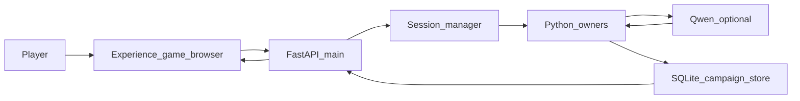

# Stage 10B master implementation plan v2

9 Ekim 2026, Europe/Istanbul. Yalnızca plan. Gameplay, API, frontend, test, smoke, lore, şema ve git değişmedi.

Bu belge Stage 10B’nin tek uygulama ve kabul sözleşmesidir. v1 korunur ve değiştirilmez. Bu v2 **henüz uygulama için onaylı değildir.** Owner onayı ayrı bir sürüm kabul kaydına yazılır. Onaylı sözleşme sessizce silinmez, gevşetilmez veya yeniden tanımlanmaz. Maddi değişiklik yeni sürüm ve yeni owner onayı ister.

## 1. Starting Git/project baseline

- Checkout: `C:\Users\Kadir\Desktop\AI-DND-phase8-expansion`
- Branch: `phase8/emergent-storytelling-expansion`
- HEAD: `f63d952506064cd59e960f1e3efa6627d4e52053`
- Worktree bu belge eklenmeden önce dirty idi. HEAD tek başına test edilmiş snapshot değildir.
- Stage 10A kapanışı: `ai-dnd/docs/STAGE10A_FINAL_CLOSURE_CURSOR_HANDOFF_v2_2026-10-09.md`
- Durum: reconstructed yerel kabul **PASS / OWNER-APPROVED / CLOSED**. `S10A-SIGNOFF-01` kapalı.
- Özgün Stage 10A kabul sözleşmesi bulunamadı ve bu belgede kurtarılmış sayılmaz.
- Kayıtlı 10A kanıt kökü: `.local/evidence/stage10a-final-acceptance-v1-20261009`
- O klasörde kayıtlı: 401 ilgili regresyon, 8.919s, OK; `qwen3:8b` 20 tur ve restart; opt-in avlu combat; tur başına en fazla 2 çağrı; red sonrası retry yok.
- Bu 401’lik grup tüm repository değildir.
- Önceki plan: `ai-dnd/docs/STAGE10B_MASTER_IMPLEMENTATION_PLAN_v1.md`. v1 aynen durur.
- Ortam: Windows, Cursor uygulama, Codex bağımsız inceleme, ChatGPT mimari ve kabul, Python + FastAPI + SQLite, yerel Ollama. Replit bu iş akışında yoktur.

P1, kod değişmeden önce aynı HEAD ve dirty ağaç için kaynak SHA-256 manifestini yeni evidence klasörüne yazar. Eski 10A klasörü ve v1 değişmez.

## 2. Document/source authority

Okunan otorite:

- `STAGE10A_FINAL_CLOSURE_CURSOR_HANDOFF_v2_2026-10-09.md` ve önceki Stage 10A handoff’ları
- `STAGE10B_MASTER_IMPLEMENTATION_PLAN_v1.md`
- `replit.md` oyuncu yolu
- `ai-dnd/scripts/development_checks.json`
- `C:\Users\Kadir\.codex\.chatgpt-projects\g-p-6abd4c46ccb08191b12a0d30ad81ba28\sources\AI-DND_Master_Handoff_v3_Project_Bible.md` bölüm 16

Bağlayıcı ayrım:

- Python oyun gerçekliğini belirler.
- Resmî 2024 PHB, DMG ve Monster Manual kural otoritesidir.
- Forgotten Realms kaynakları 1501 DR zemininde setting gerçekliğini belirler.
- Kabul edilmiş kampanya olayları kampanya canon’udur.
- Qwen niyeti anlar ve doğrulanmış sonucu anlatır.
- Frontend otoriter gerçekliği gösterir.
- Tur başına en fazla 2 model çağrısı. Reddedilen anlatı deterministik fallback alır. Retry yoktur.
- Model ve istemci canonical state yazamaz.
- Yayımlanmış macera ihtimali tamamlanmış kampanya olayı değildir.
- Combat mekaniği ve çözülmüş combat anlatısı Python’dadır. Qwen combat anlatıcısı eklenmez. Combat ve doğrudan Python cevaplarında 0 çağrı geçerlidir.

## 3. Original specification status

**Özgün Stage 10B spesifikasyonu bulunamadı.** Handoff’larda “Stage 10B” yalnız tarihsel BLOCKED kaydı olarak geçer. Bible Phase B ayrı bir UI toparlamasıdır ve Stage 10B sözleşmesi değildir.

v1 yön olarak kabul edildi, uygulama onayı almadı. Bu v2 kapsamı **reconstructed / yeni öneridir ve v2’nin açık owner onayı gerektirir.** Onaydan sonra aşağıdaki madde kimlikleri donar.

## 4. Owner-approval requirements

Uygulama, owner bu v2 belgesinin tamamını ayrı bir sürüm kabul kaydında onaylayana kadar başlamaz. Örnek ad: `ai-dnd/docs/STAGE10B_OWNER_ACCEPTANCE_v1.md`, dosya varsa bir sonraki boş sürüm. Onay kaydı bu v2 dosyasını değiştirmez. Onay cümlesi v2 yolunu ve “uygulama için onaylıyorum” anlamını açık yazar.

Onay şunları açar: P1’den P4’e kadar bu belgedeki sıra, mevcut sahipler üzerinde doğrulama ve yalnız kanıtlanmış doğruluk kusurunun en küçük düzeltmesi.

Onay şunları açmaz: production, merge, deployment, Phase 9, Waterdeep veya Baldur's Gate, yeni şehir, görev, canavar, ekonomi, save şema göçü, model bütçesi artışı, anlatı retry’si, `game.py` yeniden mimarisi.

Rutin alt görev için yeniden onay istenmez. Plan dışı mimari genişleme veya yıkıcı git işlemi gerekirse durulur.

## 5. Frozen acceptance matrix

Karar sözlüğü:

- **PASS:** madde koşuldu, beklenen otoriter eşitlik tuttu, evidence yolu yazıldı.
- **FAIL:** madde koşuldu ve eşitlik tutmadı. Evidence silinmez.
- **BLOCKED:** meşru mekanik veya gerekli ortam yok. PASS uydurulmaz.
- **NOT TESTED:** madde durur, o checkpoint henüz koşulmamıştır.

Tarayıcı maddeleri kaynak okuması veya yalnız API JSON ile PASS olamaz. Çalışan Experience istemcisi kullanılamazsa ilgili madde BLOCKED veya NOT TESTED kalır.

| ID | PASS koşulu | Sahip | Kanıt | Bağımlılık | Dışarıda |
|---|---|---|---|---|---|
| S10B-AC-001 | Çalışan Experience ekranındaki current HP ve max HP, aynı `campaign_id` için eşzamanlı API state ile aynı sayılardır | API state; UI yalnız gösterir | Görünür UI artı aynı turun API JSON | P2 | Yüzde çubuğu hesabı gerçek yazmak sayılmaz. Kaynak incelemesi PASS değildir |
| S10B-AC-002 | API konum id’si ve parent, otoriter state ile aynıdır. Oyuncu metninde iç id görünmek zorunda değildir. Görünen ad, API’nin oyuncu adı alanıyla aynıdır. Tavern girişi, çıkış ve yeniden giriş parent’ı `fr:city:neverwinter` olan aynı yerel sahneyi kullanır | `living_world`, location owner | API id/parent artı görünür ad | P2, P3 | Şablon mekân parent’ı değiştirilmez. İç id’yi ekrana basmak gerekmez |
| S10B-AC-003 | Görünen kampanya zamanı API saatidir. Duvar saati veya istemci süresi yazılmaz | `timed_gameplay` / campaign clock | Görünür UI ve API | P2 | Yeni takvim yok |
| S10B-AC-004 | Hava yalnız API alanı varsa gösterilir. Alan yoksa mevcut “belirsiz” sunumu kalır; yeni hava uydurulmaz | exploration/clock public projection | API alanı boş ve dolu iki gözlem, görünür UI | P2 | Yeni hava sistemi yok |
| S10B-AC-005 | Combat aktifliği, round, sıra ve HP, API combat state ile aynıdır | `bounded_encounter`, combat lifecycle | Görünür UI ve avlu API state | P2, P3 | Yeni combat sistemi yok |
| S10B-AC-006 | Oyuncuya gösterilmesi gereken envanter ve ekipman kimlikleri API’deki aynı kimliklerdir. Satır sessizce kaybolmaz. İstemci eşya eklemez. Meşru filtre veya sayfalama varsa kanıt, gizli satırın hangi kontrolle açıldığını ve açılınca API kimliğiyle eşleştiğini yazar | inventory owner | tam kimlik listesi, önce/sonra | P2 | Yeni eşya yok. “Alt küme yeter” PASS değildir |
| S10B-AC-007 | Boş görev kataloğunda ekran ve API “sunulmuş etkin görev yok” durumundadır. Görev kaydı yazılmaz | `quest_catalog` | birleşik kampanya | P3 | Yeni görev yok |
| S10B-AC-008 | Açıklanmış oyuncu adı yalnız o NPC belleğindedir. Bilinmeyen NPC public adıyla görünür. Kayıtsız ad hatırlanmaz | NPC memory, `living_world.public_npc_name` | izolasyon assert | P3 | Yeni NPC biyografisi yok |
| S10B-AC-009 | Açık dükkân isteği bir dükkân yaratır. Aynı keeper ikinci yaratımda çoğalmaz. “Bul” yaratım değildir | `shop_creation.py` | mevcut shop testleri artı P3 | P3 | Shop owner yeniden yazılmaz |
| S10B-AC-010 | Ekrandaki anlatı, o turun `narration` alanının metnidir | play response | görünür UI ve API | P2 | Yeni anlatıcı yok |
| S10B-AC-011 | Kampanya A’nın geciken cevabı kampanya B’nin görünür ekranını ve state’ini değiştirmez | experience campaign scope | çalışan iki kampanya, gecikmeli cevap | P2 | Yeni istemci mimarisi yok |
| S10B-AC-012 | Yenileme ve resume aynı kampanyanın HP, konum, dükkân ve combat kaydını görünür ekranda gösterir | campaign store | çalışan tarayıcı restart | P2, P3 | Production DB yok |
| S10B-AC-013 | Birleşik izole kampanya bu belgenin 8. bölüm sırasını meşru mekaniklerle geçer | mevcut sahipler | yeni smoke klasörü | P3 | Hostile enjeksiyonu, zorlanmış zar, sahte ödül yok |
| S10B-AC-014 | Dört gözlem de tutulur. Aynı `action_id` ve aynı gövde ikinci kez kaynak, zar, hasar, ödül veya olay tüketmez. Aynı `action_id` ve çatışan gövde reddedilir, ikinci tur yazılmaz. Eşzamanlı çift gönderimde tek otoriter çözüm vardır. Kesinti sonrası tarayıcı tekrarı ikinci zar, hasar, ödül veya olay üretmez | `campaign_store.get_turn_action`, `session_manager`, `core_resolution`, mevcut `action_id` protokolü | mevcut idempotency testleri artı combat ve tarayıcı tekrar gözlemi | P3 | Protokol veya persistence sahibi değiştirilmez |
| S10B-AC-015 | Kayıt başarısız olursa otoriter state kısmi kalmaz. Mevcut rollback sahibi ne yapıyorsa o gözlenir | persistence owner | mevcut failed-save testleri | P3 | Yeni rollback politikası yok |
| S10B-AC-016 | İkinci kampanya birincinin NPC, dükkân, isim ve avlusunu almaz | session isolation | P3 ikinci kampanya | P3 | — |
| S10B-AC-017 | Canonical combat aktif olduktan sonra ve combat bitmeden restart aynı combat id, konum, HP, inisiyatif ve action economy ile döner. Resume sonrası meşru tur, oturumun kendi RNG’si ile ilerler. Saldırının ıskalayacağı veya düşmanın sağ kalacağı varsayılmaz | combat persistence | P3, aktivasyondan sonra, bitişten önce | P3 | Zar yaması yok. Düşman uydurulmaz. Final 10A dövüşü bu maddenin kanıtı değildir |
| S10B-AC-018 | Oyuncu turunda model çağrısı 0, 1 veya 2’dir. 3 yasaktır. Reddedilen anlatıdan sonra model retry yoktur. Combat ve doğrudan Python yollarında 0 çağrı geçerlidir | narration budget | trace | P3, P4 | Bütçe artmaz. Sayacı doldurmak için çağrı yok |
| S10B-AC-019 | Model arızası, otoriter eylem çözülmeden önce olursa mevcut işlem sınırı o eylemi sahte başarıya çevirmez ve model çıktısından state yazmaz. Eylem çözüldükten sonra olursa çözülmüş sonuç durur, anlatı mevcut sözleşmedeki deterministik fallback’e iner, ikinci anlatıcı çağrısı ve bütçe ihlali yoktur | ollama adapter, narration gate, mevcut transaction sınırı | arıza iki sınırda ayrı gözlenir. Bu gözlem canlı AC-028 yerine geçmez | P4 | Yeni rollback yok. Gate gevşetilmez |
| S10B-AC-020 | Desteklenmeyen lore, NPC geçmişi, görev, ödül, fiyat veya envanter iddiası state yazmaz | reality gate | negatif yollar | P4 | Gate gevşetilmez |
| S10B-AC-021 | Anlatı çözülmüş zar, hasar ve hareketle çelişen kalıcı gerçek yazamaz. Combat cümlesi Python sonucudur | combat narration | avlu turları | P3 | Qwen combat anlatıcısı yok |
| S10B-AC-022 | Aktif combat sırasında yasak seyahat konumu değiştirmez | `combat_lifecycle` | tavernaya gitme denemesi | P3 | — |
| S10B-AC-023 | Sıra oyuncuda değilken saldırı ikinci bir vuruş veya hasar üretmez | action economy | negatif combat | P4 | — |
| S10B-AC-024 | Yanlış konumdaki veya var olmayan NPC hedefi o NPC’ye bellek veya hasar yazmaz | NPC targeting | önce/sonra | P4 | — |
| S10B-AC-025 | Hiç olmamış konuşma veya doğrulanmamış tarih iddiası kampanya olayı olmaz | campaign canon | negatif anlatı | P4 | — |
| S10B-AC-026 | Manuel okuma: Türkçe, çözülmüş sonucu söyler, motor/Python/sunucu/model sözcüğü oyuncuya görünmez, restart sonrası aynı gerçek sürer | narration review | insan notu | P4 | Tüm anlatıyı jenerik cümleye çevirmek yok |
| S10B-AC-027 | İlgili regresyon grubu yeni evidence klasöründe exit 0. Eski 8.919s log durur ve tüm suite sayılmaz | `development_checks.json` seçicileri artı 10A ilgili grup | yeni log | P4 | Tüm repository iddiası yok |
| S10B-AC-028 | Canlı yerel oyun hattında en az bir meşru Qwen çağrısı vardır. Faz izi o çağrıyı gösterir. O turun otoriter state’i çağrıdan önce ve sonra tutarlıdır. Çağrı, niyet veya doğrulanmış sonuç anlatısı içindir | mevcut narration yolu, `qwen3:8b` | P3 canlı trace. Sentetik birim sayılmaz | P3 | Sayacı doldurmak için çağrı yok. Combat’ta 0 çağrı bu maddeyi karşılamaz ve combat için geçersiz de değildir |
| S10B-INV-001 | Tarihsel HTTP 500 doğrulanmamış olarak durur. Kabul senaryosunda beklenmeyen HTTP 500 yeniden çıkarsa ilgili AC, düzelene kadar FAIL veya BLOCKED olur. Traceback saklanır. Çıkmaması düzeltildi anlamına gelmez | `api/main.py` turn sınırı | eski tanı notu artı yeni koşu | P3, P4 | Kök neden uydurulmaz. Sessizce kapatılmaz |

## 6. Current system/owner dependency diagram

Doğrulanan istemci: `artifacts/ai-dnd-experience/src/pages/game-browser.tsx`. Dayanak: `replit.md` oyuncu yolu, `development_checks.json` `frontend_package`, `start_local.ps1`. `usePlayGameTurn` `action_id` gönderir. `artifacts/ai-dnd-web` yalnız session yüzeyidir; bu planda kampanya özelliği almaz. `artifacts/api-server` oyun API’si değildir.

P2 kanıtı çalışan bu istemcidir. Kaynak dosyasının varlığı AC PASS değildir.

## 7. Complete browser/API verification strategy

Yol: oyuncu yazısı, çalışan Experience, FastAPI, Python çözümü, gerekirse Qwen, doğrulanmış cevap, Experience sunumu.

P2 çalışan tarayıcıda masaüstü ve dar genişlikte görünür değerleri aynı turun API cevabıyla karşılaştırır: kampanya ve karakter kimliği, konum adı, kampanya zamanı, varsa hava, HP ve combat, envanter ve ekipman, görev günlüğü, bilinen ve bilinmeyen NPC, dükkân, anlatı, seyahat veya encounter durumu. İç konum id’si API state’ine karşı kontrol edilir, oyuncu metninde aranmaz.

Kontroller çalışan istemciyle yapılır: yenileme, resume, kampanya değiştirme, geciken cevap, klavye ile gönderim, dar ekran sunumu. A’nın geciken cevabı B’yi ezmez. Hata oyuncuya görünür ve lore uydurmaz.

Çalışan tarayıcı kullanılamazsa etkilenen maddeler BLOCKED veya NOT TESTED kalır. PASS yazılmaz.

Yeni UI sistemi, dashboard veya panel eklenmez. Doğrulanmış bir sunum kusuru varsa yalnız o alan API değerine bağlanır. Meşru envanter filtresi veya sayfalama AC-006 kanıtında adlandırılır.

## 8. Unified real campaign scenario

Tek kullanımlık SQLite. Ayrı API süreci. Production DB seçilmez. Oturum RNG’si kullanılır. Sıra, meşru mekanik varsa:

1. Neverwinter, 1501 DR, The North başlangıcı.
2. Geçerli karakter kimliği.
3. Mevcut konum ve yerel sahne. İç id API’de doğrulanır.
4. Açık dükkân yaratımı, sonra aynı dükkânı bulma, ikinci yaratım yok.
5. Tavernaya giriş, Neverwinter’a çıkış, aynı tavernaya dönüş.
6. Bir NPC’ye açık isim. Restart sonrası aynı NPC hatırlar.
7. Kayıtsız ad reddi.
8. Boş katalogda görev sorusu. Görev yazılmaz.
9. Meşru bir oyuncu turu canlı Qwen hattından geçer. Faz izi ve state tutarlılığı AC-028’dir. Bu tur combat komutu değildir.
10. Opt-in avlu. Canonical combat aktivasyonu: inisiyatif, katılımcı kimlikleri, konumlar, HP, action economy.
11. Aktivasyon dururken, combat bitmeden kayıt ve restart. Aynı combat id, konum, HP, inisiyatif ve action economy.
12. Resume sonrası meşru tur. Dash, hareket veya saldırı oturum RNG’si ile çözülür. Iskalama, isabet, sağ kalma veya bitiş sonuçtur, önkoşul değildir.
13. İkinci kampanya birincinin kayıtlarını görmez.

Bir adım meşru olarak çalıştırılamazsa o adım **BLOCKED** veya **NOT TESTED** yazılır. Düşman, zar, ödül veya yolculuk eklenerek PASS üretilmez. Qwen, sayacı doldurmak için ayrıca çağrılmaz. Combat turunda 0 çağrı AC-018 için geçerli kalır ve AC-028’i karşılamaz.

## 9. Idempotency and recovery strategy

Mevcut sahipler: `ai-dnd/api/persistence/campaign_store.py` `get_turn_action`, `ai-dnd/api/session_manager.py`, `ai-dnd/api/core_resolution.py` action scope, Experience `stableTurnActionId`.

AC-014 dört gözlemi ayırır:

1. Aynı `action_id` ve aynı gövde: ikinci yürütme yoktur.
2. Aynı `action_id` ve çatışan gövde: red, ikinci tur yoktur.
3. Eşzamanlı çift gönderim: tek otoriter çözüm.
4. Kesinti sonrası tarayıcı tekrarı: ikinci zar, hasar, ödül veya olay yoktur.

Ek gözlemler: sırasız veya geciken cevap, kayıt hatasında mevcut rollback, tur sırasında süreç kesintisi, restart, oturuma bağlı serialize, combat persistence, mevcut save formatı.

Garanti:

1. Kabul edilmiş bir eylem kaynağı iki kez tüketmez.
2. Çözülmüş saldırı, aynı istek tekrarında yeniden zar atmaz veya yeniden hasar vermez.
3. Başarısız işlem, mevcut sahip ne koruyorsa onu korur. Yeni rollback politikası yazılmaz.
4. Kampanyalar arası bellek ve dünya sızıntısı yoktur.
5. Resume dükkân, NPC, ödül veya olayı çoğaltmaz.

Test yoksa madde NOT TESTED kalır. Eksik garanti, sessiz protokol değişikliği değildir. Şema göçü ayrı onay ister.

İlgili mevcut testler: `api/tests/test_persistence_idempotency.py`, `api/tests/test_campaign_api.py`, `api/tests/test_campaign_time.py`, `api/tests/test_bounded_encounter.py` içindeki action id çatışması, `api/tests/test_ambient_receipt_corruption.py`. Bunlar canlı oyun kanıtı değildir.

## 10. Model failure and deterministic fallback strategy

İzole testler: çağrı sayısı, faz muhasebesi, retry yok, deterministik fallback, Ollama kapalı veya timeout, bozuk çıktı, desteklenmeyen lore, NPC bellek, görev veya ödül, envanter veya ekonomi, zara aykırı anlatı, sıfır çağrılı doğrudan Python yolu.

AC-019 iki sınırı ayırır:

- Otoriter eylem çözülmeden önce: sahte başarı yoktur. Model çıktısı state yazmaz.
- Otoriter eylem çözüldükten sonra: çözülmüş sonuç durur. Anlatı, mevcut sözleşmenin deterministik fallback’ine iner. Ek anlatıcı çağrısı ve bütçe ihlali yoktur.

Model hatası canonical olay yazamaz. Yeni rollback politikası yazılmaz. Reality Gate gevşetilmez. Bu arıza testleri AC-028’in canlı Qwen kanıtı değildir. Combat’ta 0 çağrı geçer.

Canlı hatta AC-028, meşru bir niyet veya doğrulanmış sonuç turunda gerçek `qwen3:8b` çağrısı, faz izi ve state tutarlılığı ister.

## 11. World/campaign continuity strategy

Ardışık turlarda karşılaştırılır: konum id ve parent, oyuncu adı, yerel ve bölgesel hareket, seyahat süresi ve kampanya saati, varsa hava, aktif encounter, NPC kimliği ve bellek, dükkân, görev durumu, kabul edilmiş olaylar, combat katılımcıları, konum, HP, inisiyatif, action economy ve koşullar.

Atmosfer serbesttir. Kalıcı gerçek yazamaz. Macera kancası tarih olmaz. Anlatı görev, lore veya mekanik yaratmaz. Yeni şehir, canavar, görev, eşya veya dünya üreticisi yok.

## 12. Negative-path and isolation tests

S10B-AC-020 ile S10B-AC-025. Her biri state’i önce ve sonra karşılaştırır. Uygun anlatı, mekanik başarı değildir. Yeşil sonuç için olay uydurulmaz.

Kabul senaryosunda beklenmeyen HTTP 500 çıkarsa ilgili madde FAIL veya BLOCKED olur. Tarihsel ve tekrarlanmayan 500, INV-001 altında doğrulanmamış kalır.

## 13. Manual player-experience acceptance

P4 insan notu, S10B-AC-026. Forgotten Realms macerası gibi okunur. Tutarlı Türkçe, çözülmüş eylem, gizli motor sözcüğü yok, bilinen ve bilinmeyen ad ayrımı, combat ve hareket sonucu açık, hata lore uydurmaz, restart sonrası süreklilik. Güvenlik, tüm anlatıyı aynı jenerik cümleye çevirerek sağlanmaz. İç konum id’sinin oyuncu metninde olması gerekmez.

## 14. Complete execution order and checkpoints

### P1 — Sözleşme ve taban

- Sahip: belge. Kod yok.
- Dosya: bu v2. v1 ve eski handoff’lar korunur.
- Önkoşul: bu belge durur.
- Checkpoint: owner onayı ayrı sürüm kabul kaydına yazılır. Bu dosya düzenlenmez. Kaynak manifesti yeni klasöre alınır. Komut, HEAD, dirty durum, exit ve hash kaydı.
- Durma: ayrı onay kaydı yoksa P2 başlamaz.

### P2 — Çalışan tarayıcı ve API otoritesi

- Sahipler: Experience `game-browser.tsx`, FastAPI `api/main.py`, public state projeksiyonu.
- Muhtemel dosyalar: yalnız kanıtlanmış sunum kusuru varsa experience bileşeni. Yeni sayfa yok.
- Korunan: `ai-dnd-web`, `api-server`, Python sahipleri.
- Adımlar: çalışan Experience’da bir Neverwinter turu, klavye gönderimi, yenileme, resume, iki kampanya ve geciken cevap, masaüstü ve dar ekran. Görünür değerler aynı API cevabıyla yazılır.
- Checkpoint: AC-001–006, 010–012. Her biri PASS, FAIL, BLOCKED veya NOT TESTED. Tarayıcı yoksa PASS yok.
- Durma: istemci state yazıyorsa düzeltme bu sunumla sınırlıdır. Yeni UI gerekirse dur.

### P3 — Süreklilik, kurtarma, iki kampanya, canlı Qwen

- Sahipler: `game.py` oturumu, `living_world`, `shop_creation`, `local_dialogue`, `bounded_encounter`, `campaign_store`, combat lifecycle, mevcut narration yolu.
- Muhtemel dosyalar: yeni izole harness. Ürün kodu yalnız kanıtlanmış kusurda.
- Korunan: `shop_creation.py` sözleşmesi, lore pack, save şema sürümleri, Neverwinter pack, `action_id` protokolü.
- Adımlar: bölüm 8 sırası. Restart, combat aktivasyonundan sonra ve bitişten önce. AC-014’ün dört gözlemi. AC-028 meşru canlı çağrı.
- Checkpoint: AC-007–009, 013–018, 021, 022, 028.
- Durma: meşru yol yoksa BLOCKED. Enjeksiyon, zar yaması veya sayaç için Qwen çağrısı yok. Kabul senaryosunda HTTP 500 ilgili maddeyi FAIL veya BLOCKED yapar.

### P4 — Güvenilirlik, regresyon, oyuncu kabulü

- Sahipler: narration gate, ollama adapter, reality gate, regresyon seçicileri.
- Adımlar: AC-019’un iki işlem sınırı, negatif yollar, ilgili regresyon, manuel not, manifest. INV-001 doğrulanmamış kalır, çıkarsa ilgili AC kapanmaz.
- Checkpoint: AC-019, 020, 023–027, INV-001.
- Durma: regresyon FAIL ise kabul FAIL. Evidence silinmez.

Her checkpoint kaydı: komut, ortam, HEAD, dirty durum, kaynak hash, exit, model çağrı izi, evidence yolu, varsa manuel not. P2 kaydı görünür UI ile API eşleşmesini içerir.

## 15. Proposed touched/protected files

Muhtemel dokunuş, onaydan sonra ve yalnız kusur varsa:

- `artifacts/ai-dnd-experience/src/pages/game-browser.tsx` ve onun okuduğu mevcut paneller
- Yeni izole harness, `ai-dnd/api/tests/` altında, geçici SQLite
- Yeni evidence klasörü `.local/evidence/stage10b-acceptance-v1-<tarih>/`
- Ayrı owner kabul kaydı. Bu v2’yi düzenlemez

Korunan:

- `ai-dnd/shop_creation.py` sahibi
- `ai-dnd/game.py` mimarisi ve combat çözücü
- Lore pack, freeze, `snapshot_manifest.json`
- Save format sürümleri
- `action_id` protokolü ve persistence sahibi
- `artifacts/ai-dnd-web`, `artifacts/api-server`
- Tüm Stage 10A handoff ve evidence dizinleri
- `STAGE10B_MASTER_IMPLEMENTATION_PLAN_v1.md`
- Onaylandıktan sonra bu v2’nin madde metni

## 16. Regression matrix and evidence paths

- Eski kök korunur: `.local/evidence/stage10a-final-acceptance-v1-20261009`
- Yeni kök: `.local/evidence/stage10b-acceptance-v1-<tarih>/`
- İçinde: `source-hashes.json`, `browser-session.md` (görünür UI ve API eşleşmesi), `unified-campaign.json`, `idempotency.json`, `model-failure.json`, `qwen-phase-trace.json`, `regressions.log`, `manual-review.md`, `summary.json`
- Regresyon: 10A’da kullanılan ilgili grup artı `development_checks.json` seçicileri. Sayı, tüm suite olarak yazılmaz.
- Sentetik birim, canlı oyun veya AC-028 kanıtı diye yazılmaz.
- FAIL transkripti düzeltilince de saklanır.
- HTTP 500 yeniden çıkarsa traceback bu kökte kalır.

## 17. PASS/FAIL/BLOCKED rules

- Stage 10B PASS: AC-001–028 hepsi PASS. INV-001 PASS olmak zorunda değildir ve doğrulanmamış kalabilir. NOT TESTED veya BLOCKED varsa Stage 10B PASS değildir.
- Bir AC FAIL ise Stage 10B FAIL.
- Ortam veya çalışan tarayıcı eksikse ilgili AC BLOCKED ve genel sonuç BLOCKED.
- Koşulmayan AC NOT TESTED kalır. Yok sayılarak PASS yazılmaz.
- Kaynak veya yalnız API incelemesi tarayıcı maddesini PASS yapmaz.
- Manuel AC-026 ve canlı AC-028 olmadan genel PASS yoktur.
- Combat’ta 0 çağrı AC-018’i geçebilir. AC-028’i geçemez.
- Kabul senaryosunda beklenmeyen HTTP 500, ilgili AC düzelene kadar FAIL veya BLOCKED olur. Tarihsel olay tek başına çözüldü yazılmaz.

## 18. Risks and stop conditions

- Save uyumu bozulması. Şema büyümez.
- İstek protokolünün sessizce değişmesi. Mevcut `action_id` sahibi kullanılır.
- Varsayılan session’a serialize. Aktif oturumun kendi serialize yolu kullanılır.
- Model veya UI’nin canon yazması.
- 10A shop, tavern, isim, görev ve avlu davranışının değişmesi.
- Eski evidence’in üstüne yazılması.
- HTTP 500’ün çözülmüş ilan edilmesi.
- Restart’ın dövüş bittikten sonra yapılması.
- Sayacı doldurmak için Qwen çağrılması.
- Tarayıcı koşulmadan UI maddesine PASS yazılması.

Dur: yıkıcı git, şema göçü, yeni şehir veya sistem, `game.py` bölünmesi, bütçe veya retry değişikliği, production DB, zar yaması, düşman enjeksiyonu, onaylı v2 metnini yerinde değiştirmek.

## 19. Stage 10B final closure criteria

Kapanış ancak AC-001–028 PASS, çalışan tarayıcı kanıtı, canlı Qwen faz izi, yeni evidence manifesti, manuel not ve bu v2 maddeleri değişmeden duruyorsa yazılır. Kapanış belgesi ayrı sürüm olur. Bu v2 kapanış belgesi değildir. Production ve merge kapanıştan otomatik çıkmaz. INV-001 doğrulanmamış kalabilir. Kabul senaryosunda açık HTTP 500 varken kapanış yazılmaz.

## 20. Explicit exclusions and future-phase work

Bu planda yoktur:

- Replit
- Production, merge, deployment
- Phase 9
- Waterdeep ve Baldur's Gate aktivasyonu
- Yeni görev, canavar, eşya, ekonomi, şehir veya dünya üreticisi
- Qwen combat anlatıcısı
- Save şema göçü
- `game.py` yeniden yazımı
- Bible Phase B Continue ve suggestion sistemi
- Tüm repository yeşil iddiası
- Özgün Stage 10A listesinin kurtarıldığı iddiası
- Sayacı doldurmak için yapılan model çağrısı

Bunlar gelecek fazdır ve ayrı owner kararı ister.

## 21. v1’den v2’ye değişiklikler

v1 silinmedi. Taşınan kapsam, bağımlılıklar, otorite sınırları ve hariç tutulanlar durur. Değişen maddeler:

- AC-028 eklendi: canlı hatta en az bir meşru Qwen çağrısı, faz izi ve state tutarlılığı. Combat’ta 0 çağrı ayrıca geçerlidir.
- Birleşik senaryoda restart, canonical combat aktivasyonundan sonra ve combat bitmeden yapılır. Saldırının sonucu varsayılmaz.
- P2 çalışan Experience ister. Kaynak veya yalnız API PASS sayılmaz.
- AC-002 iç id’yi API’de tutar, oyuncu metninde aramaz.
- AC-006 sessiz kaybolmayı reddeder ve meşru filtreyi kanıtlar.
- AC-014 dört idempotency gözlemini ayırır. Protokol aynı kalır.
- AC-019 model arızasını eylemden önce ve sonra ayırır.
- Owner onayı ayrı sürüm kaydına yazılır. Bu sözleşme yerinde düzenlenmez.
- INV-001 tarihsel 500’ü doğrulanmamış bırakır. Kabul senaryosunda yeniden çıkarsa ilgili madde FAIL veya BLOCKED olur.
- Genel PASS artık AC-001–028 ister.
